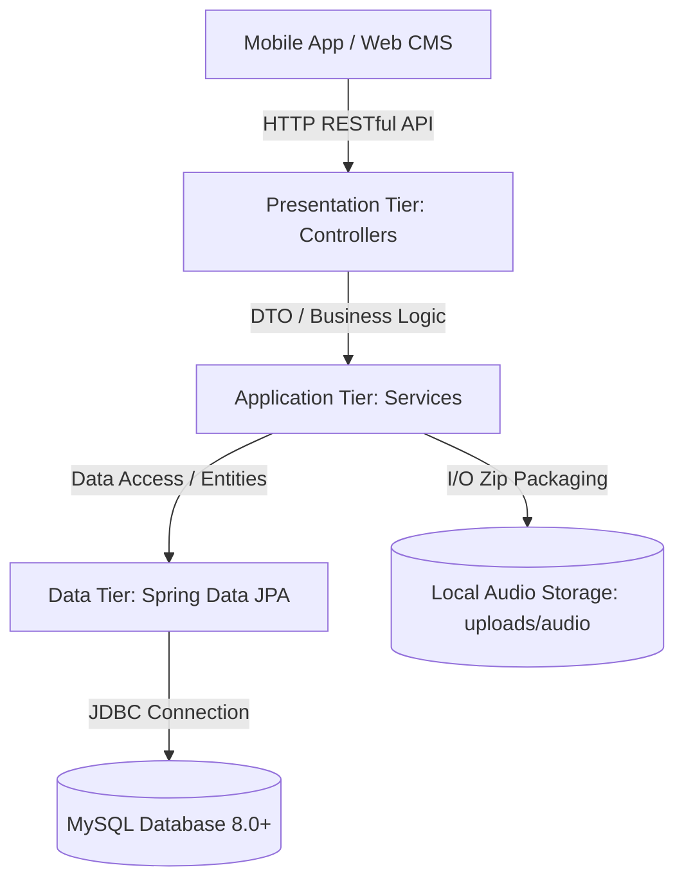

# Multi Languages Automatic Translation (Hệ thống Thuyết minh Audio Tour Tự Động Đa Ngôn Ngữ)

> **Đồ án môn học:** Công nghệ Phần mềm  
> **Trường:** Đại học Sài Gòn (SGU) - Khoa Công nghệ Thông tin  
> **Phần đảm nhiệm:** Phần 2 - Backend Developer theo kiến trúc 3 lớp (3-Tier Architecture) bao gồm CI/CD  

---

## 📌 1. Giới thiệu Đề tài

Hệ thống Backend cung cấp toàn bộ RESTful API cho Ứng dụng Di động (Mobile App) du lịch thuyết minh tự động tại TP. Hồ Chí Minh. Hệ thống hỗ trợ chế độ kép (**Hybrid Triggers**):
1. **Quét mã QR (QR Code Trigger):** Dán tại các trạm dừng xe buýt (Khánh Hội, Vĩnh Hội, Xóm Chiếu - Quận 4) và các phòng ban di tích (Dinh Độc Lập - Quận 1). Du khách quét QR để **tải trọn gói âm thanh MP3 và văn bản dạng ZIP về máy để nghe Offline**, không cần kết nối Internet.
2. **Định vị ngoài trời (GPS Geofencing):** Xác định tọa độ du khách và tự động kích hoạt bài thuyết minh khi tiến vào bán kính định sẵn (`radiusInMeters`).
3. **Phân tích dữ liệu (Analytics & Dashboard):** Ghi nhận lịch sử nghe ẩn danh, phân tích Top địa điểm được nghe nhiều nhất, tỷ lệ QR vs Geofence và dữ liệu bản đồ nhiệt (Heatmap).

---

## 🏗️ 2. Kiến trúc Hệ thống (3-Tier Architecture)

Dự án được xây dựng theo chuẩn mực 3 tầng:



- **Tầng 1 - Controller (Presentation Tier):** `LocationController`, `NarrationController`, `AudioPackageController`, `AnalyticsController`, `TourController`, `LanguageController`, `AuthController`.
- **Tầng 2 - Service (Business Logic Tier):** `LocationService`, `NarrationService` (thuyết minh, phát audio trực tiếp & ZIP offline), `AnalyticsService`, `TourService`, `LanguageService`, `AuthService`, cùng `LiveAudience` (giữ các phiên đang nghe) và `ServerAddress` (dò IP LAN cho mã QR).
- **Tầng 3 - Repository & Data (Data Access Tier):** `LocationRepository`, `LanguageRepository`, `NarrationRepository`, `PlaybackLogRepository`, `TourRepository`.

---

## 🛠️ 3. Công nghệ Sử dụng (Tech Stack)

- **Ngôn ngữ:** Java 21 (LTS)
- **Framework:** Spring Boot 4.1.1
- **Database:** MySQL 8.0+ (InnoDB, UTF-8mb4)
- **ORM:** Spring Data JPA / Hibernate
- **Bảo mật:** Spring Security + JWT (jjwt 0.12.6, HS256)
- **Migration:** Flyway (`ddl-auto: validate`)
- **Tiện ích:** Project Lombok (Constructor Injection với `@RequiredArgsConstructor`)
- **Tài liệu API:** Springdoc OpenAPI 3 / Swagger UI
- **Kiểm thử tự động:** JUnit 5, Mockito (106 test tự động)
- **Giao diện du khách:** HTML tĩnh + vanilla JavaScript + Leaflet 1.9.4 (không bundler, không bước build)
- **CI/CD:** GitHub Actions tự động kiểm thử và đóng gói khi có Commit/PR

---

## 🚀 4. Hướng dẫn Khởi chạy Dự án

### Yêu cầu môi trường
- JDK 21 trở lên
- MySQL 8.0 trở lên đang chạy tại `localhost:3306`
- Git

### Các bước khởi chạy

1. **Clone repository:**
   ```bash
   git clone https://github.com/HuynhQuang16032006/Multi_Languages_Automatic_Translation.git
   cd Multi_Languages_Automatic_Translation
   ```

2. **Cấu hình Database:**
   Tạo cơ sở dữ liệu MySQL:
   ```sql
   CREATE DATABASE audiotour_db CHARACTER SET utf8mb4 COLLATE utf8mb4_unicode_ci;
   ```
   *(Cấu hình tài khoản/mật khẩu tại `src/main/resources/application.yml`, mặc định `root`/`123456`).*

3. **Chạy ứng dụng:**
   - **Windows:**
     ```powershell
     .\mvnw.cmd spring-boot:run
     ```
   - **Linux / macOS:**
     ```bash
     ./mvnw spring-boot:run
     ```

4. **Chạy toàn bộ Test tự động:**
   ```powershell
   .\mvnw.cmd clean test
   ```

5. **Chạy bằng Docker Compose (app + MySQL):**
   ```bash
   cp .env.example .env      # bắt buộc điền mật khẩu DB, JWT secret và tài khoản admin
   docker compose up --build -d
   ```
   App chạy tại `http://localhost:8080`, Swagger UI tại `http://localhost:8080/swagger-ui.html`, trang chủ du khách tại `http://localhost:8080/`.

---

## 📖 5. Danh mục RESTful API & Swagger UI

Sau khi server chạy, truy cập tài liệu tương tác Swagger UI tại:  
👉 **[http://localhost:8080/swagger-ui.html](http://localhost:8080/swagger-ui.html)**

### Danh sách API chính bàn giao cho Team Mobile:

> 🔓 **Xác thực:** du khách dùng hệ thống **ẩn danh**, không cần đăng nhập. Các API **đọc** (`GET` trên `/api/locations/**`, `/api/tours/**`, `/api/languages/**`, `/api/narrations/**` và bản phân trang `/api/v1/...` tương ứng) cùng `/api/packages/*` và `/api/analytics/**` mở **public** cho mọi người. Các API **ghi** (`POST`, `PUT`, `DELETE`) vẫn yêu cầu header `Authorization: Bearer <token>` do admin đăng nhập ở `POST /api/auth/login`. Thiếu token hoặc token sai trả về **401**. Cột "Xác thực" trong bảng dưới ghi rõ từng endpoint (theo `SecurityConfig`).

| Nhóm | Method | Đường dẫn API | Mô tả chức năng | Xác thực |
| :--- | :---: | :--- | :--- | :---: |
| **Xác thực** | `POST` | `/api/auth/login`, `/api/v1/auth/login` | Đăng nhập, trả về `{ "token": "...", "tokenType": "Bearer" }` (401 nếu sai thông tin) | Public |
| **POI & Vị trí** | `GET` | `/api/locations` | Lấy danh sách các địa điểm gốc (mảng phẳng, kèm các phòng ban con) | Public |
| | `GET` | `/api/v1/locations` | Bản phân trang của `/api/locations` (`page`, `size`, `sort`) | Public |
| | `GET` | `/api/locations/pois` | Đồng bộ toàn bộ điểm POI (tọa độ, bán kính geofence, ưu tiên) về SQLite | Public |
| | `GET` | `/api/locations/{id}` | Lấy chi tiết thông tin 1 địa điểm | Public |
| | `GET` | `/api/locations/{id}/sub-locations` | Lấy các khu vực con bên trong 1 địa điểm (VD: các phòng trong Dinh Độc Lập) | Public |
| | `GET` | `/api/locations/by-qr/{qrCode}` | Quét mã QR nhận thông tin địa điểm (không cần GPS) | Public |
| **Thuyết minh** | `GET` | `/api/narrations?locationId={id}&languageCode={vi\|en}` | Lấy nội dung văn bản thuyết minh + tên file MP3 (404 nếu POI chưa có bản thuyết minh cho ngôn ngữ đó) | Public |
| | `POST` | `/api/narrations/{id}/audio?force=false` | Sinh file MP3 từ `textContent` bằng ElevenLabs TTS rồi lưu vào `uploads/audio`; file đã có thì dùng lại, `force=true` để sinh lại (503 nếu thiếu API key) | Token admin |
| **Gói Offline** | `GET` | `/api/packages/stream?locationId={id}&languageCode={code}` | Phát trực tiếp file MP3 (dùng cho trang thuyết minh) | Public |
| | `GET` | `/api/packages/offline?locationId={id}&languageCode={code}` | Tải file ZIP `tour-offline.zip` gồm `content.txt` và file MP3 thật | Public |
| **Phân tích** | `POST` | `/api/analytics/heartbeat` | Nhịp tim ẩn danh mỗi 3s khi du khách đang nghe (`deviceId` tự sinh ở client) | Public |
| | `POST` | `/api/analytics/logs` | Mobile App gửi log sau khi phát xong audio (tránh lặp & lưu vết) | Public |
| | `GET` | `/api/analytics/dashboard` | Cung cấp dữ liệu thống kê tổng quan (Top POI, Heatmap, tỷ lệ QR vs GPS) | Public |
| **Tuyến Tour** | `GET` | `/api/tours` | Lấy danh sách các tuyến tour tham quan | Public |
| | `GET` | `/api/v1/tours` | Bản phân trang của `/api/tours` (`page`, `size`, `sort`) | Public |
| | `GET` | `/api/tours/{id}` | Lấy chi tiết lộ trình 1 tour | Public |
| **Ngôn ngữ** | `GET` | `/api/languages`, `/api/v1/languages` | Danh sách ngôn ngữ (`/api/v1` có phân trang) | Public |
| | `GET` | `/api/languages/supported` | Danh sách ngôn ngữ admin được phép thêm (giao của TTS và DeepL, đọc từ `app.languages.supported`) | Public |
| | `GET` | `/api/languages/{id}`, `/api/v1/languages/{id}` | Lấy chi tiết 1 ngôn ngữ | Public |
| | `POST` | `/api/languages`, `/api/v1/languages` | Thêm ngôn ngữ mới (201 Created; 409 Conflict nếu trùng `code`) | Token admin |
| | `POST` | `/api/languages/{code}/translate` | Dịch toàn bộ thuyết minh `vi` sang `code` bằng DeepL, lưu narration mới rồi sinh audio (201 kèm `translations`, `audioGenerated`) | Public |
| | `PUT` | `/api/languages/{id}`, `/api/v1/languages/{id}` | Cập nhật ngôn ngữ theo ID | Token admin |
| | `DELETE` | `/api/languages/{id}`, `/api/v1/languages/{id}` | Xoá ngôn ngữ (204 No Content) | Token admin |

> 📄 **Phân trang chỉ có trên `/api/v1`:** các endpoint `/api/...` giữ nguyên định dạng mảng JSON như trước để client cũ không bị ảnh hưởng. Chỉ `/api/v1/...` trả về `{ content, totalElements, totalPages, size, number, ... }`.

> 🎙️ **Sinh audio tự động (TTS):** `POST /api/narrations/{id}/audio` đọc `textContent` bằng ElevenLabs, ghi MP3 vào `uploads/audio` và lưu tên file vào `audioUrl`. File đã có thì dùng lại (không tốn credit); thêm `?force=true` để sinh lại. Cần `ELEVENLABS_API_KEY` — thiếu key thì endpoint trả **503**, app vẫn chạy bình thường. Tiếng Việt chỉ có ở model `eleven_flash_v2_5`/`eleven_v3`, **không** có ở `eleven_multilingual_v2`. Free tier 10.000 ký tự/tháng, không có giấy phép thương mại và phải ghi công `elevenlabs.io` khi công bố audio. Thử nhanh: `curl -X POST "http://localhost:8080/api/narrations/1/audio" -H "Authorization: Bearer <token>"` (thêm `?force=true` nếu file đã tồn tại và bạn muốn nghe giọng mới — lệnh này ghi đè file seed, lấy lại bằng `git checkout uploads/audio`). Chi tiết: [`docs/adr/0004-tts-elevenlabs.md`](docs/adr/0004-tts-elevenlabs.md).

---

## 🗺️ 6. Trang chủ du khách (Giao diện Web)

Sau khi chạy app, mở trình duyệt tại **[http://localhost:8080/](http://localhost:8080/)** (hoặc `/index.html`). Trang là **HTML tĩnh + vanilla JavaScript** đặt trong `src/main/resources/static/`, không cần bước build và **không cần đăng nhập** — du khách dùng hệ thống ẩn danh (quyết định P5-1 trong `TASK_CHECKLIST.md`).

**Tính năng:**
- **Bản đồ Leaflet** với marker từng POI, tile nền **OpenStreetMap** — **không cần API key**, miễn phí. Nút đổi lớp ở góc trên phải chuyển giữa lớp **đường phố** và lớp **tối** (lớp tối dùng chung tile OSM + CSS filter nên không cần key của nhà cung cấp khác).
- **Danh sách POI** dưới bản đồ (ảnh, tên, địa chỉ).
- **Bottom sheet chi tiết**: bấm marker hoặc POI để mở, chọn ngôn ngữ **VI / EN** rồi bấm **"Nghe thuyết minh"** — trang chuyển sang `player.html` để phát MP3 qua máy chủ và hiện kịch bản thuyết minh (ghi nhận lượt nghe ẩn danh qua `POST /api/analytics/heartbeat`).
- **Nút "Gần tôi"**: lấy vị trí qua `navigator.geolocation`, tính khoảng cách Haversine và sắp xếp POI theo khoảng cách (có nút quay lại sắp xếp A-Z).
- **Danh sách tuyến tham quan**: bấm một tuyến để lọc POI theo lộ trình của tuyến đó.
- **Cache offline**: danh sách POI được lưu trong `localStorage`, mất mạng vẫn xem được (kèm cảnh báo đang dùng dữ liệu lưu cục bộ).

**Giới hạn:**
- Tile bản đồ tải từ Internet → mất mạng thì bản đồ không có nền (danh sách POI vẫn hiện nhờ cache).
- Nút "Gần tôi" chỉ chạy khi trang được mở bằng **HTTPS hoặc `http://localhost`**, vì trình duyệt chỉ cấp API định vị trong *secure context* (mở bằng IP mạng LAN thì nút này bị ẩn).
- Âm thanh phát qua máy chủ nên **cần mạng**. Muốn nghe offline thì tải gói ZIP tại `GET /api/packages/offline?locationId={id}&languageCode={vi}` (hoặc `{en}`).

> 📌 **Quyết định kiến trúc:** giao diện du khách dùng HTML tĩnh + Leaflet thay vì framework SPA (không thêm toolchain, không thêm bước build) — chi tiết tại [`docs/adr/0001-guest-ui-static-html-leaflet.md`](docs/adr/0001-guest-ui-static-html-leaflet.md).

---

## 🔄 7. Đường ống Tự động hóa CI/CD (GitHub Actions)

Dự án tích hợp sẵn file cấu hình CI/CD tại `.github/workflows/ci.yml`. Mỗi khi thành viên tạo Commit hoặc Pull Request:
1. Tự động kích hoạt máy chủ ảo Ubuntu Runner và dịch vụ MySQL Container.
2. Thiết lập môi trường Java 21.
3. Thực thi tự động 94 test (Unit test, Controller test & Integration test với MySQL container).
4. Đóng gói sản phẩm thành file thực thi `.jar` và lưu vào GitHub Artifacts.

---

## 👥 8. Phân công Nhiệm vụ & Thành viên
- **Thực hiện:** Nhóm sinh viên ngành CNTT - Trường Đại học Sài Gòn (SGU).
- **Phạm vi đồ án:** Hoàn thiện Backend 3 lớp, thiết kế CSDL, nghiệp vụ nén ZIP Offline, OpenAPI Docs và thiết lập CI/CD.

## 🐳 9. Docker & Biến môi trường

### Build & chạy bằng Docker
```bash
docker build -t audiotour-backend .
docker run -p 8080:8080 \
  -e SPRING_PROFILES_ACTIVE=prod \
  -e SPRING_DATASOURCE_URL="jdbc:mysql://host.docker.internal:3306/audiotour_db?useSSL=false&allowPublicKeyRetrieval=true&characterEncoding=UTF-8&serverTimezone=UTC" \
  -e DB_USERNAME=root -e DB_PASSWORD="$DB_PASSWORD" \
  -e JWT_SECRET="$(openssl rand -base64 48)" \
  -e APP_ADMIN_USERNAME=admin -e APP_ADMIN_PASSWORD="$APP_ADMIN_PASSWORD" \
  audiotour-backend
```
`SPRING_PROFILES_ACTIVE=prod` là bắt buộc; thiếu nó thì container chạy bằng secret dev.

### Docker Compose (app + MySQL)
```bash
cp .env.example .env   # chỉ chạy khi chưa có .env; điền DB_ROOT_PASSWORD, DB_PASSWORD, JWT_SECRET, APP_ADMIN_*
docker compose up --build -d
```
`docker-compose.yml` đã set `SPRING_PROFILES_ACTIVE=prod`, nên compose **từ chối khởi động** nếu thiếu secret/tài khoản.

Yêu cầu Docker Desktop đang chạy với Linux containers (Windows: bật WSL 2, khởi động lại nếu trình cài đặt yêu cầu). Không commit `.env` và không ghi đè file này khi đã có dữ liệu DB.

Volume MySQL local hiện dùng tên riêng `audiotour-mysql-local-v5`, gắn vào `/var/lib/mysql`. Volume cũ `multi_languages_automatic_translation_audiotour-db-data` được giữ nguyên, không tự di chuyển dữ liệu. Healthcheck DB chạy `SELECT 1` có xác thực; `mysqladmin ping` không đủ vì vẫn có thể thành công khi đăng nhập bị từ chối.

Compose chỉ mở backend tại `127.0.0.1:8080`; MySQL chỉ truy cập trong mạng Compose, không chiếm cổng `3306` của MySQL trên máy. Dữ liệu DB lưu trong named volume; không chạy `docker compose down -v` nếu cần giữ dữ liệu.

Audio seed và audio TTS dùng chung `uploads/audio` trên host, bind mount đọc/ghi vào `/app/uploads/audio` trong service app. Thư mục phải có sẵn khi clone repo; Compose không tự tạo thư mục rỗng nếu thiếu. Không cần copy audio vào image và không liên quan volume MySQL. File TTS mới được giữ qua restart/recreate app; sao lưu thư mục này cùng database để giữ ánh xạ `narrations.audio_url`. Không ghi đè file có sẵn; TTS tạo tên file mới theo ADR 0004.

Lệnh `docker run` riêng ở trên không tự có kho audio: thêm `--mount type=bind,source="$(pwd)/uploads/audio",target=/app/uploads/audio` (Bash), hoặc dùng Compose để có mount tương đối nhất quán. Bind mount cho phép container ghi vào kho host; chỉ chạy image tin cậy và không dùng chung thư mục với dữ liệu nhạy cảm.

Kiểm tra trên Windows PowerShell:
```powershell
.\mvnw.cmd test
.\mvnw.cmd compile
docker compose ps
curl.exe --fail --show-error --write-out "\nHTTP %{http_code}\n" http://localhost:8080/actuator/health
```
Chờ app khởi động xong: health phải trả HTTP 200 và `status: UP`. Nếu chưa đạt, xem `docker compose logs app db`. Dừng bằng `docker compose down` để giữ volume.

Nếu Maven dừng ở `npm ci` với `EPERM` trong cache npm của tài khoản Windows, đặt cache riêng cho phiên PowerShell rồi chạy lại:
```powershell
$env:npm_config_cache = Join-Path $PWD 'target/npm-cache'
```
Không cần khóa ElevenLabs/DeepL để app khởi động; chưa cấu hình thì các chức năng sinh audio/dịch máy trả 503 như mô tả bên dưới.

### Chạy production (bắt buộc)
Profile `prod` (`src/main/resources/application-prod.yml`) **không có giá trị mặc định** cho DB/JWT/admin. Vì vậy:

```bash
export SPRING_PROFILES_ACTIVE=prod
export DB_USERNAME=... DB_PASSWORD=...
export JWT_SECRET=...            # tối thiểu 32 byte
export APP_ADMIN_USERNAME=... APP_ADMIN_PASSWORD=...
java -jar target/audiotour-0.0.1-SNAPSHOT.jar
```

> ⚠️ Chạy `java -jar` **không** có `SPRING_PROFILES_ACTIVE=prod` (hoặc không có các biến trên) chỉ là **local-dev boot**: app dùng secret dev và `admin123` trong `application.yml`. Không dùng cách này để deploy.

Profile `prod` từ chối JWT secret, mật khẩu admin và mật khẩu DB mặc định của dev; phải dùng giá trị riêng, mạnh. Kiểm tra profile thực tế trước triển khai: cấu hình dev vẫn có credential công khai. Rate limit dùng địa chỉ kết nối, bỏ qua `X-Forwarded-For`; sau reverse proxy mọi client dùng chung hạn mức. Nếu cần hạn mức theo IP gốc, cấu hình rate limit tại proxy tin cậy và chặn truy cập trực tiếp backend. Bộ đếm trong bộ nhớ không được chia sẻ giữa các instance.

JWT phát hành trước thay đổi này hết hiệu lực và cần đăng nhập lại. Sau mỗi lần đổi mật khẩu, mọi JWT cũ bị thu hồi; client đăng nhập lại bằng mật khẩu mới. Mỗi yêu cầu có JWT cần đọc tài khoản admin từ DB.

### Biến môi trường
| Biến | Mặc định (dev) | Ghi chú |
| :--- | :--- | :--- |
| `SPRING_PROFILES_ACTIVE` | (không) | `prod` = bắt buộc có đủ biến bên dưới |
| `DB_USERNAME` / `DB_PASSWORD` | `root` / `123456` | Profile prod không có default |
| `DB_ROOT_PASSWORD` / `DB_NAME` | `root` / `audiotour_db` | Dùng cho `docker-compose.yml` |
| `JWT_SECRET` | secret dev | Profile prod: bắt buộc, tối thiểu 32 byte (HS256) |
| `JWT_EXPIRATION_MS` | `86400000` | Thời hạn token (24 giờ) |
| `APP_ADMIN_USERNAME` / `APP_ADMIN_PASSWORD` | `admin` / `admin123` | Profile prod: bắt buộc; username ≥ 3 ký tự |
| `ELEVENLABS_API_KEY` | (trống) | Key cho TTS; trống thì `POST /api/narrations/{id}/audio` trả 503 |
| `TTS_VOICE` | (trống) | Một voice ID dùng chung cho mọi ngôn ngữ; **bắt buộc** — voice thư viện bị free tier chặn qua API (402) |
| `TTS_MODEL_ID` | `eleven_flash_v2_5` | Không đổi sang `eleven_multilingual_v2` (không có `vi`) |
| `DEEPL_API_KEY` | (trống) | Key DeepL Free cho `POST /api/languages/{code}/translate`; trống thì endpoint trả 503 |
| `DEEPL_BASE_URL` | `https://api-free.deepl.com` | Pro plan dùng `https://api.deepl.com` |

Danh sách đầy đủ xem tại `.env.example`. Quy trình rollback xem tại `docs/ROLLBACK.md`.

**Không muốn set biến môi trường?** Tạo `config/application.yml` (đã nằm trong `.gitignore`, Spring Boot tự đọc và override classpath) rồi điền:

```yaml
app:
  tts:
    api-key: "sk_..."
    voice-id: "<voice_id>"   # một voice dùng chung cho vi/en/zh
  mt:
    api-key: "<DeepL key>"   # bắt buộc để thêm ngôn ngữ mới
```

Chạy `.\mvnw.cmd spring-boot:run` là đủ. Lưu ý: `.env` chỉ dùng cho `docker compose`; `spring-boot:run` không đọc `.env`.
