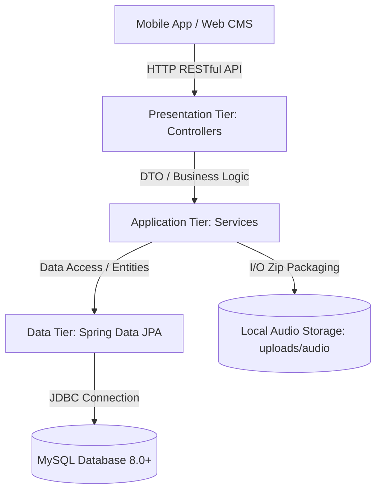

# Multi Languages Automatic Translation (Hệ thống Thuyết minh Audio Tour Tự Động Đa Ngôn Ngữ)

> **Đồ án môn học:** Công nghệ Phần mềm  
> **Trường:** Đại học Sài Gòn (SGU) - Khoa Công nghệ Thông tin  
> **Phần đảm nhiệm:** Phần 2 - Backend Developer theo kiến trúc 3 lớp (3-Tier Architecture) bao gồm CI/CD  

---

## 📌 1. Giới thiệu Đề tài

Hệ thống Backend cung cấp toàn bộ RESTful API cho Ứng dụng Di động (Mobile App) du lịch thuyết minh tự động tại TP. Hồ Chí Minh. Hệ thống hỗ trợ chế độ kép (**Hybrid Triggers**):
1. **Quét mã QR (QR Code Trigger):** Dán tại các trạm dừng xe buýt (Khánh Hội, Vĩnh Hội, Xóm Chiếu - Quận 4) và các phòng ban di tích (Dinh Độc Lập - Quận 1). Du khách quét QR để **tải trọn gói âm thanh MP3 và văn bản dạng ZIP về máy để nghe Offline**, không cần kết nối Internet.
2. **Định vị ngoài trời (GPS Geofencing):** Xác định tọa độ du khách và tự động kích hoạt bài thuyết minh khi tiến vào bán kính định sẵn (`radiusInMeters`).
3. **Phân tích dữ liệu (Analytics & Dashboard):** Ghi nhận lịch sử nghe ẩn danh, phân tích Top địa điểm được nghe nhiều nhất, tỷ lệ QR vs Geofence và dữ liệu bản đồ nhiệt (Heatmap).

---

## 🏗️ 2. Kiến trúc Hệ thống (3-Tier Architecture)

Dự án được xây dựng theo chuẩn mực 3 tầng:



- **Tầng 1 - Controller (Presentation Tier):** `LocationController`, `AudioPackageController`, `AnalyticsController`, `TourController`.
- **Tầng 2 - Service (Business Logic Tier):** `LocationService`, `AudioPackageService`, `AnalyticsService`, `TourService`.
- **Tầng 3 - Repository & Data (Data Access Tier):** `LocationRepository`, `LanguageRepository`, `NarrationRepository`, `PlaybackLogRepository`, `TourRepository`.

---

## 🛠️ 3. Công nghệ Sử dụng (Tech Stack)

- **Ngôn ngữ:** Java 21 (LTS)
- **Framework:** Spring Boot 4.1.1
- **Database:** MySQL 8.0+ (InnoDB, UTF-8mb4)
- **ORM:** Spring Data JPA / Hibernate
- **Tiện ích:** Project Lombok (Constructor Injection với `@RequiredArgsConstructor`)
- **Tài liệu API:** Springdoc OpenAPI 3 / Swagger UI
- **Kiểm thử tự động:** JUnit 5, Mockito (18/18 Tests Passed)
- **CI/CD:** GitHub Actions tự động kiểm thử và đóng gói khi có Commit/PR

---

## 🚀 4. Hướng dẫn Khởi chạy Dự án

### Yêu cầu môi trường
- JDK 21 trở lên
- MySQL 8.0 trở lên đang chạy tại `localhost:3306`
- Git

### Các bước khởi chạy

1. **Clone repository:**
   ```bash
   git clone https://github.com/HuynhQuang16032006/Multi_Languages_Automatic_Translation.git
   cd Multi_Languages_Automatic_Translation
   ```

2. **Cấu hình Database:**
   Tạo cơ sở dữ liệu MySQL:
   ```sql
   CREATE DATABASE audiotour_db CHARACTER SET utf8mb4 COLLATE utf8mb4_unicode_ci;
   ```
   *(Cấu hình tài khoản/mật khẩu tại `src/main/resources/application.yml`, mặc định `root`/`123456`).*

3. **Chạy ứng dụng:**
   - **Windows:**
     ```powershell
     .\mvnw.cmd spring-boot:run
     ```
   - **Linux / macOS:**
     ```bash
     ./mvnw spring-boot:run
     ```

4. **Chạy toàn bộ Test tự động:**
   ```powershell
   .\mvnw.cmd clean test
   ```

---

## 📖 5. Danh mục RESTful API & Swagger UI

Sau khi server chạy, truy cập tài liệu tương tác Swagger UI tại:  
👉 **[http://localhost:8080/swagger-ui.html](http://localhost:8080/swagger-ui.html)**

### Danh sách API chính bàn giao cho Team Mobile:

| Nhóm | Method | Đường dẫn API | Mô tả chức năng |
| :--- | :---: | :--- | :--- |
| **POI & Vị trí** | `GET` | `/api/locations` | Lấy danh sách các địa điểm gốc (kèm các phòng ban con) |
| | `GET` | `/api/locations/pois` | Đồng bộ toàn bộ điểm POI (tọa độ, bán kính geofence, ưu tiên) về SQLite |
| | `GET` | `/api/locations/{id}` | Lấy chi tiết thông tin 1 địa điểm |
| | `GET` | `/api/locations/{id}/sub-locations` | Lấy các khu vực con bên trong 1 địa điểm (VD: các phòng trong Dinh Độc Lập) |
| | `GET` | `/api/locations/by-qr/{qrCode}` | Quét mã QR nhận thông tin địa điểm (không cần GPS) |
| **Gói Offline** | `GET` | `/api/packages/offline?locationId={id}&languageCode={code}` | Tải file ZIP `tour-offline.zip` gồm `content.txt` và file MP3 thật |
| **Phân tích** | `POST` | `/api/analytics/logs` | Mobile App gửi log sau khi phát xong audio (tránh lặp & lưu vết) |
| | `GET` | `/api/analytics/dashboard` | Cung cấp dữ liệu thống kê tổng quan (Top POI, Heatmap, tỷ lệ QR vs GPS) |
| **Tuyến Tour** | `GET` | `/api/tours` | Lấy danh sách các tuyến tour tham quan |
| | `GET` | `/api/tours/{id}` | Lấy chi tiết lộ trình 1 tour |

---

## 🔄 6. Đường ống Tự động hóa CI/CD (GitHub Actions)

Dự án tích hợp sẵn file cấu hình CI/CD tại `.github/workflows/ci.yml`. Mỗi khi thành viên tạo Commit hoặc Pull Request:
1. Tự động kích hoạt máy chủ ảo Ubuntu Runner và dịch vụ MySQL Container.
2. Thiết lập môi trường Java 21.
3. Thực thi tự động 18 bài kiểm thử (Unit test & Controller integration test).
4. Đóng gói sản phẩm thành file thực thi `.jar` và lưu vào GitHub Artifacts.

---

## 👥 7. Phân công Nhiệm vụ & Thành viên
- **Thực hiện:** Nhóm sinh viên ngành CNTT - Trường Đại học Sài Gòn (SGU).
- **Phạm vi đồ án:** Hoàn thiện Backend 3 lớp, thiết kế CSDL, nghiệp vụ nén ZIP Offline, OpenAPI Docs và thiết lập CI/CD.

## Docker
docker build -t audiotour-backend .`n
## Env
Set DB_USERNAME, DB_PASSWORD, JWT secret for production.
