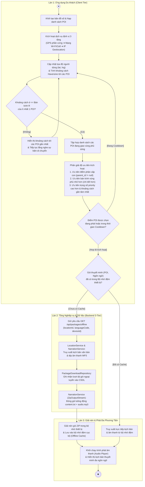
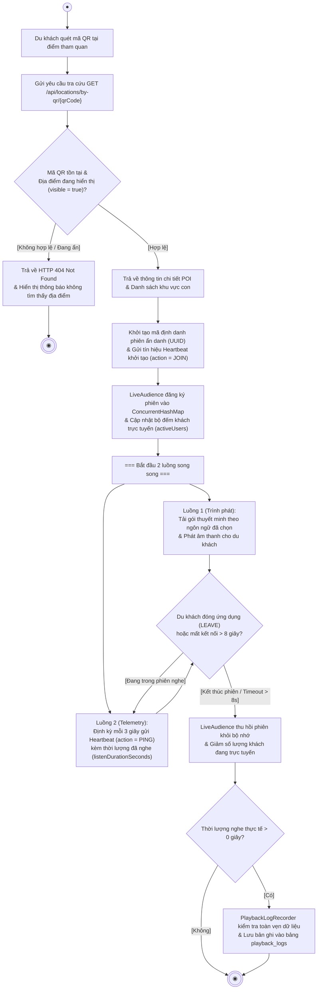
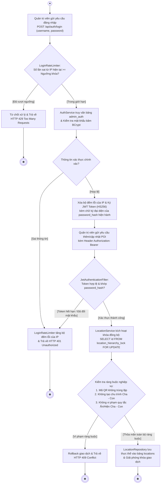
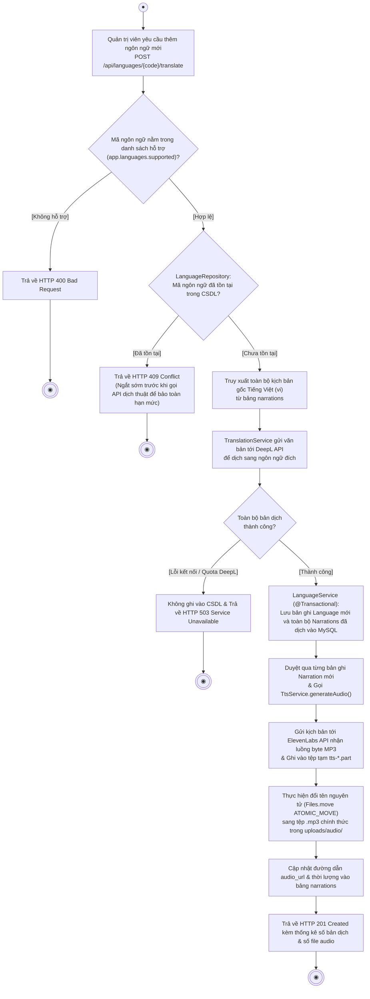

# TÀI LIỆU ĐẶC TẢ LƯỢC ĐỒ HOẠT ĐỘNG (UML 2.5 ACTIVITY DIAGRAMS)

---

## 🏛️ THÔNG TIN TÀI LIỆU

* **Tên hệ thống:** Hệ thống Thuyết minh Audio Tour Tự Động Đa Ngôn Ngữ (*Smart Multi-Languages Automatic Audio Tour System*)
* **Môn học:** Công nghệ Phần mềm (*Software Engineering*) – Khoa Công nghệ Thông tin, Trường Đại học Sài Gòn (SGU)
* **Phiên bản tài liệu:** v2.1 (Chuẩn hóa theo kiến trúc Backend 3 lớp, CSDL MySQL Flyway và quy chuẩn UML 2.5)
* **Mục đích tài liệu:** Mô hình hóa các luồng quy trình nghiệp vụ cốt lõi, các điểm quyết định rẽ nhánh (*Decision Nodes*), luồng xử lý song song (*Fork/Join*) và sự phối hợp giữa các phân hệ (*Swimlanes*) trong môi trường vận hành thực tế.

---

## 📐 1. QUY ƯỚC KÝ HIỆU UML 2.5 ACTIVITY DIAGRAM

| Thành phần UML | Ký hiệu | Ý nghĩa trong Hệ thống |
| :--- | :---: | :--- |
| **Điểm khởi đầu (Initial Node)** | `((●))` | Điểm bắt đầu của một quy trình nghiệp vụ khi có tác nhân kích hoạt. |
| **Hoạt động (Action / Activity)** | `[Hoạt động]` | Một bước xử lý nghiệp vụ nguyên tử tại Client, Application Tier hoặc Data Tier. |
| **Nút quyết định (Decision / Merge)** | `{Điều kiện?}` | Kiểm tra điều kiện rẽ nhánh (`[Đúng]` / `[Sai]`) dựa trên trạng thái dữ liệu hoặc ràng buộc nghiệp vụ. |
| **Thanh đồng bộ (Fork / Join Bar)** | `===` | Tách luồng thực thi song song (ví dụ: vừa phát âm thanh vừa gửi tín hiệu Telemetry) và hợp nhất luồng. |
| **Điểm kết thúc (Activity Final Node)** | `(((◉)))` | Điểm kết thúc hoàn tất một quy trình nghiệp vụ. |

---

## 🗺️ 2. LƯỢC ĐỒ HOẠT ĐỘNG 1: QUY TRÌNH ĐỊNH VỊ ĐA TẦNG & KÍCH HOẠT THUYẾT MINH TỰ ĐỘNG GEOFENCING (AD-01)

* **Mô tả nghiệp vụ:** Mô tả quy trình từ khi du khách bật tính năng dẫn đường rảnh tay (*Hands-free Audio Tour*), hệ thống thu thập tọa độ qua cơ chế định vị 3 tầng, tính toán khoảng cách địa lý Haversine, phân giải xung đột ưu tiên theo cấu trúc phân cấp Cha – Con, đến khi tải gói âm thanh ngoại tuyến và phát thuyết minh.

---

## 📱 3. LƯỢC ĐỒ HOẠT ĐỘNG 2: QUY TRÌNH QUÉT MÃ QR & ĐỒNG BỘ PHIÊN TRỰC TUYẾN THỜI GIAN THỰC (AD-02)

* **Mô tả nghiệp vụ:** Mô tả quy trình du khách tiếp cận điểm di tích thông qua mã QR định danh tại hiện trường, cơ chế duy trì nhịp tim (*Stateful Heartbeat*) với `LiveAudience` và tự động ghi nhận nhật ký nghe (`PlaybackLog`) khi kết thúc phiên.

---

## 🔐 4. LƯỢC ĐỒ HOẠT ĐỘNG 3: QUY TRÌNH XÁC THỰC QUẢN TRỊ, BẢO VỆ BRUTE-FORCE & QUẢN LÝ ĐỊA ĐIỂM PHÂN CẤP (AD-03)

* **Mô tả nghiệp vụ:** Mô tả quy trình bảo mật đăng nhập bằng Stateless JWT kết hợp bộ giới hạn tần suất `LoginRateLimiter`, thu hồi Token khi đổi mật khẩu, và cơ chế khóa đồng bộ (*Pessimistic Locking*) khi cập nhật cây phân cấp địa điểm Cha – Con.

---

## 🌐 5. LƯỢC ĐỒ HOẠT ĐỘNG 4: QUY TRÌNH TỰ ĐỘNG DỊCH MÁY (DEEPL) & TỔNG HỢP GIỌNG ĐỌC AI (ELEVENLABS TTS) (AD-04)

* **Mô tả nghiệp vụ:** Mô tả quy trình mở rộng ngôn ngữ tự động trong `LanguageOnboardingService`, đảm bảo tính nguyên tử của dữ liệu CSDL và tính toàn vẹn của tệp âm thanh vật lý thông qua kỹ thuật `ATOMIC_MOVE`.

