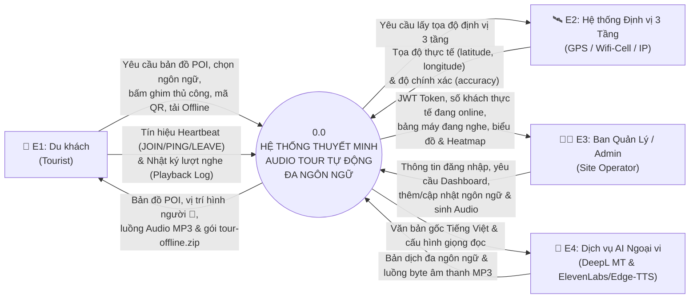
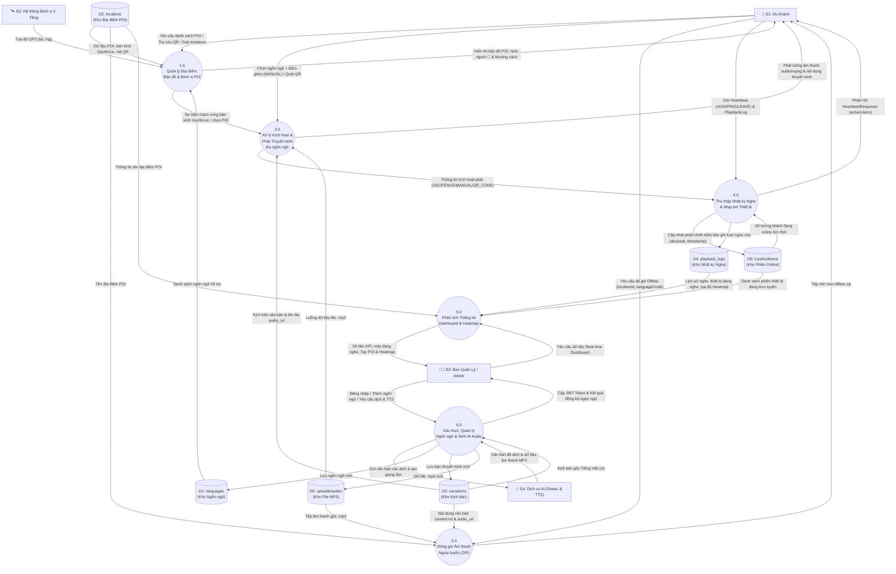
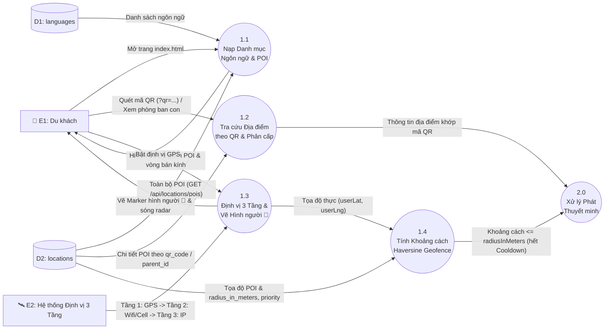
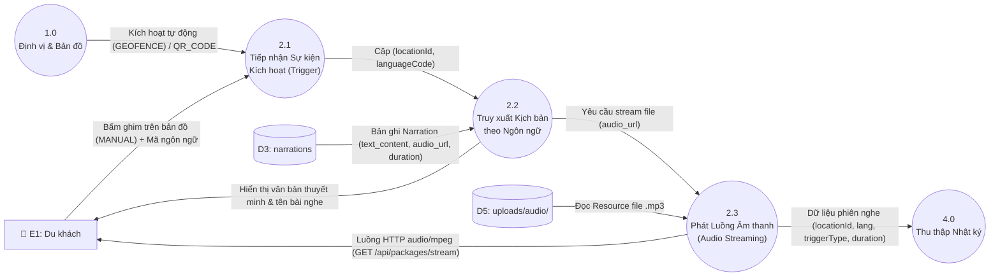
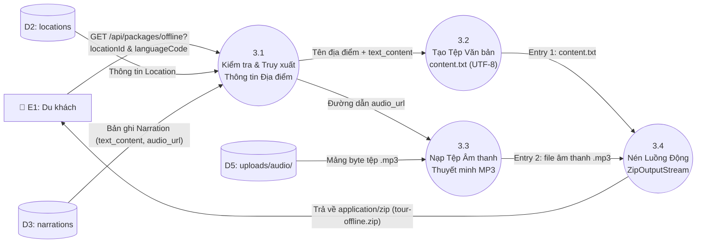
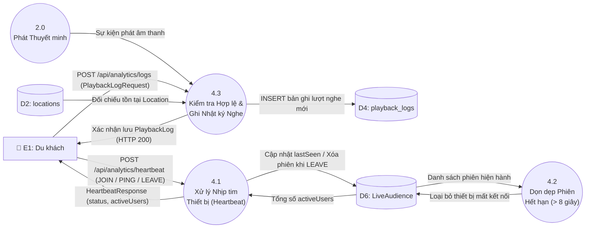
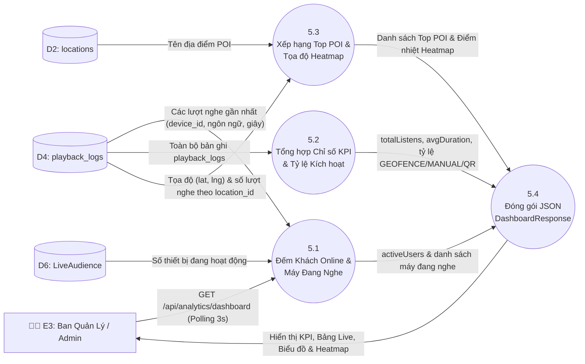
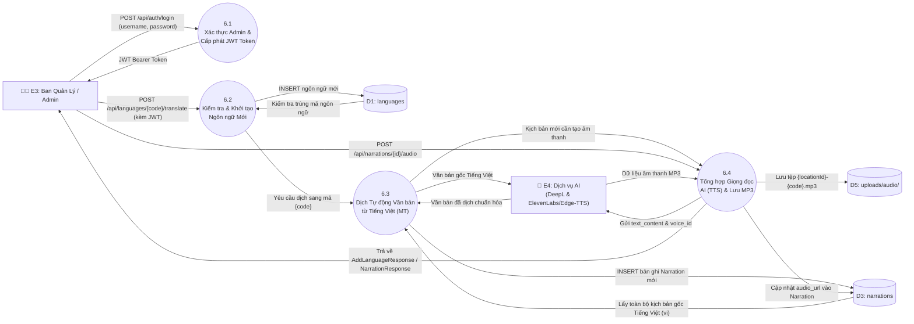

# TÀI LIỆU SƠ ĐỒ LUỒNG DỮ LIỆU (DATA FLOW DIAGRAMS - DFD)

---

## 🏛️ THÔNG TIN TỔNG QUAN

* **Hệ thống:** Hệ thống Thuyết minh Audio Tour Tự Động Đa Ngôn Ngữ (*Smart Multi-Languages Automatic Audio Tour System*)
* **Môn học:** Công nghệ Phần mềm (Software Engineering) – Khoa Công nghệ Thông tin, Trường Đại học Sài Gòn (SGU)
* **Phiên bản tài liệu:** v2.1 (Đồng bộ kiến trúc Backend 3 lớp, CSDL 4 bảng chuẩn hóa, 2 chế độ nghe POI & Real-time Dashboard)
* **Phương pháp luận:** Phân tích và Thiết kế Hệ thống Hướng cấu trúc (*Structured Systems Analysis and Design*), kết hợp ký hiệu chuẩn **Yourdon - DeMarco** & **Gane - Sarson**.

---

## 📐 1. QUY ƯỚC KÝ HIỆU & THÀNH PHẦN DFD (DFD NOTATIONS & COMPONENTS)

### 1.1. Quy ước biểu diễn trên sơ đồ Mermaid

| Thành phần DFD | Ký hiệu chuẩn | Ý nghĩa trong Hệ thống Audio Tour |
| :--- | :---: | :--- |
| **Tác nhân ngoài (External Entity)** | Hình chữ nhật `[Tác nhân]` | Đối tượng phát sinh hoặc tiếp nhận dữ liệu nằm ngoài phạm vi phần mềm (Du khách, Cảm biến định vị, Ban Quản Lý, Dịch vụ AI Cloud). |
| **Tiến trình (Process)** | Hình tròn / Bo tròn `((P1.0 ...))` | Chức năng biến đổi, kiểm tra hoặc điều phối luồng dữ liệu (tương ứng các Controller & Service trong Spring Boot). |
| **Kho dữ liệu (Data Store)** | Hình trụ `[(D1: ...)]` | Nơi lưu trữ dữ liệu tĩnh hoặc trạng thái hệ thống (4 bảng MySQL, thư mục file MP3, bộ nhớ phiên trực tuyến). |
| **Luồng dữ liệu (Data Flow)** | Mũi tên có nhãn `-->|Dữ liệu|` | Đường di chuyển của gói tin (HTTP Request/Response, SQL Query, File Stream) giữa các thành phần. |

---

### 1.2. Danh mục Tác nhân ngoài (External Entities)

| Mã | Tên Tác Nhân Ngoài | Mô Tả Chi Tiết Vai Trò Giao Tiếp Dữ Liệu |
| :---: | :--- | :--- |
| **E1** | **Du khách (Tourist)** | Người dùng cuối sử dụng Web Du khách (`index.html`): chọn ngôn ngữ, bấm ghim bản đồ nghe thủ công, quét mã QR, tải gói ZIP offline. |
| **E2** | **Hệ thống Định vị 3 Tầng (GPS / Network / IP Sensor)** | Cung cấp tọa độ địa lý thực tế `(latitude, longitude)` của thiết bị để vẽ hình người đi bộ (🚶) và tính khoảng cách Haversine kích hoạt Geofence tự động. |
| **E3** | **Ban Quản Lý / Admin (Site Administrator)** | Quản trị viên sử dụng Web Quản trị (`dashboard.html`): đăng nhập JWT, theo dõi khách đang online, xem máy đang nghe, phân tích Heatmap và thêm ngôn ngữ mới. |
| **E4** | **Dịch vụ AI Dịch thuật & TTS (DeepL & ElevenLabs / Edge-TTS)** | Hệ thống đám mây bên thứ ba nhận văn bản gốc tiếng Việt để dịch sang ngôn ngữ đích và tổng hợp giọng đọc nhân tạo thành tệp âm thanh `.mp3`. |

---

### 1.3. Danh mục Kho dữ liệu (Data Stores)

| Mã Kho | Tên Kho Dữ Liệu | Ánh Xạ Vật Lý (Database / Storage) | Nội Dung Lưu Trữ Chính |
| :---: | :--- | :--- | :--- |
| **D1** | **Kho Ngôn ngữ** | Bảng MySQL `languages` | Danh mục mã ngôn ngữ chuẩn ISO (`id`, `code`, `name`: `vi`, `en`, `zh`, `ja`,...). |
| **D2** | **Kho Địa điểm POI** | Bảng MySQL `locations` | Thông tin địa danh, tọa độ GPS (`latitude`, `longitude`), bán kính `radius_in_meters`, `priority`, `qr_code`, `parent_id`. |
| **D3** | **Kho Kịch bản Thuyết minh** | Bảng MySQL `narrations` | Nội dung văn bản thuyết minh (`text_content`), tên tệp âm thanh (`audio_url`), thời lượng (`duration_in_seconds`) theo từng cặp `(location_id, language_id)`. |
| **D4** | **Kho Nhật ký Nghe** | Bảng MySQL `playback_logs` | Lịch sử các lượt phát âm thanh (`location_id`, `language_code`, `listen_duration_seconds`, `trigger_type`, `latitude`, `longitude`, `device_id`, `created_at`). |
| **D5** | **Kho Tệp Âm thanh MP3** | Hệ thống tệp `uploads/audio/` | Kho lưu trữ vật lý các tệp âm thanh `.mp3` phục vụ phát trực tuyến (Streaming) và nén gói ngoại tuyến (ZIP). |
| **D6** | **Kho Phiên Trực tuyến** | Bộ nhớ RAM `LiveAudience` (ConcurrentHashMap) | Trạng thái nhịp tim (Heartbeat `JOIN`/`PING`/`LEAVE`) của các thiết bị đang hoạt động trong cửa sổ thời gian thực. |

---

## 🌐 2. SƠ ĐỒ DFD MỨC NGỮ CẢNH (CONTEXT DIAGRAM - LEVEL 0)

Sơ đồ mức ngữ cảnh (Level 0) thể hiện toàn bộ **Hệ thống Thuyết minh Audio Tour Tự Động Đa Ngôn Ngữ** như một tiến trình trung tâm duy nhất (`0.0`) tương tác với 4 tác nhân ngoài.

---

## 🗺️ 3. SƠ ĐỒ DFD MỨC ĐỈNH (TOP-LEVEL DIAGRAM - LEVEL 1)

Sơ đồ DFD Mức 1 phân rã hệ thống thành **6 tiến trình nghiệp vụ cốt lõi** (`1.0` đến `6.0`) kết nối trực tiếp với 6 kho dữ liệu (`D1` đến `D6`) và 4 tác nhân ngoài (`E1` đến `E4`).

---

## 🔍 4. SƠ ĐỒ DFD MỨC CHI TIẾT (DETAILED DIAGRAMS - LEVEL 2)

Để làm rõ luồng xử lý bên trong từng phân hệ của đồ án, dưới đây là các sơ đồ phân rã **DFD Mức 2** cho cả 6 tiến trình chính.

---

### 📌 4.1. DFD Mức 2 – Tiến trình 1.0: Quản lý Địa điểm, Bản đồ & Định vị POI

Phân rã chi tiết quá trình tải danh mục địa danh, phân cấp cha - con (`parent_id`), tra cứu mã QR và định vị 3 tầng kết hợp tính khoảng cách Haversine.

---

### 📌 4.2. DFD Mức 2 – Tiến trình 2.0: Xử lý Kích hoạt & Phát Thuyết minh Đa ngôn ngữ

Phân rã cơ chế kích hoạt thuyết minh kép (**Chế độ 1: Tự động GPS Geofencing**, **Chế độ 2: Bấm ghim bản đồ thủ công**, và **Bổ trợ: Quét mã QR**) cùng luồng phát trực tuyến (`Audio Streaming`).

---

### 📌 4.3. DFD Mức 2 – Tiến trình 3.0: Đóng gói Âm thanh Ngoại tuyến (Offline ZIP Packaging)

Phân rã quá trình tạo gói nén động `tour-offline.zip` trực tiếp trong bộ nhớ bằng `ZipOutputStream` mà không sinh tệp rác trên đĩa cứng.

---

### 📌 4.4. DFD Mức 2 – Tiến trình 4.0: Thu thập Nhật ký Nghe & Nhịp tim Thiết bị

Phân rã cơ chế giám sát phiên truy cập thời gian thực qua `LiveAudience` (`POST /api/analytics/heartbeat`) và ghi nhận lịch sử nghe qua `PlaybackLogRecorder` (`POST /api/analytics/logs`).

---

### 📌 4.5. DFD Mức 2 – Tiến trình 5.0: Phân tích Thống kê Dashboard & Heatmap

Phân rã quá trình tổng hợp dữ liệu BI cho màn hình Quản trị (`dashboard.html`) được cập nhật tự động định kỳ mỗi 3 giây (`GET /api/analytics/dashboard`).

---

### 📌 4.6. DFD Mức 2 – Tiến trình 6.0: Xác thực, Quản lý Ngôn ngữ & Tự động Dịch + Sinh Audio AI

Phân rã quy trình bảo mật JWT (`AuthService`), quản lý danh mục ngôn ngữ (`LanguageService`) và đường ống tự động dịch thuật văn bản tiếng Việt sang ngôn ngữ mới kết hợp tổng hợp giọng đọc AI (`LanguageOnboardingService`, `TranslationService`, `TtsService`).

---

## 📊 5. BẢNG ĐẶC TẢ CHI TIẾT CÁC LUỒNG DỮ LIỆU (DATA FLOW DICTIONARY)

Bảng dưới đây đối chiếu toàn bộ các luồng dữ liệu trên DFD với giao thức vận chuyển, cấu trúc dữ liệu (DTO / Payload) và REST API Endpoint thực tế trong mã nguồn:

| Mã Luồng | Tên Luồng Dữ Liệu | Nguồn | Đích | Giao Thức / REST API Endpoint | Cấu Trúc Dữ Liệu Đi Kèm |
| :---: | :--- | :--- | :--- | :--- | :--- |
| **DF-01** | Truy vấn danh sách POI | `E1: Du khách` | `P1.0` | `GET /api/locations/pois` | Mảng JSON `Location` (`id`, `name`, `latitude`, `longitude`, `radiusInMeters`, `priority`, `qrCode`, `imageUrl`) |
| **DF-02** | Tra cứu địa điểm qua QR | `E1: Du khách` | `P1.0` | `GET /api/locations/by-qr/{qrCode}` | Tham số đường dẫn `qrCode` -> Trả về đối tượng `Location` |
| **DF-03** | Tra cứu khu vực con | `E1: Du khách` | `P1.0` | `GET /api/locations/{id}/sub-locations` | Danh sách các phòng ban/khu vực con thuộc địa điểm cha (`parent_id`) |
| **DF-04** | Tọa độ định vị 3 tầng | `E2: Cảm biến GPS` | `P1.0` | Browser Geolocation API / IP API | `{ latitude, longitude, accuracy, tier }` |
| **DF-05** | Truy xuất bài thuyết minh | `E1: Du khách` | `P2.0` | `GET /api/narrations?locationId=&languageCode=` | `NarrationResponse` (`id`, `locationId`, `languageCode`, `textContent`, `audioUrl`, `durationInSeconds`) |
| **DF-06** | Phát trực tuyến âm thanh | `P2.0` | `E1: Du khách` | `GET /api/packages/stream?locationId=&languageCode=` | Luồng nhị phân `Resource` với Content-Type `audio/mpeg` |
| **DF-07** | Tải gói nén Offline ZIP | `P3.0` | `E1: Du khách` | `GET /api/packages/offline?locationId=&languageCode=` | Mảng `byte[]` định dạng `application/zip` (`tour-offline.zip` gồm `content.txt` + `audio.mp3`) |
| **DF-08** | Tín hiệu nhịp tim thiết bị | `E1: Du khách` | `P4.0` | `POST /api/analytics/heartbeat` | `DeviceHeartbeatRequest` (`deviceId`, `action`: `JOIN`/`PING`/`LEAVE`) -> `HeartbeatResponse` (`activeUsers`) |
| **DF-09** | Ghi nhận nhật ký lượt nghe | `E1` / `P2.0` | `P4.0` | `POST /api/analytics/logs` | `PlaybackLogRequest` (`locationId`, `languageCode`, `listenDurationSeconds`, `triggerType`, `deviceId`, `latitude`, `longitude`) |
| **DF-10** | Truy vấn số liệu Dashboard | `E3: Ban Quản Lý` | `P5.0` | `GET /api/analytics/dashboard` | `DashboardResponse` (Tổng lượt nghe, khách online, máy đang nghe, Top POI, tỷ lệ kích hoạt, tọa độ Heatmap) |
| **DF-11** | Xác thực Quản trị viên | `E3: Ban Quản Lý` | `P6.0` | `POST /api/auth/login` | `LoginRequest` (`username`, `password`) -> `LoginResponse` (`token`, `tokenType`, `expiresIn`) |
| **DF-12** | Tự động dịch & sinh Audio | `E3: Ban Quản Lý` | `P6.0` | `POST /api/languages/{code}/translate` | Mã ngôn ngữ đích `{code}` -> Dịch toàn bộ kịch bản tiếng Việt qua `E4` -> Sinh MP3 -> `AddLanguageResponse` |

---

## ✅ 6. KIỂM TRA TÍNH CÂN BẰNG & TOÀN VẸN CỦA SƠ ĐỒ DFD (DFD BALANCING & VALIDATION)

Sơ đồ DFD của đồ án đảm bảo tuân thủ nghiêm ngặt các nguyên tắc kiểm tra chất lượng trong Kỹ nghệ Phần mềm:

1. **Tính cân bằng giữa các mức (Level Balancing):** Toàn bộ các luồng dữ liệu vào/ra giữa 4 tác nhân ngoài (`E1` – `E4`) ở **DFD Mức 0 (Ngữ cảnh)** đều được bảo toàn và khớp chính xác với tổng hợp các luồng vào/ra ở **DFD Mức 1** và **DFD Mức 2**.
2. **Không có hố đen dữ liệu (No Black Holes):** Mọi tiến trình (`1.0` đến `6.0`) đều có cả luồng dữ liệu đầu vào (Input) và luồng dữ liệu đầu ra (Output) rõ ràng.
3. **Không có luồng dữ liệu tự phát (No Miracles):** Mọi đầu ra của tiến trình đều được tổng hợp hoặc biến đổi từ dữ liệu đầu vào của tác nhân hoặc truy xuất từ kho dữ liệu (`D1` – `D6`).
4. **Đúng quy tắc kết nối kho dữ liệu:** Không có kho dữ liệu nào tự truyền dữ liệu trực tiếp cho kho dữ liệu khác hoặc truyền trực tiếp cho tác nhân ngoài mà không thông qua tiến trình xử lý (`Process`).
