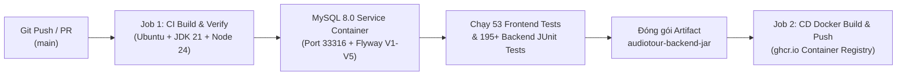

# ĐẶC TẢ QUẢN LÝ PHIÊN BẢN CSDL FLYWAY & ĐƯỜNG ỐNG CI/CD (BACKEND 3-TIER)

---

## 🗄️ 1. QUẢN LÝ PHIÊN BẢN CSDL VỚI FLYWAY MIGRATION (`V1` – `V5`)

Hệ thống sử dụng **Flyway Migration** kết hợp cấu hình `spring.jpa.hibernate.ddl-auto: validate` trong `application.yml` để đảm bảo toàn vẹn cấu trúc dữ liệu giữa tầng Entity (Java) và MySQL 8.0+.

| Phiên bản | File Migration (`src/main/resources/db/migration/`) | Bảng / Ràng buộc tác động | Mục đích Kỹ thuật |
| :---: | :--- | :--- | :--- |
| **V1** | `V1__initial_schema.sql` | `languages`, `locations`, `narrations`, `playback_logs` | Khởi tạo 4 bảng cốt lõi của hệ thống thuyết minh đa ngôn ngữ với bộ mã `utf8mb4_unicode_ci`. |
| **V2** | `V2__package_downloads.sql` | `package_downloads` | Ghi nhận lịch sử tải gói âm thanh ngoại tuyến (`tour-offline.zip`) gắn với `location_id`, `language_code`, `device_id`. |
| **V3** | `V3__admin_auth.sql` | `admin_auth` | Lưu trữ tài khoản và mật khẩu băm BCrypt (`password_hash`) của quản trị viên phục vụ xác thực JWT và đổi mật khẩu. |
| **V4** | `V4__location_visibility.sql` | `locations.visible`, `location_hierarchy_lock` | Bổ sung cờ ẩn/hiện địa điểm (`visible`) và bảng khóa đồng bộ (`SELECT ... FOR UPDATE`) khi thay đổi cây phân cấp cha–con. |
| **V5** | `V5__narration_location_language_unique.sql` | `uk_narrations_location_language` | Ràng buộc duy nhất `UNIQUE (location_id, language_id)` đảm bảo mỗi địa điểm chỉ có tối đa 1 bài thuyết minh cho mỗi ngôn ngữ. |

---

## ⚙️ 2. ĐƯỜNG ỐNG TỰ ĐỘNG HÓA CI/CD (`.github/workflows/ci.yml`)

Quy trình CI/CD trên **GitHub Actions** được tự động kích hoạt trên mỗi sự kiện `push` hoặc `pull_request` vào nhánh `main`:

1. **Giai đoạn CI (`build-and-test`):**
   - Khởi chạy dịch vụ **MySQL 8.0** độc lập trên cổng `33316`.
   - Kiểm thử đơn vị Frontend React (`npm ci && npm test`).
   - Khởi tạo 2 schema kiểm thử cách ly (`audiotour_test` và `audiotour_prod_profile_test`).
   - Thực thi `./mvnw clean verify` chạy toàn bộ Unit Test, Controller MockMvc Test, Architecture 3-Tier Test và Database Integration Test.
2. **Giai đoạn CD (`docker-build-push`):**
   - Chỉ thực thi khi giai đoạn CI thành công (`needs: build-and-test`).
   - Sử dụng `docker/build-push-action@v6` để đóng gói ứng dụng theo `Dockerfile` đa tầng (Multi-stage build) và phát hành lên **GitHub Container Registry (`ghcr.io`)**.
