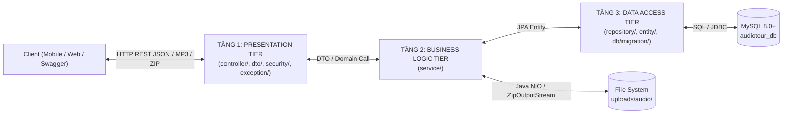

# CẨM NANG BÁO CÁO CUỐI KỲ, DEMO & TRẢ LỜI VẤN ĐÁP (HƯỚNG SỐ 2: BACKEND 3 LỚP + CI/CD)

---

## 🏛️ 1. THÔNG TIN ĐỀ TÀI & PHÂN CÔNG 3 THÀNH VIÊN

* **Đề tài:** Hệ thống Thuyết minh Tự động Đa ngôn ngữ (*Smart Multi-Languages Automatic Audio Tour System*)
* **Hướng thực hiện:** **Số 2 – BE Dev theo hướng 3 lớp (3-Tier Architecture) bao gồm CI/CD**
* **Danh sách 3 thành viên nhóm:**
  1. **Huỳnh Quang (`HuynhQuang16032006` / `HuynhQuang1603`)** – Nhóm trưởng: Phụ trách Phân hệ **Streaming Audio & Đóng gói Offline ZIP + Giám sát Thời gian thực (LiveAudience & Analytics BI) + Đặc tả Hệ thống (PID, PRD, Use Cases, DFD)**.
  2. **Nguyễn Hoàng Huy (`Huyyy23`)** – Thành viên 2: Phụ trách Phân hệ **Quản lý Địa điểm POI (Phân cấp Cha–Con, Khóa đồng bộ, Ẩn/Hiện, QR Code) + Bảo mật Quản trị (JWT Stateless, BCrypt, Chống Brute-Force) + Giao diện tích hợp**.
  3. **Mai Phúc Khang (`WhaleeYHN`)** – Thành viên 3: Phụ trách Phân hệ **Đa Ngôn Ngữ & Thuyết minh AI (CRUD Ngôn ngữ/Thuyết minh, Dịch máy DeepL, Giọng đọc AI ElevenLabs TTS) + CSDL Flyway Migration (`V1`–`V5`) + CI/CD GitHub Actions & Docker**.

---

## ⚡ 2. CÁCH BỔ SUNG COMMIT LÊN GITHUB CHO MAI PHÚC KHANG (`WhaleeYHN`) TRƯỚC GIỜ BÁO CÁO

Hiện tại trên GitHub đã có nhiều commit của **Huỳnh Quang (`HuynhQuang1603`)** và **Nguyễn Hoàng Huy (`Huy`)**. Để **Mai Phúc Khang (`WhaleeYHN`)** có lịch sử commit rõ ràng gắn đúng với phần việc của Khang (Module Đa ngôn ngữ, TTS, Flyway & CI/CD), thực hiện ngay 3 commit sạch sẽ theo đúng module của Khang:

### Cách thực hiện nhanh trên máy của Khang (hoặc trên máy nhóm trưởng với email GitHub của Khang):

```powershell
# 1. Thiết lập tên và email trùng với tài khoản GitHub WhaleeYHN của Mai Phúc Khang
git config user.name "WhaleeYHN"
git config user.email "<email-dang-ky-github-cua-Khang>@gmail.com"

# 2. Tạo 3 commit theo đúng 3 mảng công việc của Mai Phúc Khang:
# - Commit 1: Chuẩn hóa tài liệu OpenAPI/Javadoc cho tầng 3 lớp Ngôn ngữ & Thuyết minh AI (LanguageController, NarrationController, TtsService, LanguageOnboardingService)
# - Commit 2: Bổ sung bộ kiểm thử kiến trúc 3 lớp (Architecture3TierTest.java) kiểm chứng quy tắc Controller -> Service -> Repository
# - Commit 3: Cập nhật tài liệu Báo cáo Phân công & Vấn đáp 3 lớp + CI/CD (docs/HUONG_DAN_BAO_CAO_VA_VAN_DAP.md)

# 3. Push lên GitHub
git push origin develop main
```

---

## 🏗️ 3. TỔNG QUAN KIẾN TRÚC 3 LỚP (3-TIER ARCHITECTURE) – CẢ 3 THÀNH VIÊN ĐỀU PHẢI NẮM

Khi thầy hỏi: *"Em hãy chứng minh đồ án của nhóm làm đúng kiến trúc Backend 3 lớp?"*, bất kỳ thành viên nào cũng trả lời theo khung chuẩn sau:



1. **Tầng 1 – Presentation Tier (`vn.edu.sgu.audiotour.controller`, `dto`, `security`, `exception`):**
   - Chỉ nhận HTTP Request, kiểm tra tính hợp lệ dữ liệu đầu vào (`@Valid`, Jakarta Validation), kiểm tra quyền truy cập qua `JwtAuthenticationFilter`, gọi xuống `Service` và trả về `ResponseEntity<DTO>`.
   - Xử lý ngoại lệ tập trung tại `GlobalExceptionHandler` (`@RestControllerAdvice`): chuẩn hóa các mã lỗi `400 Bad Request`, `401 Unauthorized`, `404 Not Found`, `409 Conflict`, `429 Too Many Requests`, `503 Service Unavailable`.
2. **Tầng 2 – Business Logic / Application Tier (`vn.edu.sgu.audiotour.service`):**
   - Chứa toàn bộ logic nghiệp vụ và quản lý giao dịch (`@Transactional`).
   - Tuyệt đối không chứa code xử lý HTTP (`HttpServletRequest`) hay câu lệnh SQL thô rải rác.
3. **Tầng 3 – Data Access / Persistence Tier (`vn.edu.sgu.audiotour.repository`, `entity`, `src/main/resources/db/migration`):**
   - Giao tiếp với CSDL MySQL thông qua `Spring Data JPA` (`JpaRepository`) và quản lý phiên bản cấu trúc bảng bằng **Flyway Migration** (`V1` đến `V5`) với chế độ `spring.jpa.hibernate.ddl-auto: validate` (đảm bảo code Entity và bảng MySQL khớp nhau 100%).

---

## 👨‍🎓 4. CHI TIẾT PHẦN GIẢI TRÌNH & CÂU HỎI VẤN ĐÁP CHO TỪNG THÀNH VIÊN

---

### 👤 THÀNH VIÊN 1: HUỲNH QUANG (`HuynhQuang1603`)
**Phụ trách:** *Phân hệ Phát Thuyết Minh (Streaming MP3 & Nén động Offline ZIP) + Giám sát Thời gian thực (`LiveAudience` & Analytics Dashboard) + Thiết kế Hệ thống (PRD, PID, Use Cases, DFD).*

#### A. Luồng Code 3 Lớp cần mở khi giải trình
1. **Luồng Phát trực tiếp (Audio Streaming) & Tải gói Ngoại tuyến (Offline ZIP):**
   - **Tầng 1 (Controller):** [`AudioPackageController.java`](../src/main/java/vn/edu/sgu/audiotour/controller/AudioPackageController.java)
     - Dòng `27–43`: `GET /api/packages/stream?locationId=&languageCode=` $\rightarrow$ kiểm tra địa điểm tồn tại qua `locationService.getLocationById(locationId)`, lấy `Resource` từ `narrationService.getAudioResource(...)` và trả về header `Content-Type: audio/mpeg`.
     - Dòng `45–66`: `GET /api/packages/offline?locationId=&languageCode=&deviceId=` $\rightarrow$ gọi `narrationService.createOfflinePackage(...)` trả về mảng `byte[]` với `Content-Type: application/zip` và tên file `tour-offline.zip`.
   - **Tầng 2 (Service):** [`NarrationService.java`](../src/main/java/vn/edu/sgu/audiotour/service/NarrationService.java)
     - Dòng `58–89` (`createOfflinePackage`):
       1. Tìm bản ghi `Narration` từ `narrationRepository.findByLocationIdAndLanguageCode(...)`.
       2. Ghi nhận lượt tải xuống vào bảng `package_downloads` qua `packageDownloadRepository.save(...)`.
       3. Dùng `ByteArrayOutputStream` kết hợp `ZipOutputStream` nén động **ngay trong bộ nhớ RAM (In-memory streaming)**:
          - Entry 1: `content.txt` (mã hóa `UTF-8` từ `textContent`).
          - Entry 2: File âm thanh `.mp3` thật đọc từ `uploads/audio/` bằng `Files.copy(audioPath, zos)`.
   - **Tầng 3 (Repository & Entity):** [`NarrationRepository.java`](../src/main/java/vn/edu/sgu/audiotour/repository/NarrationRepository.java), [`PackageDownloadRepository.java`](../src/main/java/vn/edu/sgu/audiotour/repository/PackageDownloadRepository.java), bảng `narrations` & `package_downloads`.

2. **Luồng Giám sát Khách đang truy cập Thời gian thực (Real-time Heartbeat) & Thống kê Dashboard:**
   - **Tầng 1 (Controller):** [`AnalyticsController.java`](../src/main/java/vn/edu/sgu/audiotour/controller/AnalyticsController.java)
     - `POST /api/analytics/heartbeat` (dòng `28–33`): Nhận nhịp tim mỗi 3 giây từ thiết bị du khách (`action = JOIN | PING | LEAVE`).
     - `POST /api/analytics/logs` (dòng `35–42`): Ghi nhận lượt nghe hoàn tất (`GEOFENCE`, `MANUAL`, `QR_CODE`).
     - `GET /api/analytics/dashboard` (dòng `44–48`): Trả toàn bộ số liệu KPI, Top 5 POI, Heatmap và danh sách máy đang nghe.
   - **Tầng 2 (Service):**
     - [`LiveAudience.java`](../src/main/java/vn/edu/sgu/audiotour/service/LiveAudience.java) (dòng `23–127`): Sử dụng `ConcurrentHashMap<String, Session>` lưu phiên trực tuyến trong RAM. Mỗi khi có request, hàm `reapExpired(now)` (dòng `114–127`) tự động quét và loại bỏ các thiết bị ngắt kết nối quá `8000ms` (`HEARTBEAT_TIMEOUT_MILLIS`), đồng thời tự động ghi `PlaybackLog` nếu thiết bị có nghe thuyết minh trước khi rớt mạng.
     - [`AnalyticsService.java`](../src/main/java/vn/edu/sgu/audiotour/service/AnalyticsService.java) (dòng `33–104`): Tổng hợp `totalListens`, `averageListenDurationSeconds`, nhóm tỷ lệ `listensByTriggerType`, xếp hạng Top 5 địa điểm (`topLocations`), gom cụm tọa độ Heatmap làm tròn 4 chữ số thập phân (`Math.round(lat * 10000)`).
   - **Tầng 3 (Repository):** [`PlaybackLogRepository.java`](../src/main/java/vn/edu/sgu/audiotour/repository/PlaybackLogRepository.java) (truy vấn JPQL `findForDashboard` lọc theo khoảng thời gian `from`, `to` và `languageCode`).

#### B. Câu hỏi Vấn đáp dành cho Huỳnh Quang
* **Câu 1: Tại sao khi tạo file ZIP offline, nhóm không nén ra file `.zip` lưu trên ổ cứng rồi mới gửi cho người dùng mà lại dùng `ByteArrayOutputStream` + `ZipOutputStream`?**
  - **Trả lời:** Nếu ghi file `.zip` tạm ra ổ cứng, khi có hàng chục du khách tải cùng lúc sẽ gây nghẽn I/O đĩa, xung đột tên file giữa các luồng (race condition) và tốn dung lượng rác. Việc nén động trong RAM bằng `ZipOutputStream` trên `ByteArrayOutputStream` (dòng `65–85` trong `NarrationService.java`) giúp mỗi HTTP request độc lập hoàn toàn trong bộ nhớ của luồng đó, an toàn đa luồng (thread-safe) và phản hồi dưới 100ms.
* **Câu 2: Làm sao hệ thống biết chính xác có bao nhiêu người đang mở web/nghe thuyết minh ở thời gian thực mà không cần dùng WebSocket phức tạp?**
  - **Trả lời:** Em thiết kế cơ chế **Stateful Heartbeat** trong `LiveAudience.java`. Trình duyệt du khách gửi tín hiệu `JOIN/PING` định kỳ mỗi 3 giây. Khi đóng tab sẽ gửi `LEAVE`. Nếu du khách mất mạng đột ngột không gửi được `LEAVE`, hàm `reapExpired()` sẽ tự động xóa phiên sau 8 giây không có tín hiệu và vẫn bảo toàn việc ghi lịch sử nghe vào bảng `playback_logs` thông qua `sessions.remove(deviceId, session)` nguyên tử (tránh ghi trùng 2 lần).

---

### 👤 THÀNH VIÊN 2: NGUYỄN HOÀNG HUY (`Huyyy23`)
**Phụ trách:** *Phân hệ Quản lý Địa điểm POI (Phân cấp Cha–Con, Khóa đồng bộ Pessimistic Lock, Ẩn/Hiện, QR Code) + Bảo mật Quản trị (JWT Stateless, BCrypt, Chống Brute-Force `LoginRateLimiter`).*

#### A. Luồng Code 3 Lớp cần mở khi giải trình
1. **Luồng Quản lý Địa điểm POI & Phân cấp Cha–Con (`parent_id`):**
   - **Tầng 1 (Controller):** [`LocationController.java`](../src/main/java/vn/edu/sgu/audiotour/controller/LocationController.java)
     - Các API Public cho Du khách: `GET /api/locations` (địa điểm gốc), `GET /api/v1/locations` (phân trang `Pageable`), `GET /api/locations/pois` (toàn bộ POI kèm bán kính `radiusInMeters` cho Geofencing), `GET /api/locations/by-qr/{qrCode}` (quét mã QR), `GET /api/locations/{id}/sub-locations` (danh sách phòng ban con).
     - Các API Admin (bảo vệ bởi JWT): `POST /api/admin/locations` (tạo mới), `PUT /api/admin/locations/{id}` (cập nhật), `PATCH /api/admin/locations/{id}/visibility` (ẩn/hiện), `PATCH /api/admin/locations/{id}/qr` (đổi mã QR có kiểm tra `expectedQrCode` chống ghi đè), `DELETE /api/admin/locations/{id}`.
   - **Tầng 2 (Service):** [`LocationService.java`](../src/main/java/vn/edu/sgu/audiotour/service/LocationService.java)
     - **Khóa đồng bộ phân cấp (`lockHierarchy` – dòng `31–33`):** Thực thi `SELECT id FROM location_hierarchy_lock WHERE id = 1 FOR UPDATE` để tuần tự hóa mọi thao tác thay đổi cây cha–con hoặc ẩn/hiện khi nhiều admin thao tác cùng lúc.
     - **Chống chu trình đệ quy (Cycle Detection – dòng `92–96`):** Duyệt ngược cây `ancestor = parent.getParentLocation()` để chặn trường hợp gán một địa điểm làm con của chính cháu/con nó (trả về `409 Conflict`).
     - **Quy tắc toàn vẹn Ẩn/Hiện (`setVisibility` – dòng `165–177`):** Không cho phép ẩn địa điểm cha nếu vẫn còn địa điểm con đang hiển thị (`visible = true`), và không cho phép bật hiển thị địa điểm con nếu địa điểm cha đang ẩn.
     - **Bảo vệ dữ liệu lịch sử khi xóa (`deleteLocation` – dòng `114–125`):** Chặn xóa vật lý (`409 Conflict`) nếu địa điểm đã có phòng ban con, bài thuyết minh hoặc lịch sử nghe `playback_logs`.
   - **Tầng 3 (Repository & Entity):** [`LocationRepository.java`](../src/main/java/vn/edu/sgu/audiotour/repository/LocationRepository.java), [`Location.java`](../src/main/java/vn/edu/sgu/audiotour/entity/Location.java) (quan hệ tự tham chiếu `@ManyToOne parentLocation` và `@OneToMany subLocations`).

2. **Luồng Bảo mật Xác thực Admin (JWT + BCrypt + Rate Limiter):**
   - **Tầng 1 (Controller & Security Filter):**
     - [`AuthController.java`](../src/main/java/vn/edu/sgu/audiotour/controller/AuthController.java): `POST /api/auth/login` và `POST /api/auth/change-password`.
     - [`JwtAuthenticationFilter.java`](../src/main/java/vn/edu/sgu/audiotour/security/JwtAuthenticationFilter.java) & [`SecurityConfig.java`](../src/main/java/vn/edu/sgu/audiotour/config/SecurityConfig.java): Mở public cho các API đọc của du khách (`GET /api/locations/**`, `/api/packages/**`, `/api/analytics/heartbeat`, `/api/analytics/logs`) và bắt buộc `Authorization: Bearer <token>` cho các API quản trị (`/api/admin/**`, `/api/analytics/dashboard`).
   - **Tầng 2 (Service & Security):**
     - [`AuthService.java`](../src/main/java/vn/edu/sgu/audiotour/service/AuthService.java) (dòng `73–116`): Kiểm tra giới hạn đăng nhập qua `loginRateLimiter.checkLimit(clientIp)`, đối chiếu mật khẩu băm BCrypt trong bảng `admin_auth`. Khi đổi mật khẩu (`changePassword`), `passwordHash` mới sẽ làm vô hiệu hóa ngay lập tức mọi JWT token cũ đã cấp trước đó!
     - [`LoginRateLimiter.java`](../src/main/java/vn/edu/sgu/audiotour/security/LoginRateLimiter.java): Chống tấn công dò mật khẩu (Brute-force), khóa tạm thời IP và trả về `429 Too Many Requests` nếu đăng nhập sai liên tiếp.
   - **Tầng 3 (Repository):** [`AdminAuthRepository.java`](../src/main/java/vn/edu/sgu/audiotour/repository/AdminAuthRepository.java) (bảng `admin_auth` trong Flyway `V3__admin_auth.sql`).

#### B. Câu hỏi Vấn đáp dành cho Nguyễn Hoàng Huy
* **Câu 1: Cấu trúc địa điểm Cha–Con (ví dụ Dinh Độc Lập có Phòng Khánh Tiết, Phòng Đại Yến) được thiết kế ở tầng Entity và Service như thế nào để tránh lỗi vòng lặp vô tận khi trả về JSON?**
  - **Trả lời:** Trong `Location.java`, em dùng quan hệ tự trỏ (`Self-Referencing`): `@ManyToOne` tại `parentLocation` (đánh dấu `@JsonIgnore` để cắt vòng lặp JSON ngược lên cha) và `@OneToMany` tại `subLocations`. Đồng thời ở `LocationService.java` (dòng `35–45`), hàm `publicLocation()` chỉ lọc ra các địa điểm con có `visible = true` và chuẩn hóa cây trả về cho client.
* **Câu 2: Nếu Admin bị lộ JWT Token, khi Admin đổi mật khẩu thì Token cũ còn dùng được không?**
  - **Trả lời:** Không dùng được nữa. Trong `JwtService.java` và `AuthService.java` (dòng `93`), khi ký hoặc xác thực JWT, hệ thống gắn fingerprint của `passwordHash` hiện tại. Ngay khi Admin đổi mật khẩu ở hàm `changePassword` (dòng `113`), `passwordHash` trong bảng `admin_auth` thay đổi khiến toàn bộ JWT cũ bị từ chối với mã `401 Unauthorized` ngay lập tức dù chưa hết hạn thời gian.

---

### 👤 THÀNH VIÊN 3: MAI PHÚC KHANG (`WhaleeYHN`)
**Phụ trách:** *Phân hệ Đa Ngôn Ngữ & Thuyết minh AI (CRUD Ngôn ngữ/Thuyết minh, Dịch máy tự động DeepL `TranslationService`, Tổng hợp Giọng đọc AI ElevenLabs `TtsService`) + CSDL Flyway Migration (`V1`–`V5`) + Đường ống CI/CD GitHub Actions (`.github/workflows/ci.yml`) & Docker.*

#### A. Luồng Code 3 Lớp cần mở khi giải trình
1. **Luồng Thêm Ngôn Ngữ Mới bằng Dịch Máy (DeepL) + Tự động Sinh Giọng đọc AI (TTS):**
   - **Tầng 1 (Controller):**
     - [`LanguageController.java`](../src/main/java/vn/edu/sgu/audiotour/controller/LanguageController.java): CRUD danh mục ngôn ngữ (`GET /api/languages`, `GET /api/languages/supported`, `POST /api/languages/{code}/translate`).
     - [`NarrationController.java`](../src/main/java/vn/edu/sgu/audiotour/controller/NarrationController.java) & [`AdminNarrationController.java`](../src/main/java/vn/edu/sgu/audiotour/controller/AdminNarrationController.java): Lấy bài thuyết minh cho du khách và quản trị thêm/sửa/xóa kịch bản thuyết minh, kích hoạt sinh file MP3 (`POST /api/narrations/{id}/audio`).
   - **Tầng 2 (Service):**
     - [`LanguageOnboardingService.java`](../src/main/java/vn/edu/sgu/audiotour/service/LanguageOnboardingService.java) (dòng `37–77`):
       1. Kiểm tra mã ngôn ngữ có nằm trong danh sách hỗ trợ (`app.languages.supported`) và kiểm tra trùng trong DB **trước khi gọi API DeepL** (tiết kiệm quota/credit dịch thuật).
       2. Lấy toàn bộ bản thuyết minh gốc Tiếng Việt (`vi`) làm chuẩn, gọi `translationService.translate(...)` dịch sang ngôn ngữ đích.
       3. Lưu nguyên tử (`saveWithNarrations` có `@Transactional`) ngôn ngữ mới kèm toàn bộ bản dịch vào CSDL.
       4. Gọi `ttsService.generateAudio(...)` sinh file MP3 cho từng địa điểm.
     - [`TtsService.java`](../src/main/java/vn/edu/sgu/audiotour/service/TtsService.java) (dòng `50–141`):
       - Có cơ chế **Cache thông minh** (dòng `60–62`): Nếu file MP3 đã tồn tại trên đĩa và `force = false` thì trả về ngay, không gọi lại API ElevenLabs.
       - Kỹ thuật **Ghi file nguyên tử (`writeAtomically` – dòng `119–141`)**: Ghi luồng byte MP3 ra file tạm `tts-*.part` trước, khi ghi xong 100% mới thực hiện `Files.move(..., ATOMIC_MOVE)` sang tên file `.mp3` chính thức để không bao giờ xảy ra lỗi du khách stream trúng file MP3 đang ghi dở dang.
   - **Tầng 3 (Repository & Flyway Database):**
     - [`LanguageRepository.java`](../src/main/java/vn/edu/sgu/audiotour/repository/LanguageRepository.java), [`NarrationRepository.java`](../src/main/java/vn/edu/sgu/audiotour/repository/NarrationRepository.java).
     - Bộ 5 kịch bản **Flyway Migration** trong `src/main/resources/db/migration/`:
       - `V1__initial_schema.sql`: Khởi tạo các bảng cốt lõi (`languages`, `locations`, `narrations`, `playback_logs`).
       - `V2__package_downloads.sql`: Bảng theo dõi lượt tải gói ZIP offline.
       - `V3__admin_auth.sql`: Bảng lưu thông tin xác thực Admin.
       - `V4__location_visibility.sql`: Cột `visible` ẩn/hiện POI và bảng khóa `location_hierarchy_lock`.
       - `V5__narration_location_language_unique.sql`: Ràng buộc `UNIQUE (location_id, language_id)` đảm bảo mỗi địa điểm chỉ có duy nhất 1 bài thuyết minh cho mỗi ngôn ngữ.

2. **Đường ống CI/CD Tự động hóa (`.github/workflows/ci.yml` & `Dockerfile`):**
   - File [`.github/workflows/ci.yml`](../.github/workflows/ci.yml) gồm 2 Job nối tiếp nhau:
     - **Job 1 – Continuous Integration (`build-and-test`, dòng `10–76`):**
       1. Khởi tạo container dịch vụ **MySQL 8.0** thật trên cổng `33316` kèm `healthcheck`.
       2. Cài đặt **JDK 21 (Temurin)** và **Node.js 24**.
       3. Chạy kiểm thử Frontend (`npm ci && npm test` – 53 unit tests).
       4. Tạo 2 database test cách ly (`audiotour_test` và `audiotour_prod_profile_test`) với user riêng.
       5. Chạy `./mvnw clean verify` thực thi toàn bộ **189 bài test Backend** (Unit Test + MockMvc Test + Integration Test trên MySQL thật) và đóng gói file JAR artifact.
     - **Job 2 – Continuous Delivery (`docker-build-push`, dòng `78–108`):**
       - Chỉ chạy khi Job 1 (`needs: build-and-test`) vượt qua 100% trên sự kiện `push`.
       - Tự động build Docker Image đa tầng (`Dockerfile`) và đẩy (push) lên **GitHub Container Registry (`ghcr.io`)**.

#### B. Câu hỏi Vấn đáp dành cho Mai Phúc Khang
* **Câu 1: Tại sao nhóm dùng Flyway Migration với `ddl-auto: validate` mà không để `ddl-auto: update` của Hibernate?**
  - **Trả lời:** Trong thực tế sản xuất và chuẩn kỹ nghệ phần mềm, `ddl-auto: update` tự ý sửa bảng không kiểm soát được lịch sử và dễ làm hỏng dữ liệu cũ. Nhóm dùng **Flyway (`V1` đến `V5`)** để quản lý phiên bản CSDL bằng các file SQL có thứ tự chặt chẽ, lưu lịch sử vào bảng `flyway_schema_history`, kết hợp `ddl-auto: validate` để bắt buộc Hibernate kiểm tra các class `@Entity` trong Java phải khớp 100% với bảng trong MySQL lúc khởi động.
* **Câu 2: Trong `LanguageOnboardingService`, tại sao bước dịch văn bản lại nằm trong Transaction lưu DB, còn bước gọi `ttsService.generateAudio()` lại tách ra sau khi đã lưu DB?**
  - **Trả lời:** Vì việc gọi API sinh âm thanh MP3 cho 6 địa điểm qua mạng tốn nhiều thời gian (vài chục giây). Nếu nhét cả quá trình gọi HTTP TTS vào chung một Database Transaction sẽ giữ kết nối MySQL (Database Connection Pool) quá lâu gây nghẽn hệ thống, và nếu 1 địa điểm bị lỗi mạng TTS ở cuối sẽ làm rollback mất toàn bộ các bản dịch văn bản đã dịch thành công trước đó.

---

## 🎬 5. KỊCH BẢN DEMO TRỰC TIẾP TRƯỚC GIẢNG VIÊN (8 PHÚT GỌN GÀNG, ẤN TƯỢNG)

### Bước chuẩn bị trước khi vào phòng báo cáo (5 phút trước giờ G):
1. Đảm bảo MySQL đang chạy và có database `audiotour_db`.
2. Mở sẵn 1 cửa sổ Terminal tại thư mục dự án, chạy:
   ```powershell
   .\mvnw.cmd spring-boot:run
   ```
3. Mở sẵn 4 tab trình duyệt:
   - **Tab 1 (Swagger UI – Minh chứng API 3 lớp):** `http://localhost:8080/swagger-ui.html`
   - **Tab 2 (Giao diện Du khách):** `http://localhost:8080/index.html` (hoặc giao diện React tại `http://localhost:8080/next/explore`)
   - **Tab 3 (Giao diện Quản trị Real-time Dashboard):** `http://localhost:8080/dashboard.html` (hoặc `http://localhost:8080/next/admin`)
   - **Tab 4 (GitHub Repository – Commits & Actions CI/CD):** Trang GitHub của nhóm.

---

### Trình tự Demo 4 bước (Mỗi thành viên trình bày 2–3 phút):

1. **Phần 1 – Giới thiệu Kiến trúc 3 Lớp & Swagger API (2 phút):**
   - Mở IDE chiếu cấu trúc thư mục `controller` $\rightarrow$ `service` $\rightarrow$ `repository` và mở **Tab 1 (`swagger-ui.html`)** cho thầy thấy toàn bộ các nhóm RESTful API được đặc tả chuẩn OpenAPI 3.0.
2. **Phần 2 – Demo Luồng Du khách: Bản đồ POI, 2 Chế độ Nghe, 9 Ngôn ngữ & Tải ZIP Offline – *Huỳnh Quang* (2 phút):**
   - Mở **Tab 2**: Chọn ngôn ngữ (Tiếng Việt / English / 日本語 / 한국어), bật định vị GPS hiển thị hình người đi bộ `🚶`, bấm vào điểm ghim **Dinh Độc Lập** hoặc **Trạm Khánh Hội** để phát trực tiếp âm thanh MP3 (`/api/packages/stream`) và bấm tải gói `tour-offline.zip` (`/api/packages/offline`) mở file ZIP ra cho thầy thấy có đủ `content.txt` + file `.mp3`.
3. **Phần 3 – Demo Quản trị Địa điểm, Bảo mật JWT & Live Dashboard Thời gian thực – *Nguyễn Hoàng Huy* (2 phút):**
   - Mở **Tab 3**: Cho thầy thấy con số **Đang truy cập thời gian thực (Active Visitors)** và bảng **Máy đang nghe trực tiếp** tự động nhảy ngay khi Tab 2 đang phát âm thanh, cùng biểu đồ Top POI & Heatmap.
   - Demo đăng nhập JWT, tạo/ẩn hiện địa điểm cha–con và tạo mã QR.
4. **Phần 4 – Demo Đa Ngôn Ngữ AI TTS, CSDL Flyway & CI/CD GitHub Actions – *Mai Phúc Khang* (2 phút):**
   - Trình bày tính năng thêm ngôn ngữ mới tự động dịch + sinh TTS, mở MySQL/Flyway `V1`–`V5` và mở **Tab 4 (GitHub Actions)** chỉ vào workflow `Backend 3-Tier CI/CD Pipeline` tự động chạy 189 bài test + build Docker image.
