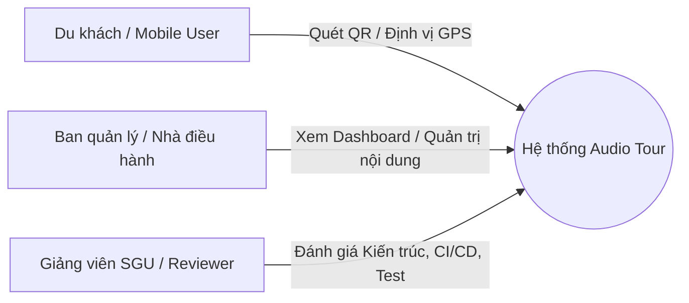
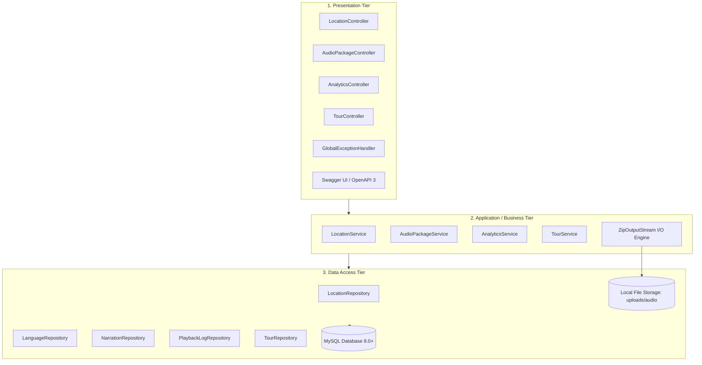
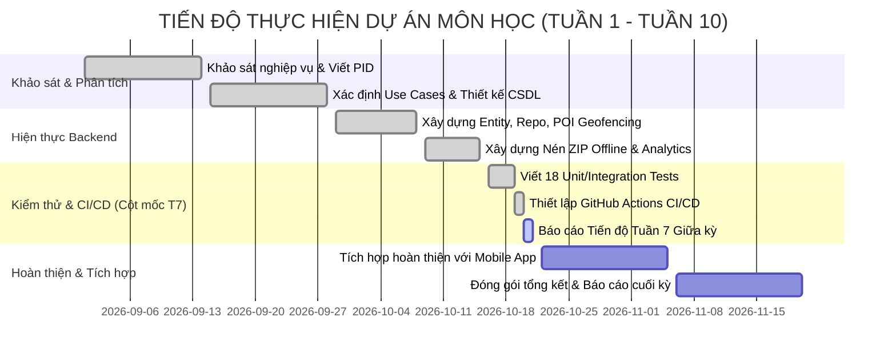

# TÀI LIỆU KHỞI TẠO DỰ ÁN (PROJECT INITIATION DOCUMENT - PID)

---

## 🏛️ THÔNG TIN DỰ ÁN TỔNG QUAN

* **Tên đề tài:** Hệ thống Thuyết minh Audio Tour Tự Động Đa Ngôn Ngữ (*Multi Languages Automatic Translation*)
* **Môn học:** Công nghệ Phần mềm (Software Engineering)
* **Trường:** Đại học Sài Gòn (SGU) – Khoa Công nghệ Thông tin
* **Giai đoạn báo cáo:** Tuần 7 (Sprint Review / Báo cáo Tiến độ Giữa kỳ)
* **Phần đảm nhiệm:** Phần 2 – Kiến trúc Backend 3 lớp (3-Tier Architecture), Cơ chế Hybrid Triggers (GPS/QR), Đóng gói Offline I/O Stream và Đường ống CI/CD

---

## 📌 1. BỐI CẢNH & TÍNH CẤP THIẾT CỦA ĐỀ TÀI (PROJECT BACKGROUND)

### 1.1. Bối cảnh thực tế
Tại các đô thị du lịch lớn như TP. Hồ Chí Minh, nhu cầu tiếp cận thông tin lịch sử - văn hóa của du khách trong nước và quốc tế ngày càng gia tăng. Tuy nhiên, các giải pháp hướng dẫn truyền thống đang đối mặt với nhiều hạn chế:
* **Chi phí cao:** Thuê hướng dẫn viên du lịch riêng đắt đỏ, không linh hoạt về thời gian.
* **Rào cản ngôn ngữ:** Đội ngũ hướng dẫn viên đa ngôn ngữ (tiếng Anh, Pháp, Nhật, Hàn,...) còn thiếu hụt tại các di tích hoặc trạm giao thông công cộng.
* **Hạn chế kết nối mạng:** Tại các phòng kín, tầng hầm di tích (như Hầm Dinh Độc Lập) hoặc khi du khách quốc tế chưa có SIM 4G, các ứng dụng streaming trực tuyến hoàn toàn tê liệt.
* **Trải nghiệm rườm rà:** Đa số ứng dụng hiện nay bắt buộc đăng ký tài khoản phức tạp, yêu cầu du khách phải tự tìm kiếm địa điểm trên màn hình thay vì tự động nhận diện thông minh.

### 1.2. Mục tiêu dự án (Project Goals & Objectives)
Dự án được xây dựng nhằm giải quyết triệt để các bài toán trên thông qua:
1. **Mô hình Kích hoạt Kép (Hybrid Triggering):**
   * **Ngoài trời:** Ứng dụng định vị GPS Geofencing tự động nhận biết du khách bước vào bán kính của trạm dừng xe buýt/di tích để phát âm thanh thuyết minh rảnh tay (Hands-free).
   * **Trong nhà / Điểm cố định:** Hỗ trợ quét mã QR Code dán tại biển bảng để tra cứu thông tin ngay lập tức mà không cần định vị vệ tinh.
2. **Cơ chế Nghe Thuyết minh Ngoại tuyến (Offline ZIP Packaging):**
   * Cho phép du khách tải trọn gói file âm thanh MP3 và nội dung văn bản kịch bản nén trong 1 file ZIP (`tour-offline.zip`) về thiết bị. Sau khi tải, app hoạt động hoàn toàn độc lập với Internet.
3. **Phân tích hành vi & Hỗ trợ điều hành (Business Intelligence & Heatmap):**
   * Thu thập ẩn danh lịch sử nghe, thời gian nghe, tỷ lệ QR vs GPS và tọa độ phát để vẽ bản đồ nhiệt (Heatmap), giúp ban quản lý nhận biết các điểm nóng du lịch.
4. **Tiêu chuẩn Kỹ nghệ Phần mềm chuyên nghiệp:**
   * Triển khai kiến trúc 3 lớp rõ ràng (Presentation - Business - Data Access).
   * Đảm bảo kiểm thử tự động (Unit Test / Integration Test) đạt 100% tỷ lệ pass.
   * Xây dựng đường ống CI/CD với GitHub Actions tự động hóa kiểm thử và đóng gói khi có thay đổi mã nguồn.

---

## 🎯 2. PHẠM VI DỰ ÁN (PROJECT SCOPE)

### 2.1. Trong phạm vi (In-Scope)
* **Tầng Cơ sở dữ liệu (Data Tier):** Thiết kế CSDL quan hệ chuẩn hóa trên MySQL 8.0/9.0 hỗ trợ lưu trữ địa điểm phân cấp (Hierarchical POIs), thuyết minh đa ngôn ngữ, tuyến tour và nhật ký nghe.
* **Tầng Nghiệp vụ & Dịch vụ (Application Tier):**
  * Logic phân cấp địa danh (ví dụ: Dinh Độc Lập chứa Phòng Khánh Tiết, Phòng Đại Yến).
  * Thuật toán nén luồng I/O `ZipOutputStream` đóng gói động file MP3 và kịch bản.
  * Logic tổng hợp phân tích: tính thời gian nghe trung bình, xếp hạng Top 5 POI, tỷ lệ QR/GPS và gom nhóm tọa độ Heatmap.
* **Tầng Giao diện & Tích hợp (Presentation Tier / Web API):**
  * Hệ thống RESTful API chuẩn RFC 7807, tích hợp OpenAPI 3 / Swagger UI tương tác.
  * Bộ lọc xử lý lỗi toàn cục (`GlobalExceptionHandler`).
* **Đảm bảo Chất lượng & CI/CD:**
  * 18 kịch bản kiểm thử tự động với JUnit 5, Mockito, MockMvc.
  * File cấu hình CI/CD GitHub Actions (`ci.yml`) tự động hóa kiểm thử trên runner Ubuntu và container MySQL.
* **Bộ dữ liệu thực tế tại TP.HCM:**
  * 3 trạm dừng xe buýt Quận 4: Khánh Hội, Vĩnh Hội, Xóm Chiếu.
  * Quần thể di tích Dinh Độc Lập Quận 1 (kèm các phòng ban chi tiết).
  * File âm thanh MP3 thật lưu trữ tại máy chủ.

### 2.2. Ngoài phạm vi (Out-of-Scope cho giai đoạn hiện tại)
* Cổng thanh toán trực tuyến (Dự án định hướng phục vụ cộng đồng và du lịch mở).
* Nhận diện giọng nói AI 2 chiều (Voice command).
* Ứng dụng AR (Thực tế ảo tăng cường 3D).

---

## 👥 3. CÁC BÊN LIÊN QUAN & TÁC NHÂN (STAKEHOLDERS & ACTORS)

| Tác nhân | Vai trò trong hệ thống | Lợi ích nhận được |
| :--- | :--- | :--- |
| **Du khách (Tourist)** | Người dùng cuối sử dụng ứng dụng di động ngoài hiện trường | Nghe thuyết minh tự động, hỗ trợ đa ngôn ngữ, nghe được offline không tốn 4G. |
| **Ban Quản lý (Operator / Admin)** | Người khai thác số liệu và vận hành du lịch | Nắm bắt mật độ du khách qua Heatmap, biết được điểm tham quan nào được yêu thích nhất. |
| **Giảng viên & Đội ngũ Phát triển** | Đánh giá tính chuẩn mực kỹ thuật theo môn học | Xác nhận tính đúng đắn của kiến trúc 3 lớp, độ bao phủ kiểm thử và quy trình DevOps CI/CD. |

---

## 🛠️ 4. KIẾN TRÚC KỸ THUẬT & CÔNG NGHỆ (TECHNICAL ARCHITECTURE)

### 4.1. Ngăn xếp Công nghệ (Tech Stack)
* **Ngôn ngữ:** Java 21 LTS (tương thích mở rộng Java 25)
* **Khung ứng dụng (Framework):** Spring Boot 4.1.1
* **Truy xuất Dữ liệu (ORM):** Spring Data JPA / Hibernate 7.x
* **Cơ sở dữ liệu:** MySQL 8.0+ / 9.3 (Engine InnoDB, UTF-8mb4)
* **Tài liệu hóa API:** Springdoc OpenAPI 3.0 / Swagger UI v2.8.5
* **Kiểm thử tự động:** JUnit 5, Mockito Framework, MockMvc TestDispatcherServlet
* **Tự động hóa CI/CD:** GitHub Actions (Ubuntu Runner + MySQL 8.0 Service Container)
* **Đóng gói & Quản lý Thư viện:** Apache Maven Wrapper (`mvnw`)

### 4.2. Sơ đồ Kiến trúc 3 tầng (3-Tier Architecture)

---

## ⚠️ 5. QUẢN LÝ RỦI RO & BIỆN PHÁP GIẢM THIỂU (RISK MANAGEMENT)

| Mã RR | Nguy cơ / Rủi ro tiềm ẩn | Mức độ | Biện pháp kỹ thuật khắc phục |
| :---: | :--- | :---: | :--- |
| **R-01** | Mất kết nối Internet tại phòng kín di tích | **Cao** | Thiết kế cơ chế **Offline ZIP Packaging**: Tải trước trọn gói file MP3 và text kịch bản về lưu trữ cục bộ. |
| **R-02** | Lỗi đệ quy vô tận Jackson khi serialize quan hệ cha-con (`Location` ↔ `subLocations`) | **Cao** | Sử dụng `@JsonIgnore` tại quan hệ ngược `parentLocation` và trả về cấu trúc DTO sạch. |
| **R-03** | Rung lắc tín hiệu GPS (GPS Jitter) gây phát thuyết minh lặp lại nhiều lần | **Trung bình** | Sử dụng bảng `playback_logs` kết hợp mã thiết bị `deviceId` và thuật toán debounce/cooldown trên Mobile. |
| **R-04** | Tràn bộ nhớ (Out-of-Memory) khi nhiều du khách cùng tải file ZIP | **Trung bình** | Xử lý luồng nén trực tiếp qua `ByteArrayOutputStream` kết hợp đệm luồng, giải phóng tài nguyên sau khi gửi. |
| **R-05** | Mã nguồn bị lỗi khi cộng tác nhóm nhiều người | **Thấp** | Thiết lập **GitHub Actions CI/CD Pipeline**: Chặn merge nếu 18 test tự động không vượt qua. |

---

## 📅 6. KẾ HOẠCH PHÂN BỔ THỜI GIAN & TIẾN ĐỘ (WBS & TIMELINE)

---

## 📝 7. KẾT LUẬN & ĐÁNH GIÁ TẠI CỘT MỐC TUẦN 7

Tính đến thời điểm **Tuần 7**, toàn bộ mục tiêu của **Phần 2 (Backend 3 lớp & CI/CD)** đã hoàn thành vượt tiến độ:
1. Cơ sở dữ liệu và 5 cặp Repository/Entity hoạt động ổn định trên MySQL 9.3.
2. Toàn bộ 4 nhóm Controller và Service phục vụ Location, Offline Package, Analytics và Tour đã hoàn thiện.
3. Bộ 18 bài kiểm thử tự động đạt tỷ lệ đậu **18/18 (100% Pass)**.
4. Đường ống tự động hóa GitHub Actions hoạt động trơn tru, sẵn sàng bàn giao API hoàn chỉnh cho đội ngũ lập trình ứng dụng di động.
