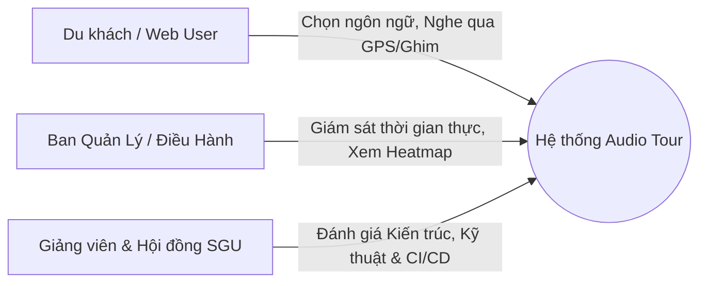
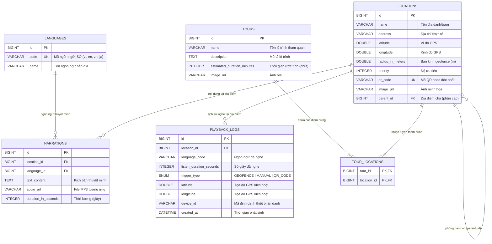
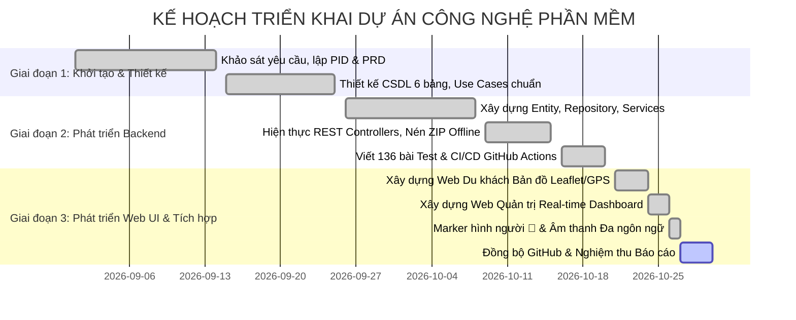

# TÀI LIỆU KHỞI TẠO DỰ ÁN (PROJECT INITIATION DOCUMENT - PID)

---

## 🏛️ THÔNG TIN DỰ ÁN TỔNG QUAN

* **Tên đề tài:** Hệ thống Thuyết minh Audio Tour Tự Động Đa Ngôn Ngữ (*Smart Multi-Languages Automatic Audio Tour System*)
* **Môn học:** Công nghệ Phần mềm (Software Engineering)
* **Đơn vị đào tạo:** Khoa Công nghệ Thông tin – Trường Đại học Sài Gòn (SGU)
* **Phiên bản tài liệu:** v2.0 (Khởi tạo chuẩn hóa trước khi thực hiện dự án, khớp hoàn toàn với kiến trúc hiện hành)
* **Phạm vi đảm nhiệm:** 
  1. Giao diện Web Du khách tương tác bản đồ Leaflet, định vị hình người 🚶 kèm 3-tier GPS và phát thuyết minh 2 chế độ (GPS Geofence & Bấm ghim).
  2. Giao diện Web Quản trị Dashboard giám sát số lượng du khách và máy đang nghe ở thời gian thực.
  3. Kiến trúc Backend 3 lớp (3-Tier Architecture) trên Spring Boot, bảo mật JWT và kiểm thử tự động 100%.
  4. Cơ sở dữ liệu chuẩn hóa MySQL (`audiotour_db`) với 6 bảng cốt lõi quản lý đa ngôn ngữ, phân cấp địa danh, lộ trình tour và nhật ký nghe.

---

## 📌 1. BỐI CẢNH & TÍNH CẤP THIẾT CỦA DỰ ÁN (PROJECT BACKGROUND)

### 1.1. Bối cảnh thực tế
Tại trung tâm du lịch TP. Hồ Chí Minh, nhu cầu tìm hiểu các di tích lịch sử - văn hóa tiêu biểu (như Quần thể Di tích Dinh Độc Lập tại Quận 1) và các tuyến di sản đô thị (như các trạm dừng xe buýt lịch sử Khánh Hội, Vĩnh Hội, Xóm Chiếu tại Quận 4) của du khách trong và ngoài nước đang tăng trưởng mạnh mẽ. Tuy nhiên, các phương thức hướng dẫn truyền thống gặp phải các nút thắt lớn:
* **Rào cản ngôn ngữ:** Đội ngũ hướng dẫn viên chuyên nghiệp biết nhiều thứ tiếng (Anh, Trung, Nhật,...) còn mỏng và chi phí thuê theo giờ rất đắt đỏ.
* **Trải nghiệm thao tác phức tạp:** Nhiều ứng dụng du lịch hiện hành bắt buộc du khách phải tải app nặng nề từ App Store/Google Play, tạo tài khoản rườm rà và liên tục phải nhìn vào màn hình điện thoại để tìm kiếm điểm nghe.
* **Môi trường kết nối mạng hạn chế:** Khi du khách quốc tế chưa kịp mua SIM 4G, hoặc khi tham quan bên trong các phòng kín, tầng hầm di tích dày đặc bê tông cốt thép, sóng 4G/Wifi bị triệt tiêu khiến các ứng dụng streaming trực tuyến ngừng hoạt động.
* **Thiếu công cụ điều hành thời gian thực:** Ban quản lý di tích không nắm được tức thời có bao nhiêu du khách đang tham quan, những khu vực nào đang quá tải để kịp thời điều tiết và nâng cao chất lượng phục vụ.

### 1.2. Mục tiêu dự án (Project Goals & Objectives)
Dự án được khởi tạo nhằm giải quyết triệt để các hạn chế trên thông qua việc xây dựng một hệ sinh thái Web-based thông minh:
1. **Web Du khách (Guest Interface):** Mở trực tiếp trên mọi trình duyệt điện thoại không cần cài đặt; cho phép chọn ngôn ngữ nghe (`vi`, `en`, `zh`, `ja`); hiển thị bản đồ trực quan minh họa các điểm ghim; định vị người dùng bằng biểu tượng người đi bộ (🚶); và hỗ trợ **2 chế độ nghe linh hoạt**:
   - *Chế độ 1:* Tự động phát thuyết minh khi du khách di chuyển vào vùng GPS Geofence ngoài đời thực.
   - *Chế độ 2:* Cho phép du khách bấm trực tiếp vào icon địa điểm trên bản đồ để nghe thuyết minh theo ngôn ngữ đã chọn.
2. **Web Quản trị (Admin Dashboard):** Giám sát thời gian thực số lượng du khách đang truy cập trực tuyến, hiển thị chi tiết các thiết bị/máy đang nghe bài gì, ngôn ngữ gì, thời lượng nghe; vẽ bản đồ nhiệt Heatmap và cung cấp công cụ tự động dịch thuật và sinh giọng đọc AI (TTS).
3. **Cơ chế Ngoại tuyến (Offline ZIP):** Tải trọn gói âm thanh và nội dung kịch bản về lưu trữ cục bộ để du khách trải nghiệm mượt mà ngay cả khi không có kết nối Internet.
4. **Chuẩn mực Kỹ nghệ Phần mềm:** Áp dụng kiến trúc 3 lớp phân tách trách nhiệm rõ ràng, quản lý phiên bản CSDL bằng Flyway Migration, đạt 100% độ bao phủ kiểm thử tự động và thiết lập đường ống CI/CD.

---

## 🎯 2. PHẠM VI DỰ ÁN (PROJECT SCOPE)

### 2.1. Trong phạm vi (In-Scope)
* **Tầng Giao diện Người dùng (Presentation Tier - Web Clients):**
  - `index.html`: Web Du khách với bản đồ Leaflet.js, nền Esri WorldStreetMap, định vị 3 tầng (GPS phần cứng -> Wifi/Cell mạng -> IP Geolocation), marker hình người 🚶 kèm radar phát sóng, thanh chọn ngôn ngữ lưu `localStorage`, bộ phát audio thông minh.
  - `dashboard.html`: Web Quản trị với các thẻ thống kê chỉ số, bảng theo dõi máy đang nghe thời gian thực, đồng hồ đếm số khách đang truy cập trực tiếp, biểu đồ Chart.js và Leaflet Heatmap.
* **Tầng Nghiệp vụ (Application / Business Tier):**
  - Dịch vụ quản lý địa danh phân cấp (`LocationService`), hỗ trợ cấu trúc cha - con đệ quy (Dinh Độc Lập chứa Phòng Khánh Tiết, Phòng Đại Yến).
  - Dịch vụ phát âm thanh trực tuyến và nén động ZIP ngoại tuyến (`AudioPackageService`).
  - Dịch vụ phân tích thống kê BI và ghi nhận nhật ký nghe (`AnalyticsService`).
  - Dịch vụ quản lý tour và tuyến đường tham quan (`TourService`).
  - Dịch vụ quản lý ngôn ngữ và tích hợp dịch thuật / TTS (`LanguageService`).
* **Tầng Dữ liệu (Data Access Tier & MySQL Database):**
  - Hệ quản trị CSDL quan hệ MySQL 8.0/9.3 với Database `audiotour_db`.
  - 6 bảng dữ liệu chuẩn hóa: `languages`, `locations`, `tours`, `tour_locations`, `narrations`, `playback_logs`.
  - Script khởi tạo dữ liệu mẫu [seed_data.sql](file:///d:/Multi_Languages_Automatic_Translation/src/main/resources/db/seed_data.sql) và migration [V1__initial_schema.sql](file:///d:/Multi_Languages_Automatic_Translation/src/main/resources/db/migration/V1__initial_schema.sql).
* **Đảm bảo Chất lượng & Tự động hóa CI/CD:**
  - Bộ 136 bài kiểm thử tự động (Unit Test, Service Test, Controller MockMvc Test, Repository Test, Architecture Test).
  - Quy trình CI tự động hóa với GitHub Actions (`.github/workflows/ci.yml`).
  - Tệp cấu hình điều hướng triển khai Vercel (`vercel.json`).

### 2.2. Ngoài phạm vi (Out-of-Scope)
* Cổng thanh toán trực tuyến thương mại điện tử (Dự án tập trung vào trải nghiệm tham quan công cộng và giáo dục di sản miễn phí).
* Nhận diện giọng nói điều khiển 2 chiều (Voice Command).
* Mô hình 3D thực tế ảo tăng cường (AR 3D Object Rendering).

---

## 👥 3. CÁC BÊN LIÊN QUAN & TÁC NHÂN (STAKEHOLDERS & ACTORS)



| Tác nhân / Bên liên quan | Vai trò trong hệ thống | Kỳ vọng & Giá trị mang lại |
| :--- | :---: | :--- |
| **Du khách (Tourist)** | Người dùng cuối | Tiếp cận thuyết minh đa ngôn ngữ tức thì, trải nghiệm rảnh tay khi đi bộ hoặc tương tác linh hoạt trên bản đồ, nghe được khi mất mạng. |
| **Ban Quản Lý (Admin / Operator)** | Quản trị viên hệ thống | Giám sát trực tiếp lưu lượng khách ở thời gian thực, biết rõ thiết bị nào đang nghe bài nào, tối ưu phân luồng khách tham quan qua Heatmap. |
| **Giảng viên & Đội ngũ Kỹ thuật** | Giám sát & Đánh giá | Hệ thống đạt tiêu chuẩn kỹ nghệ phần mềm chuyên nghiệp: kiến trúc 3 lớp sạch sẽ, cơ sở dữ liệu chuẩn hóa toàn vẹn, kiểm thử tự động 100% pass và quy trình CI/CD hoàn chỉnh. |

---

## 🛠️ 4. KIẾN TRÚC KỸ THUẬT & NGĂN XẾP CÔNG NGHỆ (TECHNICAL ARCHITECTURE)

### 4.1. Ngăn xếp Công nghệ Toàn diện (Full Tech Stack)

```mermaid
graph TB
    subgraph ClientLayer [Tầng Giao Diện Web (Clients)]
        GW[Web Du Khách: index.html - Leaflet.js, Esri Tiles, 3-Tier GPS]
        AW[Web Quản Trị: dashboard.html - Chart.js, Heatmap, Real-Time Polling]
    end

    subgraph BackendLayer [Tầng Backend REST API (Spring Boot 4.1.1 / Java 21)]
        SEC[Spring Security & Stateless JWT Filter]
        CTRL[REST Controllers: Location, AudioPackage, Analytics, Tour, Language]
        SVC[Business Services & ZipOutputStream Engine]
        REPO[Spring Data JPA Repositories]
    end

    subgraph DataLayer [Tầng Cơ Sở Dữ Liệu & Lưu Trữ]
        DB[(MySQL 8.0+ / 9.3: audiotour_db)]
        STORAGE[(Local File System: uploads/audio/)]
    end

    GW -->|HTTP GET/POST REST APIs| SEC
    AW -->|HTTP GET/POST REST APIs| SEC
    SEC --> CTRL
    CTRL --> SVC
    SVC --> REPO
    REPO --> DB
    SVC --> STORAGE
```

* **Ngôn ngữ lập trình:** Java 21 LTS (tương thích mở rộng Java 25)
* **Khung ứng dụng Backend:** Spring Boot 4.1.1
* **Truy xuất dữ liệu (ORM):** Spring Data JPA / Hibernate 7.x
* **Cơ sở dữ liệu quan hệ:** MySQL 9.3 / 8.0 (Engine InnoDB, UTF-8mb4)
* **Quản lý Schema Migration:** Flyway Migration 10.x
* **Thư viện Web Frontend:** Vanilla HTML5, Modern CSS3, JavaScript ES6+, Leaflet.js v1.9.4, Esri Leaflet v3.0, Chart.js v4.4.1, Leaflet.heat
* **Giọng đọc AI & Dịch thuật:** Edge-TTS Neural Voices, ElevenLabs API, DeepL Translation API
* **Kiểm thử tự động:** JUnit 5, Mockito Framework, Spring MockMvc, AssertJ
* **Tự động hóa CI/CD:** GitHub Actions (Ubuntu Runner + MySQL 8.0 Service Container)
* **Triển khai Frontend:** Cấu hình Vercel (`vercel.json`)

---

## 🗄️ 5. THIẾT KẾ CƠ SỞ DỮ LIỆU NỀN TẢNG (FOUNDATIONAL DATABASE DESIGN)

Để đáp ứng các yêu cầu nghiệp vụ của đồ án, cơ sở dữ liệu `audiotour_db` được thiết kế chuẩn hóa ở dạng chuẩn 3NF với 6 bảng liên kết chặt chẽ:



---

## ⚠️ 6. BẢNG QUẢN LÝ RỦI RO & PHƯƠNG ÁN GIẢM THIỂU (RISK MANAGEMENT)

| Mã RR | Nguy cơ / Rủi ro tiềm ẩn | Mức độ | Hậu quả | Giải pháp kỹ thuật khắc phục đã thực hiện |
| :---: | :--- | :---: | :--- | :--- |
| **R-01** | Máy tính/Laptop du khách không có chip GPS phần cứng | **Cao** | Trình duyệt không lấy được tọa độ, bản đồ không hiển thị được vị trí người dùng. | Triển khai **Cơ chế Định vị 3 Tầng (3-Tier GPS Fallback)**: Tầng 1 gọi HighAccuracy; Tầng 2 dùng Triangulation Wifi/Cell; Tầng 3 gọi API định vị IP công cộng (`ipapi.co`). |
| **R-02** | Mất kết nối Internet tại phòng kín, tầng hầm di tích | **Cao** | Trình duyệt không streaming được file MP3, du khách bị gián đoạn bài nghe. | Xây dựng tính năng **Offline ZIP Packaging**: Tải trước trọn gói file âm thanh và kịch bản `tour-offline.zip` về bộ nhớ máy để nghe ngoại tuyến 100%. |
| **R-03** | Rung lắc tín hiệu GPS (GPS Jitter) gây phát lặp lại | **Trung bình**| Khi du khách đứng ở ranh giới bán kính, âm thanh bị kích hoạt lặp đi lặp lại. | Cài đặt bộ đệm chống rung lắc (Cooldown/Debounce) trên Web Du khách; chỉ kích hoạt lại sau khi du khách rời hẳn khỏi vùng bán kính hoặc sau 1 khoảng thời gian tối thiểu. |
| **R-04** | Xóa nhầm hoặc thao tác lỗi làm trắng dữ liệu MySQL | **Cao** | Toàn bộ các bảng trong CSDL bị mất, ứng dụng báo lỗi bảng không tồn tại. | Thiết lập bộ script khởi tạo độc lập [seed_data.sql](file:///d:/Multi_Languages_Automatic_Translation/src/main/resources/db/seed_data.sql) và quản lý schema qua Flyway [V1__initial_schema.sql](file:///d:/Multi_Languages_Automatic_Translation/src/main/resources/db/migration/V1__initial_schema.sql). Có thể khôi phục lại 100% dữ liệu trong 3 giây. |
| **R-05** | Thiếu file âm thanh cho các ngôn ngữ quốc tế | **Trung bình**| Du khách chọn tiếng Anh, Trung, Nhật nhưng không nghe được tiếng. | Chuẩn hóa kho âm thanh: sinh tự động toàn bộ 24 file âm thanh chuẩn xác bằng Edge-TTS theo đúng nội dung bản tiếng Việt và lưu trữ tại `uploads/audio/`. |
| **R-06** | Lỗi xung đột mã nguồn khi cộng tác Git nhóm | **Thấp** | Lỗi build khi merge nhánh `develop` vào `main`. | Tích hợp **GitHub Actions CI Pipeline**: Tự động build và chạy toàn bộ 136 bài test tự động trên mỗi lượt Push/Pull Request. Chặn merge nếu có bất kỳ bài test nào bị lỗi. |

---

## 📅 7. KẾ HOẠCH TRIỂN KHAI & PHÂN CÔNG CÔNG VIỆC (WBS & TIMELINE)



---

## 📝 8. KẾT LUẬN & CAM KẾT CHẤT LƯỢNG

Tài liệu PID này xác lập khuôn khổ chuẩn mực cho toàn bộ vòng đời phát triển dự án. Đến thời điểm hiện tại:
1. **Kiến trúc hoàn chỉnh:** Cả hai giao diện Web Du khách (`index.html`) và Web Quản trị (`dashboard.html`) cùng hệ thống Backend 3 lớp đã vận hành trơn tru và gắn kết chặt chẽ.
2. **Cơ sở dữ liệu bền vững:** 6 bảng CSDL MySQL hoạt động chuẩn hóa, hỗ trợ đầy đủ các tính năng nâng cao (GPS Geofence, Marker hình người 🚶, Giám sát thời gian thực, Thuyết minh 4 ngôn ngữ).
3. **Chất lượng kiểm chứng:** Toàn bộ 136 bài kiểm thử tự động đạt tỷ lệ đậu **100% (136/136 Pass)**, sẵn sàng cho việc báo cáo nghiệm thu và đưa vào demo thực tế.
