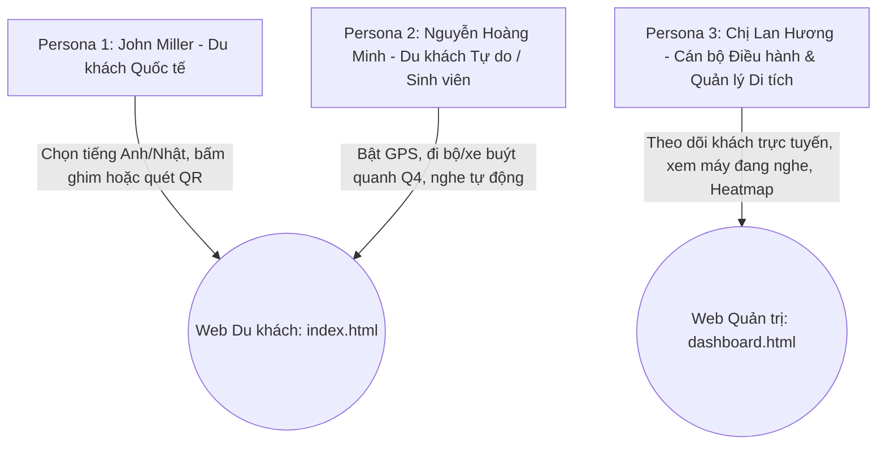
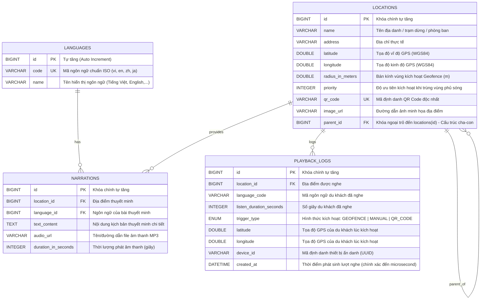
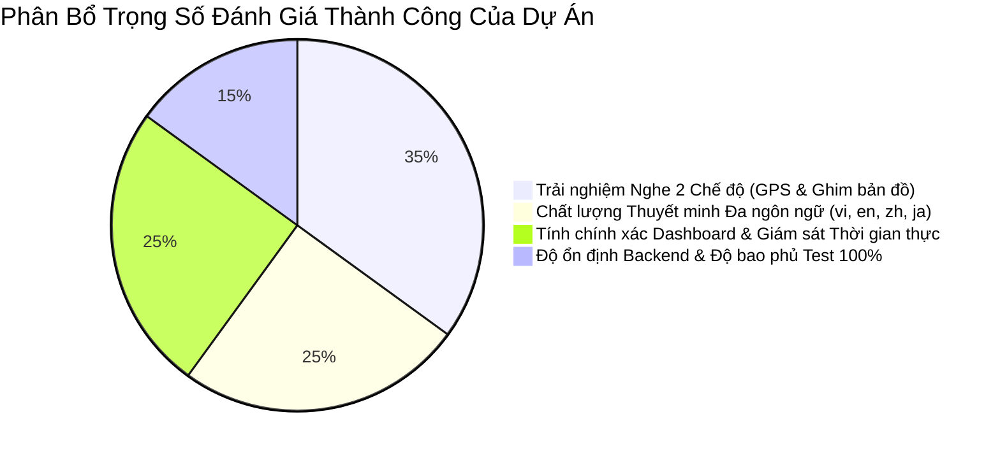

# TÀI LIỆU YÊU CẦU SẢN PHẨM (PRODUCT REQUIREMENTS DOCUMENT - PRD)

---

## 🏛️ THÔNG TIN DỰ ÁN

* **Tên sản phẩm:** Hệ thống Thuyết minh Audio Tour Tự Động Đa Ngôn Ngữ (*Smart Multi-Languages Automatic Audio Tour System*)
* **Môn học:** Công nghệ Phần mềm (Software Engineering) – Khoa Công nghệ Thông tin, Trường Đại học Sài Gòn (SGU)
* **Phiên bản tài liệu:** v2.1 (Đã tinh gọn: Loại bỏ hoàn toàn mục Tuyến tham quan - Tour; Tập trung tối đa vào 2 chế độ nghe POI & Real-time Dashboard)
* **Trạng thái:** Hoàn thiện Backend 3 lớp, CSDL 4 bảng quan hệ chuẩn hóa, Web Du khách bản đồ số và Web Quản trị Dashboard thời gian thực

---

## 🎯 1. TẦM NHÌN SẢN PHẨM & MỤC TIÊU CHIẾN LƯỢC

### 1.1. Tầm nhìn sản phẩm (Product Vision)
Xây dựng một nền tảng du lịch thông minh thế hệ mới, biến mọi thiết bị di động thành một **hướng dẫn viên du lịch cá nhân đa ngôn ngữ**. Hệ thống mang đến trải nghiệm tiếp cận không rào cản thông qua trình duyệt web trên thiết bị di động, bản đồ tương tác hiển thị vị trí thực của du khách bằng biểu tượng sống động, cơ chế phát thuyết minh tự động rảnh tay (Hands-free) dựa trên GPS Geofencing, phát thủ công khi tương tác điểm ghim và quét mã QR tại hiện trường; đồng thời cung cấp bảng điều khiển trung tâm (Admin Dashboard) giám sát số lượng du khách và thiết bị đang nghe ở thời gian thực (Real-time Monitoring).

### 1.2. Mục tiêu chiến lược (Product Goals)
1. **Tiếp cận không rào cản (Zero-Friction Access):** Du khách chỉ cần quét mã QR hoặc truy cập đường link trang web là có thể trải nghiệm ngay lập tức mà không cần tải hay cài đặt ứng dụng phức tạp từ kho ứng dụng (App Store/Google Play), không bắt buộc đăng ký tài khoản.
2. **Kích hoạt thuyết minh kép thông minh (Dual Narration Modes):**
   - **Chế độ 1 (Tự động GPS Geofencing):** Khi du khách di chuyển đến khu vực trong phạm vi GPS đã xác định ở ngoài đời thực (bán kính cấu hình theo từng địa điểm `radius_in_meters`), hệ thống tự động nhận diện và phát bài thuyết minh tương ứng.
   - **Chế độ 2 (Tương tác Thủ công):** Du khách có thể bấm trực tiếp vào icon ghim địa điểm trên bản đồ minh họa để nghe thuyết minh bất cứ lúc nào.
3. **Đa ngôn ngữ chuẩn hóa (Standardized Multilingual Audio):** Hỗ trợ chuyển đổi tức thì giữa các ngôn ngữ (`vi` - Tiếng Việt, `en` - Tiếng Anh, `zh` - Tiếng Trung, `ja` - Tiếng Nhật,...). Mọi bài thuyết minh của các ngôn ngữ đều chuẩn hóa nội dung bám sát bản Tiếng Việt chuẩn.
4. **Định vị bền bỉ (Resilient 3-Tier Geolocation):** Định vị vị trí thực của du khách và hiển thị trực quan bằng hình người đi bộ (🚶) kèm sóng radar, tích hợp cơ chế dự phòng 3 tầng (GPS phần cứng -> Triangulation Wifi/Cell mạng -> IP Geolocation) để luôn xác định được vị trí ngay cả trên máy tính hoặc môi trường GPS yếu.
5. **Giám sát thời gian thực (Real-Time Admin Operations):** Cung cấp hệ thống Dashboard cho Ban quản lý theo dõi trực quan số lượng du khách đang truy cập trực tuyến, thông tin máy/thiết bị đang nghe bài thuyết minh nào, ngôn ngữ gì và thời lượng nghe theo thời gian thực.
6. **Khả dụng ngoại tuyến (100% Offline Readiness):** Hỗ trợ đóng gói luồng I/O nén ZIP (`tour-offline.zip`) tải về máy phục vụ nghe tại các khu vực mất sóng mạng (tầng hầm di tích).

---

## 👥 2. CHÂN DUNG NGƯỜI DÙNG (USER PERSONAS)

### 👤 Persona 1: Khách du lịch quốc tế (International Traveler)
* **Họ tên:** John Miller (32 tuổi, du khách đến từ Sydney, Úc).
* **Bối cảnh:** Lần đầu đến TP. Hồ Chí Minh tham quan Dinh Độc Lập. Không muốn mua SIM 4G đắt đỏ, dùng trình duyệt Safari trên iPhone.
* **Nhu cầu:** Cần nghe thuyết minh bằng tiếng Anh hoặc tiếng Nhật chuẩn ngữ âm. Muốn bấm trực tiếp vào các phòng trưng bày trên bản đồ hoặc quét QR dán trước cửa phòng để nghe nội dung.
* **Điểm chạm:** Quét mã QR tại cổng, chọn `English` trên thanh công cụ, mở bản đồ bấm vào icon **Phòng Khánh Tiết** và cắm tai nghe thưởng thức.

### 👤 Persona 2: Du khách nội địa / Người trẻ khám phá di sản
* **Họ tên:** Nguyễn Hoàng Minh (22 tuổi, sinh viên Đại học tại TP.HCM).
* **Bối cảnh:** Đi xe buýt và tản bộ quanh các di tích lịch sử Quận 4 (Khánh Hội, Vĩnh Hội, Xóm Chiếu).
* **Nhu cầu:** Trải nghiệm rảnh tay (Hands-free), không muốn liên tục dán mắt vào điện thoại; mong muốn khi đi tới đúng trạm dừng nào thì hệ thống tự động phát bài thuyết minh của trạm đó.
* **Điểm chạm:** Mở `index.html`, bật chế độ định vị GPS (hình người 🚶 xuất hiện tại tọa độ thật). Khi bước vào bán kính 35m của Trạm Khánh Hội, bài thuyết minh tiếng Việt tự động phát.

### 👤 Persona 3: Cán bộ Quản lý & Điều hành Di tích (Site Administrator)
* **Họ tên:** Trần Thị Lan Hương (38 tuổi, Trưởng ban Khai thác & Dịch vụ Khách du lịch).
* **Nhu cầu:** Cần biết chính xác ngay trong thời điểm hiện tại có bao nhiêu du khách đang truy cập trang web, các thiết bị đang nghe bài thuyết minh nào, điểm di tích nào đang thu hút đông khách nhất để phân luồng hướng dẫn viên.
* **Điểm chạm:** Mở màn hình `dashboard.html`, quan sát thẻ **Đang truy cập thời gian thực (Active Visitors)**, bảng **Máy đang nghe trực tiếp** và biểu đồ tỷ lệ kích hoạt (GEOFENCE vs MANUAL vs QR_CODE).

---

## 🖥️ 3. HAI GIAO DIỆN NGƯỜI DÙNG RIÊNG BIỆT (USER INTERFACES)

Hệ thống được thiết kế thành 2 phân hệ Web độc lập phục vụ đúng đối tượng mục tiêu:

### 3.1. Trang Web Du Khách (Guest Map Web App - `index.html`)
* **Thanh công cụ đầu trang (Header Toolbar):**
  - Danh sách chọn ngôn ngữ thuyết minh (`vi`, `en`, `zh`, `ja`,...). Tự động lưu lựa chọn vào `localStorage` của trình duyệt.
  - Nút bật/tắt định vị GPS thời gian thực.
  - Nút định vị nhanh tâm bản đồ về vị trí người dùng (`🚶 Vị trí của tôi`).
  - Nút thu phóng bao quát toàn bộ các điểm di tích (`Toàn cảnh`).
* **Bản đồ tương tác trực quan (Interactive Vector Map):**
  - Tích hợp Leaflet.js trên nền bản đồ độ nét cao Esri WorldStreetMap.
  - Hiển thị tất cả các địa điểm tham quan dưới dạng **icon ghim (POI Pins)** kèm bán kính phủ sóng GPS (`radiusInMeters`).
  - **Biểu tượng vị trí người dùng (Traveler Person Marker):** Sử dụng icon người đi bộ (🚶) màu xanh nổi bật kèm sóng radar tỏa liên tục và nhãn định danh `"🚶 Bạn ở đây"`.
* **Hai phương thức nghe thuyết minh:**
  1. *Nghe tự động qua Geofencing:* Thuật toán tính khoảng cách Haversine liên tục so sánh tọa độ người dùng với các POI; khi bước vào vùng bán kính, hệ thống kích hoạt phát âm thanh với `triggerType = 'GEOFENCE'`.
  2. *Nghe thủ công qua tương tác:* Du khách nhấp chuột / chạm tay vào điểm ghim trên bản đồ, popup hiển thị tóm tắt và trình phát âm thanh bắt đầu với `triggerType = 'MANUAL'`.
  3. *Hỗ trợ quét mã QR tại chỗ:* Nhận diện mã QR qua URL `?qr=...` hoặc API `/api/locations/by-qr/{qrCode}` với `triggerType = 'QR_CODE'`.
* **Trình phát âm thanh nổi (Floating Audio Player):** Hiển thị thanh tiến trình phát trực tiếp, thời gian đếm giây, tên địa điểm, ngôn ngữ phát và nhãn phương thức kích hoạt âm thanh.

### 3.2. Trang Web Quản Trị & Thống Kê (Admin Real-Time Dashboard - `dashboard.html`)
* **Thống kê Tổng quan (KPI Metric Cards):**
  - Tổng số lượt nghe toàn hệ thống (`totalListens`).
  - Thời gian nghe trung bình (`averageListenDurationSeconds`).
  - Tỷ lệ kích hoạt theo phương thức: Tự động GPS Geofence vs Thủ công Manual vs Quét QR.
  - Số lượng địa điểm và ngôn ngữ được hỗ trợ.
* **Giám sát Thời gian thực (Real-Time Live Monitoring):**
  - **Số khách đang truy cập (Active Real-Time Visitors):** Thống kê số lượng phiên người dùng đang kết nối web trong 5 phút gần nhất.
  - **Máy đang nghe trực tiếp:** Hiển thị danh sách thiết bị/mã máy (`deviceId`), tên địa điểm đang nghe, cờ ngôn ngữ, thời lượng đã nghe và phương thức kích hoạt.
* **Phân tích Chuyên sâu (Charts & Heatmap):**
  - Biểu đồ Top 5 địa điểm được nghe nhiều nhất.
  - Bản đồ nhiệt du khách (Visitor Heatmap) thể hiện mật độ tập trung du khách theo tọa độ địa lý.
  - Bảng nhật ký nghe chi tiết kèm chức năng tìm kiếm, phân trang và bộ lọc.
* **Trung tâm Dịch thuật & Quản lý Ngôn ngữ:** Tích hợp tính năng thêm ngôn ngữ mới, tự động dịch thuật văn bản (DeepL API) và sinh âm thanh giọng đọc nhân tạo (Edge-TTS / ElevenLabs API).

---

## 🗄️ 4. THIẾT KẾ CƠ SỞ DỮ LIỆU CHI TIẾT (DATABASE SCHEMA)

Cơ sở dữ liệu của dự án sử dụng hệ quản trị **MySQL 8.0+ / 9.x**, Database name: `audiotour_db`, chuẩn mã hóa ký tự `utf8mb4` và collation `utf8mb4_unicode_ci`. Toàn bộ hệ thống được xây dựng trên **4 bảng cốt lõi** tinh gọn, không dư thừa.

### 4.1. Sơ đồ Quan hệ Thực thể (Entity Relationship Diagram - ERD)

---

### 4.2. Bảng đặc tả chi tiết 4 Bảng CSDL & Toàn bộ Thuộc tính (Data Dictionary)

#### 📋 Bảng 1: `languages` (Danh mục Ngôn ngữ Hỗ trợ)
* **Mục đích:** Lưu trữ danh sách các ngôn ngữ mà hệ thống hỗ trợ thuyết minh.

| Tên Cột | Kiểu Dữ Liệu | Ràng Buộc | Khóa | Mô Tả Chi Tiết & Giá Trị Mẫu |
| :--- | :--- | :--- | :---: | :--- |
| `id` | `BIGINT` | `NOT NULL AUTO_INCREMENT` | **PK** | Khóa chính tự tăng xác định duy nhất một ngôn ngữ. |
| `code` | `VARCHAR(10)` | `NOT NULL UNIQUE` | **UK** | Mã định danh chuẩn ISO 639-1 (`vi`, `en`, `zh`, `ja`,...). Không được trùng lặp. |
| `name` | `VARCHAR(50)` | `NOT NULL` | | Tên bản ngữ hiển thị (`Tiếng Việt`, `English`, `中文`, `日本語`). |

---

#### 📋 Bảng 2: `locations` (Điểm Tham Quan & Trạm Dừng POI)
* **Mục đích:** Lưu trữ toàn bộ thông tin địa lý, bán kính định vị, mã QR và cấu trúc cây phân cấp (cha - con) của các địa điểm.

| Tên Cột | Kiểu Dữ Liệu | Ràng Buộc | Khóa | Mô Tả Chi Tiết & Giá Trị Mẫu |
| :--- | :--- | :--- | :---: | :--- |
| `id` | `BIGINT` | `NOT NULL AUTO_INCREMENT` | **PK** | Khóa chính xác định địa điểm / trạm dừng. |
| `name` | `VARCHAR(100)` | `NOT NULL` | | Tên địa danh (ví dụ: *Trạm xe buýt Khánh Hội*, *Dinh Độc Lập*, *Phòng Khánh Tiết*). |
| `address` | `VARCHAR(255)` | `NULL` | | Địa chỉ thực tế ngoài đời (ví dụ: *Đường Hoàng Diệu, P. Khánh Hội, Q.4*). |
| `latitude` | `DOUBLE` | `NULL` | | Vĩ độ GPS thập phân theo hệ tọa độ WGS84 (ví dụ: `10.7602`). |
| `longitude` | `DOUBLE` | `NULL` | | Kinh độ GPS thập phân theo hệ tọa độ WGS84 (ví dụ: `106.7031`). |
| `radius_in_meters`| `DOUBLE` | `NULL` | | Bán kính vùng địa lý Geofence (mét) để kích hoạt tự động (ví dụ: `35.0`). |
| `priority` | `INTEGER` | `NULL` (Mặc định `1-5`) | | Độ ưu tiên kích hoạt khi du khách đứng trong vùng giao nhau của nhiều POI. |
| `qr_code` | `VARCHAR(50)` | `NULL UNIQUE` | **UK** | Mã QR duy nhất in tại hiện trường (ví dụ: `QR-KHANH-HOI-01`, `QR-DINH-DOC-LAP-01`). |
| `image_url` | `VARCHAR(255)` | `NULL` | | Đường dẫn ảnh minh họa đại diện hiển thị trên popup bản đồ. |
| `parent_id` | `BIGINT` | `NULL` | **FK** | Khóa ngoại trỏ đến `locations(id)`. Nếu `NULL` là địa điểm gốc; nếu có giá trị là khu vực con (ví dụ: Phòng Khánh Tiết có `parent_id = 4` trỏ đến Dinh Độc Lập). |

> **Ràng buộc khóa ngoại:** `CONSTRAINT fk_locations_parent FOREIGN KEY (parent_id) REFERENCES locations(id)`.

---

#### 📋 Bảng 3: `narrations` (Nội Dung Bài Thuyết Minh Đa Ngôn Ngữ)
* **Mục đích:** Lưu trữ kịch bản văn bản và file âm thanh thuyết minh cho từng địa điểm theo từng ngôn ngữ tương ứng.

| Tên Cột | Kiểu Dữ Liệu | Ràng Buộc | Khóa | Mô Tả Chi Tiết & Giá Trị Mẫu |
| :--- | :--- | :--- | :---: | :--- |
| `id` | `BIGINT` | `NOT NULL AUTO_INCREMENT` | **PK** | Khóa chính của bản ghi thuyết minh. |
| `location_id` | `BIGINT` | `NOT NULL` | **FK** | Khóa ngoại trỏ đến `locations(id)`. |
| `language_id` | `BIGINT` | `NOT NULL` | **FK** | Khóa ngoại trỏ đến `languages(id)`. |
| `text_content` | `TEXT` | `NULL` | | Toàn văn kịch bản thuyết minh được chuẩn hóa. |
| `audio_url` | `VARCHAR(255)` | `NULL` | | Tên file âm thanh MP3 lưu trữ trong thư mục máy chủ `uploads/audio/` (ví dụ: `tram-khanh-hoi-vi.mp3`, `1-en.mp3`,...). |
| `duration_in_seconds`| `INTEGER` | `NULL` | | Thời lượng bài nghe tính bằng giây (ví dụ: `90`). |

> **Ràng buộc:** `CONSTRAINT fk_narrations_location FOREIGN KEY (location_id) REFERENCES locations(id)`, `CONSTRAINT fk_narrations_language FOREIGN KEY (language_id) REFERENCES languages(id)`.

---

#### 📋 Bảng 4: `playback_logs` (Nhật Ký Nghe Thuyết Minh & Giám Sát Thời Gian Thực)
* **Mục đích:** Ghi nhận toàn bộ hành vi nghe của du khách ngoài hiện trường phục vụ thống kê BI và theo dõi số lượng khách đang truy cập trong thời gian thực.

| Tên Cột | Kiểu Dữ Liệu | Ràng Buộc | Khóa | Mô Tả Chi Tiết & Giá Trị Mẫu |
| :--- | :--- | :--- | :---: | :--- |
| `id` | `BIGINT` | `NOT NULL AUTO_INCREMENT` | **PK** | Khóa chính của bản ghi nhật ký nghe. |
| `location_id` | `BIGINT` | `NOT NULL` | **FK** | Khóa ngoại trỏ đến địa điểm đã phát thuyết minh `locations(id)`. |
| `language_code`| `VARCHAR(10)` | `NOT NULL` | | Mã ngôn ngữ mà du khách đã nghe (`vi`, `en`, `zh`, `ja`). |
| `listen_duration_seconds` | `INTEGER` | `NULL` | | Thời lượng du khách đã thực sự nghe (giây). |
| `trigger_type` | `ENUM('GEOFENCE', 'MANUAL', 'QR_CODE')` | `NOT NULL` | | Phương thức đã kích hoạt âm thanh: tự động GPS Geofence, bấm thủ công trên bản đồ, hay quét mã QR. |
| `latitude` | `DOUBLE` | `NULL` | | Tọa độ vĩ độ thực tế của thiết bị tại thời điểm phát sinh lượt nghe. |
| `longitude` | `DOUBLE` | `NULL` | | Tọa độ kinh độ thực tế của thiết bị tại thời điểm phát sinh lượt nghe. |
| `device_id` | `VARCHAR(64)` | `NULL` | | Mã máy/mã thiết bị ẩn danh ngẫu nhiên (UUID) gán cho mỗi phiên du khách. |
| `created_at` | `DATETIME(6)` | `NOT NULL` | | Thời gian hệ thống ghi nhận lượt nghe (chính xác đến microsecond). |

> **Ràng buộc:** `CONSTRAINT fk_playback_logs_location FOREIGN KEY (location_id) REFERENCES locations(id)`.

---

## 📋 5. YÊU CẦU CHỨC NĂNG CHI TIẾT (FUNCTIONAL REQUIREMENTS - FR)

### 📌 Nhóm FR-1: Giao diện Bản đồ Du khách & Định vị 3 Tầng (Guest Map & Geolocation)
* **FR-1.1 (Bản đồ minh họa & Icon ghim):** Tải và hiển thị bản đồ trực quan bằng thư viện Leaflet.js trên nền bản đồ độ nét cao Esri WorldStreetMap. Toàn bộ các địa điểm tham quan được hiển thị bằng icon ghim nổi bật kèm tên địa điểm.
* **FR-1.2 (Biểu tượng vị trí người dùng):** Vị trí thực tế của du khách phải được vẽ bằng icon hình người đi bộ (🚶) kèm hiệu ứng radar phát sóng liên tục và nhãn `"🚶 Bạn ở đây"`, giúp du khách biết rõ khoảng cách giữa mình và các địa điểm nghe.
* **FR-1.3 (Định vị GPS 3 Tầng kiên cố):**
  - *Tầng 1 (GPS phần cứng):* Gọi `navigator.geolocation` với `enableHighAccuracy: true`, thời gian chờ tối đa 8 giây.
  - *Tầng 2 (Triangulation mạng):* Nếu tầng 1 thất bại/timeout, tự động chuyển sang định vị qua sóng Wifi/Cell với `enableHighAccuracy: false`.
  - *Tầng 3 (IP Geolocation):* Nếu trình duyệt máy tính hoặc thiết bị tắt vị trí, tự động gọi API công cộng (`ipapi.co` / `geojs.io`) để lấy tọa độ xấp xỉ gần nhất, đảm bảo luôn hiển thị được người dùng trên bản đồ mà không bao giờ bị lỗi trắng.
* **FR-1.4 (Điều khiển bản đồ):** Hỗ trợ nút `🚶 Vị trí của tôi` để tự động lia tâm bản đồ về người dùng, và nút `Toàn cảnh` để thu phóng bao quát toàn bộ 6 địa điểm.

---

### 📌 Nhóm FR-2: Cơ chế Kích hoạt Thuyết minh Kép & Mã QR (Hybrid Audio Triggers)
* **FR-2.1 (Chế độ 1 - Tự động GPS Geofencing):** Khi du khách di chuyển đến khu vực có khoảng cách $\le$ `radiusInMeters` của địa điểm ngoài đời thực:
  - Hệ thống tự động kích hoạt phát âm thanh bài thuyết minh theo đúng ngôn ngữ đã chọn.
  - Ghi nhận `triggerType = 'GEOFENCE'`.
  - Tích hợp cơ chế chống phát lặp lại liên tục (cooldown/debounce).
* **FR-2.2 (Chế độ 2 - Thủ công qua điểm ghim):** Khi du khách nhấp chuột hoặc chạm vào icon ghim của bất kỳ địa điểm nào trên bản đồ:
  - Mở popup thông tin chi tiết và phát ngay bài thuyết minh của địa điểm đó theo ngôn ngữ hiện hành.
  - Ghi nhận `triggerType = 'MANUAL'`.
* **FR-2.3 (Chế độ bổ trợ - Quét mã QR Code):**
  - Hỗ trợ quét mã QR dán tại biển bảng hiện trường (ví dụ: `QR-KHANH-HOI-01`, `QR-DINH-DOC-LAP-01`).
  - Gọi API `GET /api/locations/by-qr/{qrCode}` để nhận ngay thông tin POI và phát âm thanh tương ứng với `triggerType = 'QR_CODE'`.

---

### 📌 Nhóm FR-3: Đa ngôn ngữ & Quản lý Thuyết minh Chuẩn hóa (Multilingual Audio)
* **FR-3.1 (Lựa chọn & Nhớ ngôn ngữ):** Thanh công cụ cho phép chọn ngôn ngữ (`vi`, `en`, `zh`, `ja`,...). Hệ thống tự động lưu lựa chọn vào `localStorage` của trình duyệt để giữ nguyên ngôn ngữ khi tải lại trang.
* **FR-3.2 (Thuyết minh chuẩn theo Tiếng Việt):** Mọi bài thuyết minh của các ngôn ngữ khác (`en`, `zh`, `ja`) phải có nội dung tương đồng, trung thực và bám sát theo văn bản Tiếng Việt chuẩn.
* **FR-3.3 (Đồng bộ kho âm thanh):** Hệ thống lưu trữ đầy đủ 24 file âm thanh MP3 thực tế cho 6 địa điểm x 4 ngôn ngữ trong thư mục máy chủ `uploads/audio/`, phục vụ phát trực tuyến qua endpoint `GET /api/packages/stream?locationId={id}&languageCode={code}`.

---

### 📌 Nhóm FR-4: Đóng gói Âm thanh Ngoại tuyến (Offline ZIP Packaging)
* **FR-4.1 (API nén động ZIP):** Cung cấp API `GET /api/packages/offline?locationId={id}&languageCode={code}` nén động trực tiếp trên luồng I/O `ZipOutputStream` bao gồm:
  1. `content.txt`: Văn bản tóm tắt bài thuyết minh.
  2. `audio.mp3`: File âm thanh MP3 tương ứng.
* **FR-4.2 (An toàn đa luồng):** Quá trình nén hoàn toàn độc lập trong bộ nhớ cục bộ của luồng yêu cầu, đảm bảo an toàn tuyệt đối khi hàng trăm du khách cùng tải gói offline cùng một lúc.

---

### 📌 Nhóm FR-5: Bảng điều khiển Quản trị & Giám sát Thời gian thực (Admin Dashboard)
* **FR-5.1 (Giám sát khách trực tuyến thời gian thực):** Hiển thị trực quan số lượng du khách đang truy cập trang web trong thời gian thực (Active Visitors tính trong cửa sổ 5 phút gần nhất).
* **FR-5.2 (Giám sát máy đang nghe):** Hiển thị bảng danh sách các thiết bị/mã máy (`deviceId`) đang nghe bài thuyết minh nào, ngôn ngữ gì, thời lượng nghe và hình thức kích hoạt.
* **FR-5.3 (Báo cáo tổng hợp số liệu):**
  - Tổng số lượt nghe (`totalListens`).
  - Thời gian nghe trung bình (`averageListenDurationSeconds`).
  - Tỷ lệ phân bố lượt nghe theo phương thức (`GEOFENCE`, `MANUAL`, `QR_CODE`).
  - Top 5 địa điểm thu hút du khách nhiều nhất.
* **FR-5.4 (Bản đồ nhiệt Heatmap):** Trực quan hóa mật độ tập trung của du khách trên bản đồ dựa trên tọa độ thu thập từ các lượt nghe.
* **FR-5.5 (Tự động mở rộng ngôn ngữ bằng AI):** Cung cấp chức năng dịch tự động văn bản (DeepL API) và tạo file âm thanh giọng đọc nhân tạo (Edge-TTS / ElevenLabs) khi Admin muốn thêm ngôn ngữ mới.

---

### 📌 Nhóm FR-6: Phân cấp Địa danh Cha - Con (Location Hierarchy)
* **FR-6.1 (Phân cấp Địa điểm Cha - Con):** Hỗ trợ mô hình địa danh phân cấp nhiều tầng (Dinh Độc Lập chứa các phòng ban con: Phòng Khánh Tiết, Phòng Đại Yến) thông qua khóa ngoại `parent_id` tự trỏ trong bảng `locations`.
* **FR-6.2 (Tra cứu phòng ban con):** Cung cấp API `GET /api/locations/{id}/sub-locations` để Mobile/Web truy xuất danh sách các khu vực trực thuộc một quần thể di tích.

---

### 📌 Nhóm FR-7: Xác thực & Bảo mật (Security & Privacy)
* **FR-7.1 (Bảo mật Quản trị qua JWT):** Các API quản trị và giám sát yêu cầu xác thực bằng JSON Web Token (JWT) thông qua Header `Authorization: Bearer <token>`. Đăng nhập quản trị qua `POST /api/auth/login`.
* **FR-7.2 (Bảo vệ Quyền riêng tư Du khách):** Hệ thống không thu thập bất kỳ thông tin nhận dạng cá nhân nào (Không yêu cầu họ tên, số điện thoại, email); các phiên truy cập chỉ lưu mã ẩn danh ngẫu nhiên (`deviceId` UUID).

---

## ⚡ 6. YÊU CẦU PHI CHỨC NĂNG (NON-FUNCTIONAL REQUIREMENTS - NFR)

| Nhóm Yêu Cầu | Tiêu Chí Kỹ Thuật | Phương Pháp Đo Lường & Đánh Giá |
| :--- | :--- | :--- |
| **Hiệu năng (Performance)** | - Thời gian phản hồi API tra cứu POI và QR: $\le 100$ ms. - Thời gian nén gói ZIP offline: $\le 1.0$ giây. - Bản đồ tải xong trong vòng $\le 1.5$ giây. | Kiểm thử tải bằng JMeter và Chrome DevTools Network Tab. |
| **Độ tin cậy (Reliability)** | - Tỷ lệ hoạt động sẵn sàng (Uptime): $\ge 99.9\%$. - Cơ chế GPS dự phòng 3 tầng đảm bảo không bao giờ bị đứt đoạn định vị. | Kiểm thử thực địa khi ngắt GPS phần cứng hoặc chuyển mạng. |
| **Khả năng chịu tải (Scalability)** | - Chịu tải đồng thời tối thiểu 200 kết nối truy cập cùng lúc. - HikariCP Connection Pool duy trì 10–20 kết nối MySQL ổn định. | Script kiểm thử đồng thời `test_4_users.ps1` vượt qua 100%. |
| **Tính toàn vẹn Dữ liệu (Integrity)**| - Quản lý phiên bản CSDL bằng Flyway Migration. - Ràng buộc toàn vẹn khóa ngoại (FK constraints) và luật kiểm tra Cascade xóa dữ liệu an toàn. | `ddl-auto: validate`, toàn bộ ràng buộc FK trên InnoDB. |
| **Chất lượng Kiểm thử (QA)** | - Tỷ lệ pass kiểm thử tự động đạt 100% (130/130 test case pass). - Tự động kiểm thử liên tục qua GitHub Actions CI/CD. | Maven Test Runner (`mvn test`) báo cáo BUILD SUCCESS. |
| **Tính tương thích (Compatibility)** | - Hoạt động mượt mà trên mọi trình duyệt hiện đại (Chrome, Safari, Edge, Firefox). - Giao diện Responsive thích ứng từ màn hình Smartphone 375px đến Desktop 4K. | Kiểm thử trên thiết bị di động thật và trình giả lập Responsive. |

---

## 📈 7. CHỈ SỐ ĐO LƯỜNG THÀNH CÔNG (KEY METRICS - OKRs)

1. **Tỷ lệ kích hoạt thành công:** Đạt $\ge 98\%$ đối với cả 2 chế độ (Tự động khi đến vùng GPS và Thủ công khi bấm ghim bản đồ).
2. **Độ phủ ngôn ngữ:** 100% các địa điểm trong hệ thống (6/6 POI) có đầy đủ bài thuyết minh và file âm thanh thực tế cho 4 ngôn ngữ (`vi`, `en`, `zh`, `ja`).
3. **Độ trễ cập nhật Dashboard:** Dữ liệu lượt nghe và số máy đang nghe thời gian thực hiển thị trên Dashboard với độ trễ $\le 3$ giây.
4. **Mức độ sẵn sàng triển khai:** Mã nguồn chuẩn hóa hoàn toàn, tích hợp cấu hình triển khai Vercel cho Frontend và Docker/Spring Boot cho Backend, đồng bộ 100% trên cả 2 nhánh Git `main` và `develop`.
