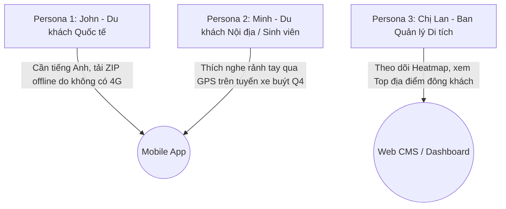
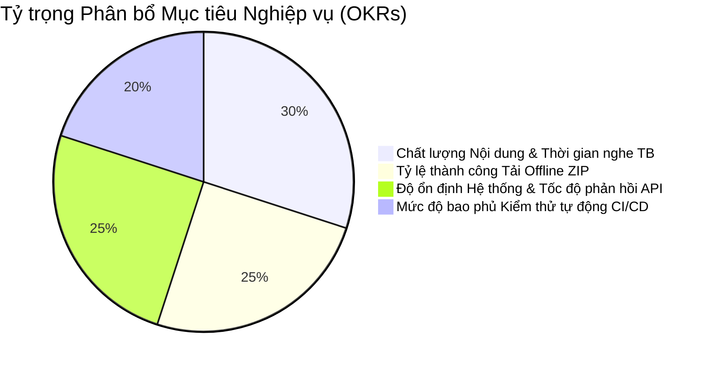
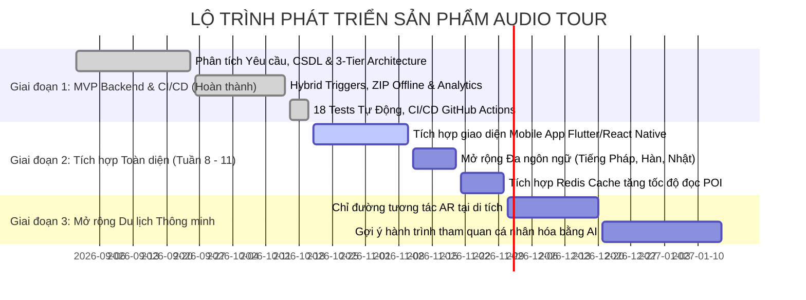

# TÀI LIỆU YÊU CẦU SẢN PHẨM (PRODUCT REQUIREMENTS DOCUMENT - PRD)

---

## 🏛️ THÔNG TIN DỰ ÁN

* **Tên sản phẩm:** Hệ thống Thuyết minh Audio Tour Tự Động Đa Ngôn Ngữ (*Smart Multi-Languages Automatic Audio Tour*)
* **Môn học:** Công nghệ Phần mềm (Software Engineering) – Trường Đại học Sài Gòn (SGU)
* **Phiên bản:** v1.0 (Cột mốc Tuần 7 - Sprint Review)
* **Trạng thái:** Sẵn sàng nghiệm thu kỹ thuật & Tích hợp Mobile App

---

## 🎯 1. TẦM NHÌN SẢN PHẨM & MỤC TIÊU (PRODUCT VISION & OBJECTIVES)

### 1.1. Tầm nhìn sản phẩm (Product Vision)
Xây dựng một nền tảng du lịch thông minh thế hệ mới, biến mọi chiếc điện thoại thông minh thành một **hướng dẫn viên du lịch cá nhân đa ngôn ngữ**. Hệ thống loại bỏ hoàn toàn rào cản kết nối mạng thông qua cơ chế đóng gói ngoại tuyến (Offline ZIP) và mang đến trải nghiệm nghe thuyết minh tự động rảnh tay (Hands-free) dựa trên công nghệ định vị GPS Geofencing kết hợp quét mã QR tại chỗ.

### 1.2. Mục tiêu chiến lược (Product Goals)
1. **Không rào cản (Zero-Friction Access):** Du khách tiếp cận nội dung ngay lập tức chỉ bằng một thao tác quét QR hoặc bước vào vùng định vị, không bắt buộc đăng ký tài khoản rườm rà.
2. **Khả dụng mọi lúc, mọi nơi (100% Offline Resilience):** Đảm bảo nghe thuyết minh bình thường tại các tầng hầm, phòng kín di tích không có sóng 4G/Wifi.
3. **Thấu hiểu hành vi du khách (Data-Driven Analytics):** Cung cấp bản đồ nhiệt Heatmap và báo cáo thời gian thực giúp ban quản lý di tích và ngành du lịch tối ưu hóa dịch vụ.
4. **Chuẩn mực Kỹ nghệ Phần mềm:** Thiết kế kiến trúc 3 lớp (3-Tier) module hóa cao, bảo mật API với JWT, kiểm thử tự động 100% và triển khai CI/CD liên tục.

---

## 👥 2. CHÂN DUNG NGƯỜI DÙNG (USER PERSONAS)

### 👤 Persona 1: Khách du lịch quốc tế (International Traveler)
* **Họ tên:** John Miller (32 tuổi, du khách đến từ Úc).
* **Bối cảnh:** Lần đầu đến TP.HCM tham quan Dinh Độc Lập. Không mua SIM 4G nội địa, chỉ dùng Wifi khách sạn.
* **Nhu cầu:** Cần nghe thuyết minh bằng tiếng Anh chuẩn xác. Muốn tải trước toàn bộ nội dung về máy để khi vào các phòng kín trong Dinh vẫn nghe thuyết minh được.
* **Điểm chạm (Touchpoint):** Quét mã `QR-PHONG-KHANH-TIET`, chọn `English`, bấm **Tải gói Offline** (`tour-offline.zip`) và cắm tai nghe trải nghiệm.

### 👤 Persona 2: Du khách nội địa / Người trẻ thích khám phá
* **Họ tên:** Nguyễn Văn Minh (21 tuổi, sinh viên tại TP.HCM).
* **Bối cảnh:** Đi xe buýt dạo quanh Quận 4 (Khánh Hội, Vĩnh Hội, Xóm Chiếu) để tìm hiểu lịch sử đô thị.
* **Nhu cầu:** Không muốn vừa đi vừa nhìn màn hình điện thoại để bấm chọn địa điểm; muốn hệ thống tự nhận biết xe buýt tới trạm nào thì tự động phát thuyết minh trạm đó.
* **Điểm chạm:** Mở app, bật định vị GPS, cất điện thoại vào túi áo. Khi xe buýt tiến vào bán kính 30m quanh trạm Khánh Hội, bài thuyết minh tự động vang lên.

### 👤 Persona 3: Cán bộ Điều hành & Ban Quản trị Di tích
* **Họ tên:** Hoàng Thị Lan (40 tuổi, Cán bộ phụ trách quản lý du khách tại Trung tâm Di tích).
* **Nhu cầu:** Cần biết chính xác mỗi ngày có bao nhiêu lượt khách nghe thuyết minh, phòng ban nào đông đúc nhất, du khách thích quét QR hay thích bật GPS.
* **Điểm chạm:** Truy cập giao diện Web CMS Dashboard xem tổng lượt nghe, tỷ lệ QR/GPS và theo dõi bản đồ nhiệt Heatmap để phân luồng khách tránh quá tải.

---

## 📋 3. YÊU CẦU CHỨC NĂNG CHI TIẾT (DETAILED FUNCTIONAL REQUIREMENTS - FR)

### 📌 Nhóm 1: Quản lý Điểm Quan Tâm & Phân Cấp Địa Danh (POI & Location Management)
* **FR-1.1 (Phân cấp Địa điểm):** Hệ thống phải hỗ trợ mô hình phân cấp đệ quy Cha-Con (`Location` ↔ `subLocations`), ví dụ: Dinh Độc Lập là địa điểm cha chứa các phòng ban con (Phòng Khánh Tiết, Phòng Đại Yến).
* **FR-1.2 (Tham số Định vị Geofence):** Mỗi POI phải cấu hình đầy đủ tọa độ GPS (`latitude`, `longitude`), bán kính vùng kích hoạt (`radiusInMeters` từ 15m đến 100m) và độ ưu tiên (`priority`).
* **FR-1.3 (Đồng bộ POI Ngoại tuyến):** Cung cấp API `GET /api/locations/pois` trả về toàn bộ dữ liệu POI để ứng dụng di động lưu vào SQLite phục vụ tính toán khoảng cách offline.
* **FR-1.4 (Nhận diện Mã QR):** Cung cấp API `GET /api/locations/by-qr/{qrCode}` truy xuất thông tin chi tiết địa điểm ngay lập tức bằng mã QR gắn tại biển báo.

---

### 📌 Nhóm 2: Cơ Chế Kích Hoạt Kép (Hybrid Triggering Engine)
* **FR-2.1 (Kích hoạt Ngoài trời qua GPS Geofencing):** 
  * Ứng dụng di động tính khoảng cách Haversine giữa tọa độ GPS người dùng và các điểm POI.
  * Tự động kích hoạt âm thanh khi khoảng cách $\le$ `radiusInMeters`.
  * Nếu trùng nhiều vùng phủ sóng, ưu tiên POI có chỉ số `priority` lớn nhất.
* **FR-2.2 (Kích hoạt Cố định qua QR Code):**
  * Hỗ trợ quét mã QR tại các vị trí không có sóng GPS (trong phòng kín, tầng hầm, trạm dừng có mái che).
  * Thời gian phản hồi API tra cứu QR phải đạt dưới 100ms.

---

### 📌 Nhóm 3: Đóng Gói Âm Thanh & Phân Phối Ngoại Tuyến (Offline ZIP Packaging)
* **FR-3.1 (Hỗ trợ Đa ngôn ngữ):** Hỗ trợ nhiều ngôn ngữ thuyết minh độc lập (`vi` - Tiếng Việt, `en` - Tiếng Anh) cho cùng một điểm di tích.
* **FR-3.2 (Thuật toán Nén Luồng I/O):**
  * Cung cấp API `GET /api/packages/offline?locationId={id}&languageCode={code}`.
  * Hệ thống đóng gói động bằng `ZipOutputStream` gồm:
    1. File văn bản tóm tắt kịch bản thuyết minh: `content.txt`.
    2. File âm thanh chất lượng cao chuẩn: `audio.mp3` (lấy từ thư mục lưu trữ `uploads/audio/`).
  * Trả về header `Content-Type: application/zip` và `Content-Disposition: attachment; filename="tour-offline.zip"`.
* **FR-3.3 (An toàn Đa luồng - Thread Safety):** Luồng nén I/O phải thực thi độc lập trên bộ nhớ cục bộ, không dùng tài nguyên tĩnh dùng chung để đảm bảo an toàn tuyệt đối khi nhiều người cùng tải.

---

### 📌 Nhóm 4: Báo Cáo Phân Tích & Bản Đồ Nhiệt (Analytics & BI Dashboard)
* **FR-4.1 (Ghi nhận Lịch sử Nghe Ẩn danh):**
  * Tiếp nhận log qua `POST /api/analytics/logs` gồm: `locationId`, `languageCode`, `listenDurationSeconds`, `triggerType` (`QR_CODE` hoặc `GEOFENCE`), `latitude`, `longitude`, `deviceId`.
  * Tự động ghi nhận thời gian hệ thống `createdAt`.
* **FR-4.2 (Tổng hợp Số liệu Dashboard CMS):** Cung cấp API `GET /api/analytics/dashboard` tổng hợp thời gian thực:
  * Tổng lượt nghe toàn hệ thống (`totalListens`).
  * Thời gian nghe trung bình (`averageListenDurationSeconds`).
  * Tỷ lệ lượt nghe theo hình thức kích hoạt (`listensByTriggerType`).
  * Danh sách Top 5 POI được nghe nhiều nhất (`topLocations`).
  * Danh sách tọa độ và cường độ phục vụ hiển thị bản đồ nhiệt (`heatmapPoints`).

---

### 📌 Nhóm 5: Tuyến Tham Quan Định Tuyến (Tour Management)
* **FR-5.1 (Danh sách Tuyến Tour):** Cung cấp API `GET /api/tours` trả về các lộ trình du lịch được thiết kế sẵn (Tour xe buýt lịch sử Quận 4, Tour Dinh Độc Lập).
* **FR-5.2 (Chi tiết Lộ trình Tour):** Cung cấp API `GET /api/tours/{id}` trả về danh sách các điểm POI theo đúng trình tự tham quan kèm thời gian dự kiến.

---

### 📌 Nhóm 6: Bảo Mật & Xác Thực (Security & Authentication)
* **FR-6.1 (Kiến trúc Stateless JWT):**
  * Sử dụng Spring Security tích hợp JWT Authentication Filter cho các API quản trị và giám sát (`/actuator/**`).
  * API đăng nhập quản trị: `POST /api/auth/login` cấp phát Bearer Token.
* **FR-6.2 (Bảo vệ Người dùng Ẩn danh):** Các API phục vụ du khách ngoài hiện trường không yêu cầu thông tin định danh cá nhân (PII), chỉ lưu mã máy ẩn danh ngẫu nhiên (`UUID`).

---

## ⚡ 4. YÊU CẦU PHI CHỨC NĂNG (NON-FUNCTIONAL REQUIREMENTS - NFR)

| Nhóm NFR | Yêu cầu Kỹ thuật cụ thể | Tiêu chuẩn Đánh giá |
| :--- | :--- | :--- |
| **Hiệu năng (Performance)** | - Thời gian phản hồi API tra cứu POI và QR Code: $\le 100$ ms. - Thời gian nén gói ZIP offline: $\le 1.0$ giây. | Đo kiểm bằng Stopwatch và Apache JMeter. |
| **Khả năng tải đồng thời (Concurrency)** | - Hệ thống chịu tải tối thiểu 100 kết nối đồng thời mà không bị treo hoặc tràn RAM. - HikariCP Connection Pool duy trì 10–20 kết nối sẵn sàng. | Script test song song `test_4_users.ps1` vượt qua 100% trong vòng dưới 1 giây. |
| **Độ tin cậy & Sẵn sàng (Reliability)** | - Tỷ lệ sẵn sàng của dịch vụ (Availability): $\ge 99.9\%$. - Chế độ ngoại tuyến đảm bảo du khách vẫn nghe được bài thuyết minh khi mất kết nối mạng. | Kiểm thử thực tế khi ngắt kết nối Wifi/4G. |
| **Tính toàn vẹn Dữ liệu (Integrity)** | - Sử dụng Flyway Database Migration quản lý phiên bản CSDL. - Ràng buộc toàn vẹn khóa ngoại (Foreign Keys), `@EntityGraph` loại bỏ hoàn toàn `LazyInitializationException`. | Không có lỗi Serialization JSON trên toàn bộ endpoint. |
| **Chất lượng Mã nguồn (QA & CI/CD)** | - Độ bao phủ kiểm thử (Test Coverage): 100% các luồng nghiệp vụ cốt lõi. - Tự động hóa kiểm thử qua GitHub Actions CI. | Bộ 18 test tự động đạt trạng thái **BUILD SUCCESS (18/18 Pass)**. |

---

## 📈 5. CHỈ SỐ ĐO LƯỜNG THÀNH CÔNG (KEY SUCCESS METRICS - OKRs)

1. **Tỷ lệ hoàn thành bài nghe (Listen Completion Rate):** $\ge 75\%$ thời lượng bài thuyết minh (được đo qua `listenDurationSeconds` trên Dashboard).
2. **Tỷ lệ tải gói ngoại tuyến thành công (Offline Download Success Rate):** Đạt $100\%$ không phát sinh lỗi I/O.
3. **Hiệu suất phản hồi đồng thời:** 4 du khách quét QR đồng thời phản hồi trong vòng $< 1.0$ giây.
4. **Chất lượng phần mềm:** 100% các pull request phải vượt qua pipeline CI/CD trước khi được phép merge vào nhánh `main`/`develop`.

---

## 🗺️ 6. LỘ TRÌNH PHÁT TRIỂN SẢN PHẨM (PRODUCT ROADMAP)

---

## 🏁 7. KẾT LUẬN & PHÊ DUYỆT

Tài liệu PRD này định nghĩa toàn bộ chuẩn mực chức năng, phi chức năng và kiến trúc kỹ thuật của hệ thống Backend. Tính đến cột mốc **Tuần 7**, toàn bộ các yêu cầu chức năng (FR-1 đến FR-6) và phi chức năng cốt lõi đã được hiện thực hóa, kiểm thử tự động đạt 18/18 test và sẵn sàng bàn giao hoàn toàn cho giai đoạn tích hợp Mobile App.
