# TÀI LIỆU ĐẶC TẢ CA SỬ DỤNG KÈM BIỂU ĐỒ CHI TIẾT (USE CASE SPECIFICATIONS & DIAGRAMS)

---

## 🏛️ THÔNG TIN TỔNG QUAN

* **Hệ thống:** Hệ thống Thuyết minh Audio Tour Tự Động Đa Ngôn Ngữ (*Multi Languages Automatic Translation*)
* **Môn học:** Công nghệ Phần mềm (Software Engineering) – Khoa CNTT, Trường Đại học Sài Gòn (SGU)
* **Quy chuẩn đặc tả:** Chuẩn RUP (Rational Unified Process) kết hợp UML 2.5 với **biểu đồ tuần tự (Sequence Diagram) và biểu đồ hoạt động (Activity Diagram) chi tiết cho từng Use Case**.

---

## 📐 1. SƠ ĐỒ CA SỬ DỤNG TỔNG THỂ & PHÂN RÃ PHÂN HỆ

### 1.1. Sơ đồ Ca Sử Dụng Tổng Thể (System Use Case Diagram)

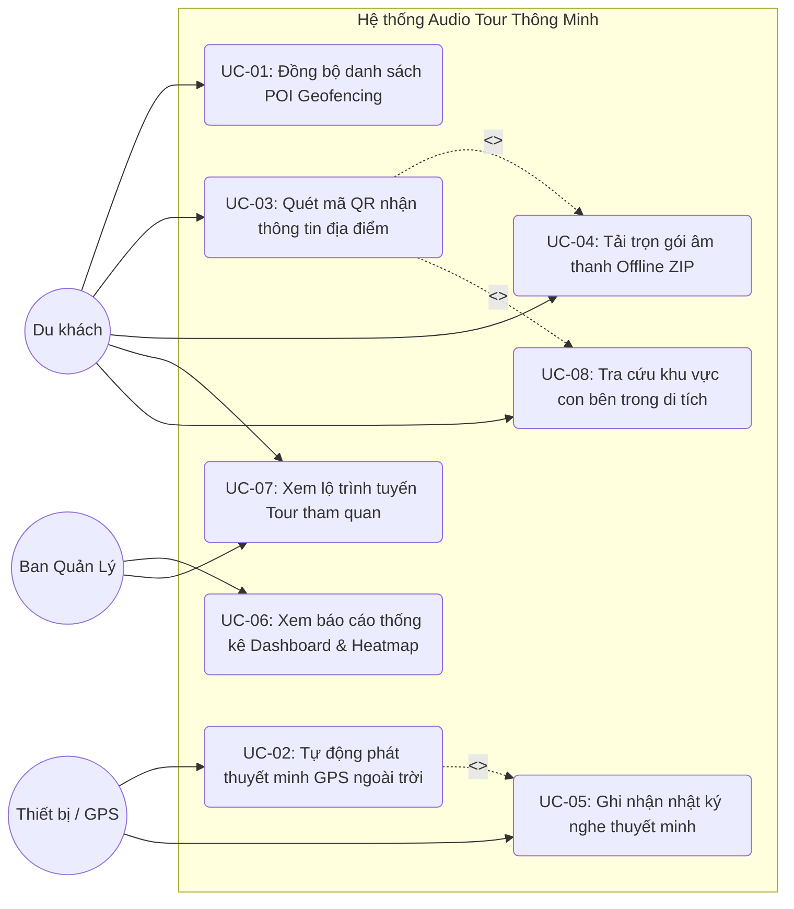

---

### 1.2. Phân rã theo 3 Phân hệ Chức năng (Sub-systems)

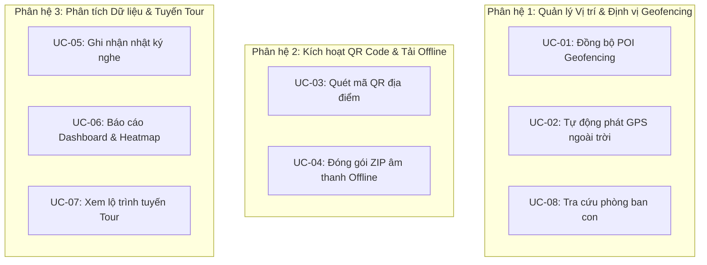

---

## 👥 2. DANH SÁCH TÁC NHÂN (ACTORS)

| Tác nhân | Loại tác nhân | Vai trò và Trách nhiệm trong hệ thống |
| :--- | :---: | :--- |
| **Du khách (Tourist)** | Primary Actor | Người dùng cuối trực tiếp tương tác với ứng dụng di động: quét mã QR, chọn ngôn ngữ nghe, tải gói offline và trải nghiệm tham quan. |
| **Thiết bị / Cảm biến GPS (Mobile Sensor)** | System Actor | Hệ thống cảm biến vị trí trên thiết bị di động, tự động đối chiếu tọa độ người dùng với các POI và phát tín hiệu kích hoạt âm thanh ngầm. |
| **Ban Quản Lý (Admin / Tour Operator)** | Primary Actor | Người quản trị truy cập Web CMS để theo dõi mật độ du khách, bản đồ nhiệt Heatmap, báo cáo số liệu và thiết lập các tuyến Tour. |

---

## 📋 3. DANH MỤC TỔNG HỢP CA SỬ DỤNG

| Mã UC | Tên Ca Sử Dụng | Tác nhân chính | Mức độ ưu tiên | Endpoint API Backend |
| :---: | :--- | :---: | :---: | :--- |
| **UC-01** | Đồng bộ danh sách POI Geofencing | Du khách / Mobile App | **Cao (High)** | `GET /api/locations/pois` |
| **UC-02** | Tự động phát thuyết minh GPS ngoài trời | Thiết bị / GPS Sensor | **Cao (High)** | Logic Mobile + `POST /api/analytics/logs` |
| **UC-03** | Quét mã QR nhận thông tin địa điểm | Du khách | **Cao (High)** | `GET /api/locations/by-qr/{qrCode}` |
| **UC-04** | Tải trọn gói âm thanh Offline dạng ZIP | Du khách | **Cao (High)** | `GET /api/packages/offline` |
| **UC-05** | Ghi nhận nhật ký nghe thuyết minh | Thiết bị Mobile App | **Trung bình (Medium)** | `POST /api/analytics/logs` |
| **UC-06** | Xem thống kê Dashboard & Heatmap | Ban Quản Lý | **Trung bình (Medium)** | `GET /api/analytics/dashboard` |
| **UC-07** | Xem danh sách và lộ trình tuyến Tour | Du khách / Ban Quản Lý | **Thấp (Low)** | `GET /api/tours`, `GET /api/tours/{id}` |
| **UC-08** | Tra cứu khu vực con bên trong di tích | Du khách | **Thấp (Low)** | `GET /api/locations/{id}/sub-locations` |

---

## 📝 4. ĐẶC TẢ CHI TIẾT TỪNG USE CASE KÈM BIỂU ĐỒ

---

### 🔹 UC-01: Đồng bộ danh sách POI Geofencing

#### 1. Mục đích
Cung cấp toàn bộ danh sách điểm quan tâm (POI) gồm tọa độ GPS, bán kính kích hoạt và độ ưu tiên về ứng dụng di động để hỗ trợ phát hiện vị trí ngoại tuyến.

#### 2. Thông tin chung
* **Tác nhân:** Du khách (thực thi tự động qua ứng dụng di động khi khởi động).
* **Tiền điều kiện:** Ứng dụng di động có kết nối Internet khi mở lần đầu.
* **Hậu điều kiện:** Dữ liệu POI được lưu trữ cục bộ trong bộ nhớ cache hoặc SQLite của điện thoại.

#### 3. Biểu đồ Tuần tự (Sequence Diagram - UC-01)

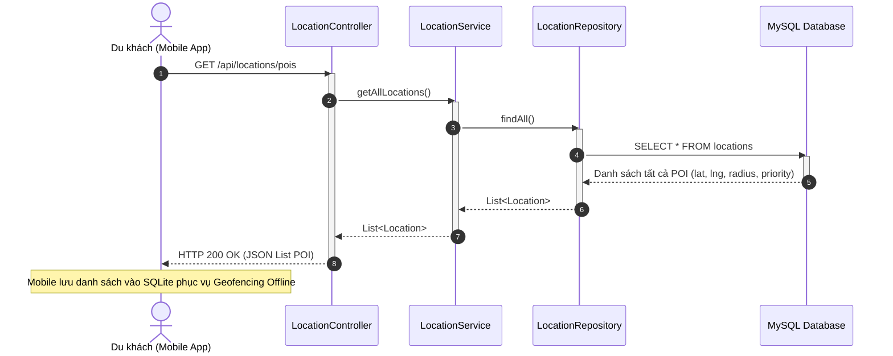

#### 4. Luồng sự kiện
* **Luồng chính:**
  1. Ứng dụng khởi động, tự động gửi `GET /api/locations/pois`.
  2. `LocationController` gọi `LocationService.getAllLocations()`.
  3. `LocationRepository` truy vấn CSDL MySQL nạp danh sách địa điểm.
  4. Hệ thống trả về mảng JSON chứa các trường `id`, `name`, `latitude`, `longitude`, `radiusInMeters`, `priority`.
  5. Ứng dụng nạp dữ liệu vào Geofencing Service chạy nền.
* **Luồng ngoại lệ:** Nếu mất mạng, ứng dụng sử dụng dữ liệu đã lưu từ phiên trước trong SQLite.

---

### 🔹 UC-02: Tự động phát thuyết minh GPS ngoài trời (Geofence Trigger)

#### 1. Mục đích
Tự động kích hoạt bài thuyết minh khi du khách bước vào bán kính vùng phủ sóng định vị của một địa điểm (ví dụ: xe buýt tới trạm Khánh Hội).

#### 2. Thông tin chung
* **Tác nhân:** Thiết bị di động / Cảm biến GPS.
* **Tiền điều kiện:** Đã hoàn thành UC-01; thiết bị đã cấp quyền vị trí (Location Permission).
* **Hậu điều kiện:** Âm thanh thuyết minh tự động phát; gọi tự động **UC-05** ghi nhận log.

#### 3. Biểu đồ Hoạt động (Activity Diagram - UC-02)

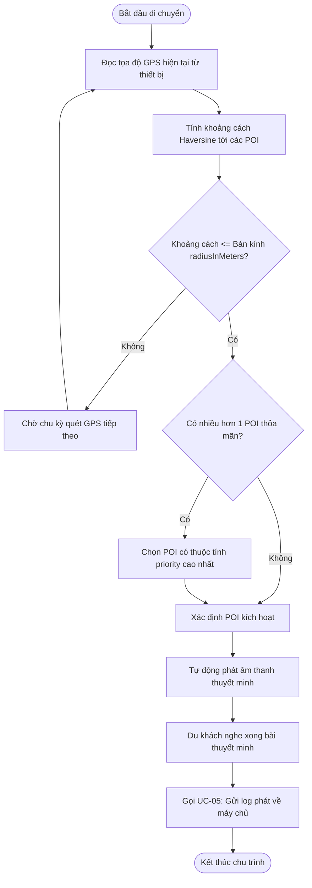

#### 4. Biểu đồ Tuần tự (Sequence Diagram - UC-02)

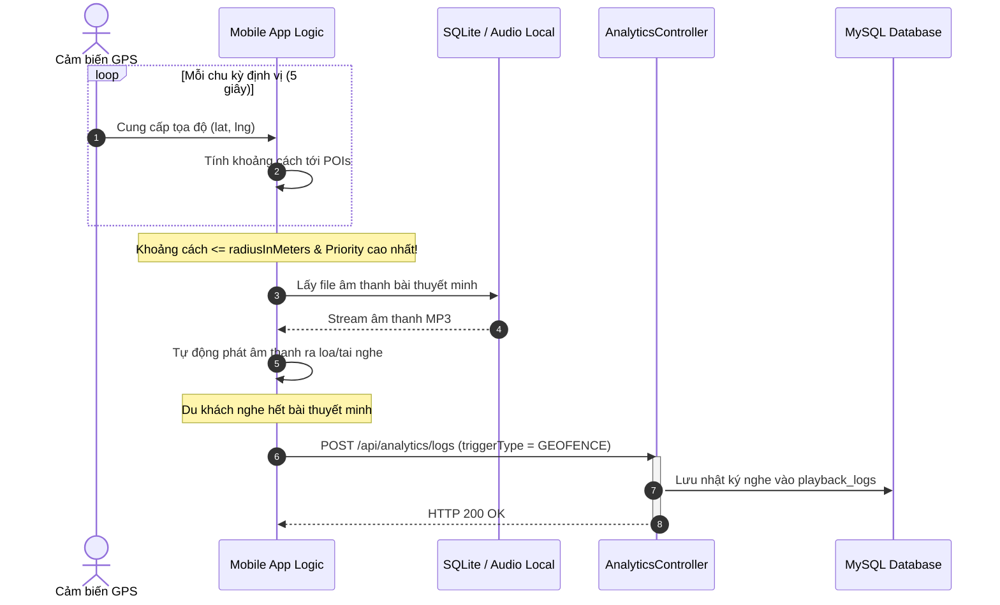

---

### 🔹 UC-03: Quét mã QR nhận thông tin địa điểm

#### 1. Mục đích
Cho phép du khách quét mã QR dán cố định tại trạm dừng hoặc phòng ban di tích để lấy thông tin chi tiết và danh sách bài thuyết minh.

#### 2. Thông tin chung
* **Tác nhân:** Du khách.
* **Tiền điều kiện:** Du khách đứng trước mã QR và cấp quyền Camera.
* **Hậu điều kiện:** Thông tin địa điểm hiển thị trên màn hình.

#### 3. Biểu đồ Tuần tự (Sequence Diagram - UC-03)

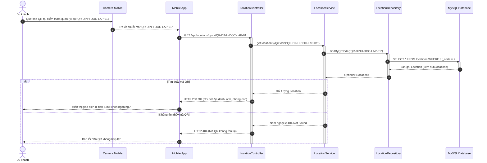

---

### 🔹 UC-04: Tải trọn gói âm thanh Offline dạng ZIP

#### 1. Mục đích
Nén động file âm thanh MP3 thực tế và file văn bản kịch bản `content.txt` thành gói `tour-offline.zip` để du khách lưu về máy và nghe ngoại tuyến khi không có mạng.

#### 2. Thông tin chung
* **Tác nhân:** Du khách.
* **Tiền điều kiện:** Du khách đang ở trang chi tiết địa danh (hoàn thành UC-03).
* **Hậu điều kiện:** File ZIP được tải về và giải nén trong máy khách.

#### 3. Biểu đồ Hoạt động Nén Luồng I/O (Activity Diagram - UC-04)

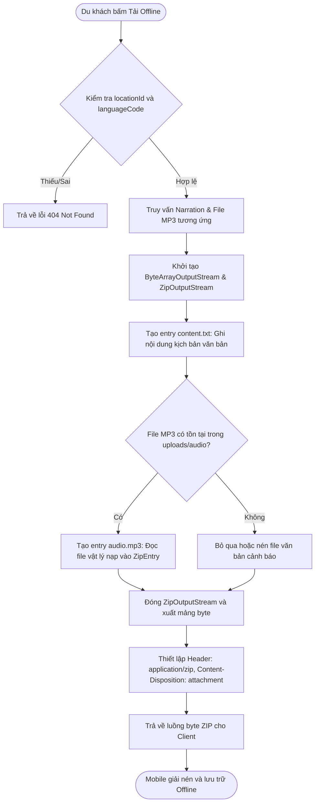

#### 4. Biểu đồ Tuần tự (Sequence Diagram - UC-04)

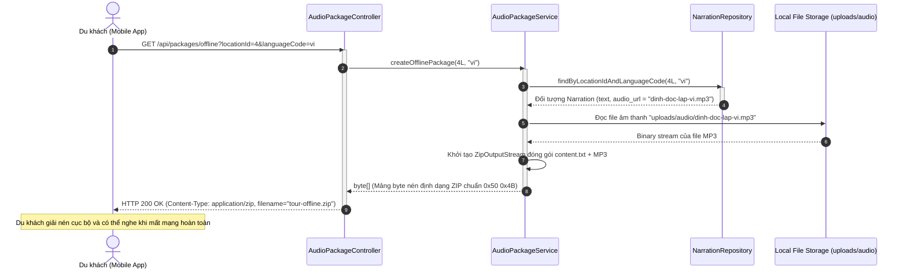

---

### 🔹 UC-05: Ghi nhận nhật ký nghe thuyết minh

#### 1. Mục đích
Ghi nhận ẩn danh các lượt nghe từ ứng dụng di động để đánh giá mức độ hấp dẫn của nội dung và vẽ bản đồ nhiệt Heatmap.

#### 2. Biểu đồ Tuần tự (Sequence Diagram - UC-05)

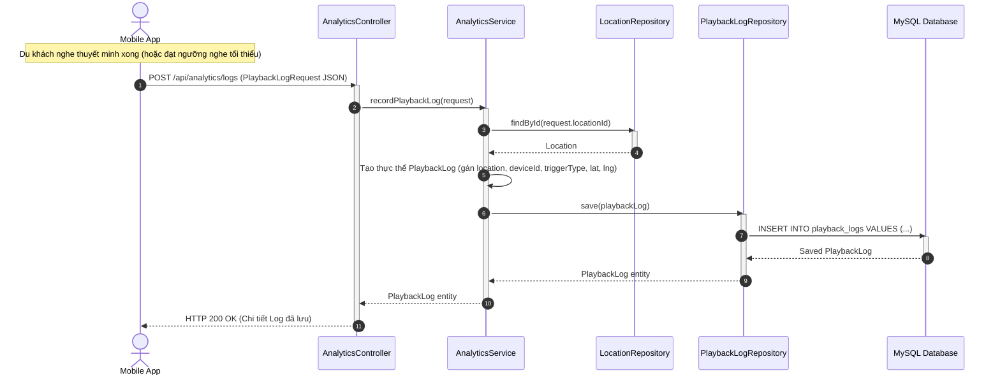

---

### 🔹 UC-06: Xem báo cáo thống kê Dashboard & Heatmap

#### 1. Mục đích
Cung cấp bảng số liệu Business Intelligence tổng thể cho Ban Quản Lý di tích/du lịch (Tổng lượt nghe, thời gian nghe TB, tỷ lệ QR vs GPS, Top 5 POI và tọa độ Heatmap).

#### 2. Biểu đồ Tuần tự (Sequence Diagram - UC-06)

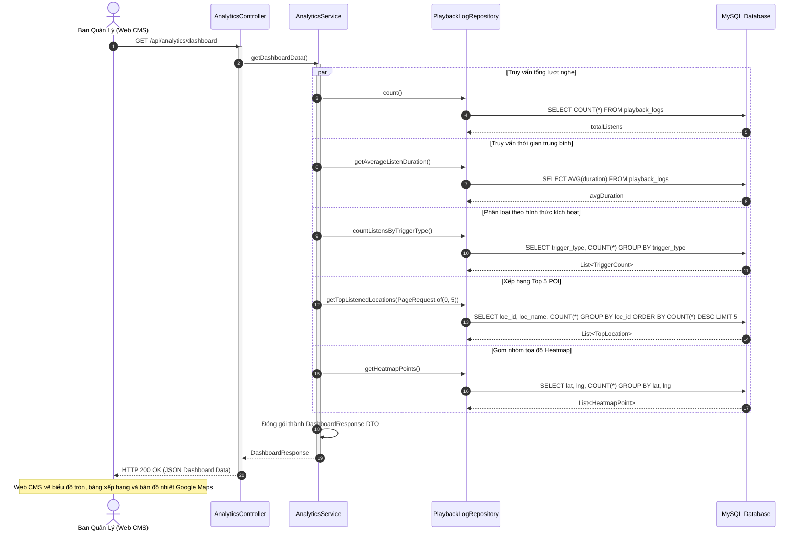

---

### 🔹 UC-07: Xem danh sách và lộ trình tuyến Tour tham quan

#### 1. Mục đích
Cung cấp lộ trình tham quan được quy hoạch sẵn theo thứ tự địa danh cho du khách (ví dụ: Tuyến xe buýt lịch sử Quận 4, Tuyến khám phá Dinh Độc Lập).

#### 2. Biểu đồ Tuần tự (Sequence Diagram - UC-07)

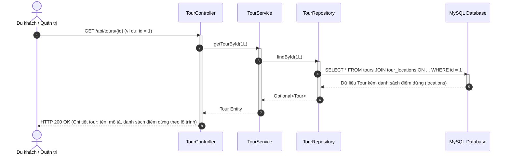

---

### 🔹 UC-08: Tra cứu khu vực con bên trong di tích (Hierarchical POIs)

#### 1. Mục đích
Cho phép du khách xem danh sách các phòng ban/khu vực con bên trong một di tích cấp cao (ví dụ: xem Phòng Khánh Tiết, Phòng Đại Yến bên trong Dinh Độc Lập).

#### 2. Biểu đồ Tuần tự (Sequence Diagram - UC-08)

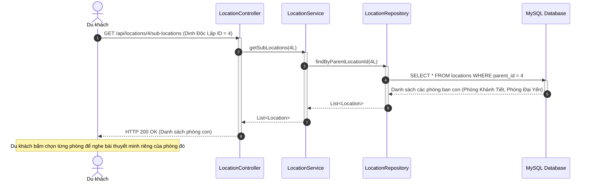

---

## 📌 5. MA TRẬN TRUY VẾT YÊU CẦU TOÀN DIỆN (REQUIREMENTS TRACEABILITY MATRIX - RTM)

| Mã UC | Tên Ca Sử Dụng | Loại Biểu Đồ Minh Họa | Lớp Controller | Lớp Service | Lớp Repository | Bảng CSDL |
| :---: | :--- | :--- | :--- | :--- | :--- | :--- |
| **UC-01** | Đồng bộ POI Geofencing | Sequence Diagram | `LocationController` | `LocationService` | `LocationRepository` | `locations` |
| **UC-02** | Thuyết minh GPS tự động | Activity + Sequence Diagram | Mobile App logic | `AnalyticsService` | `PlaybackLogRepository` | `playback_logs` |
| **UC-03** | Quét mã QR địa điểm | Sequence Diagram | `LocationController` | `LocationService` | `LocationRepository` | `locations` |
| **UC-04** | Tải trọn gói Offline ZIP | Activity + Sequence Diagram | `AudioPackageController` | `AudioPackageService` | `NarrationRepository` | `narrations`, `languages` |
| **UC-05** | Ghi nhận log nghe | Sequence Diagram | `AnalyticsController` | `AnalyticsService` | `PlaybackLogRepository` | `playback_logs` |
| **UC-06** | Dashboard & Heatmap | Sequence Diagram (Parallel) | `AnalyticsController` | `AnalyticsService` | `PlaybackLogRepository` | `playback_logs` |
| **UC-07** | Lộ trình tuyến Tour | Sequence Diagram | `TourController` | `TourService` | `TourRepository` | `tours`, `tour_locations` |
| **UC-08** | Tra cứu phòng ban con | Sequence Diagram | `LocationController` | `LocationService` | `LocationRepository` | `locations` |
