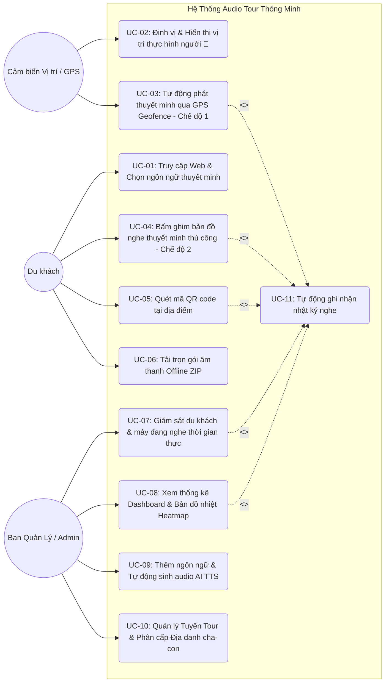
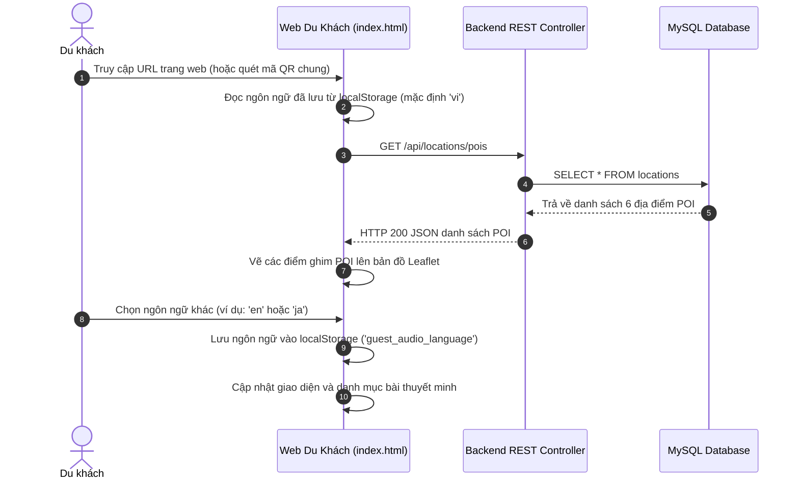
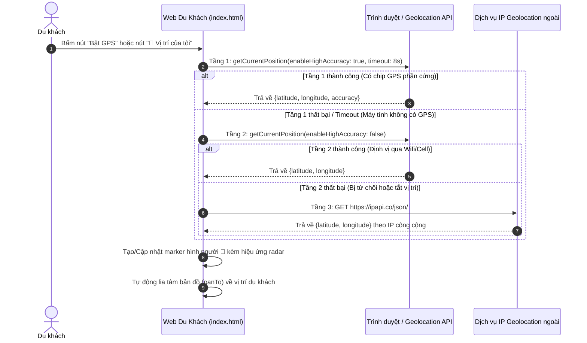
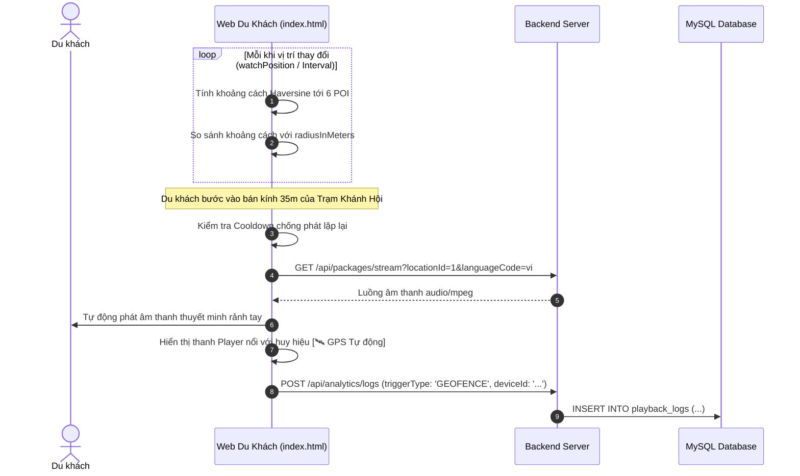
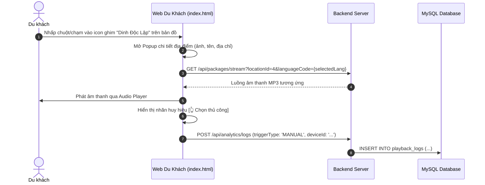
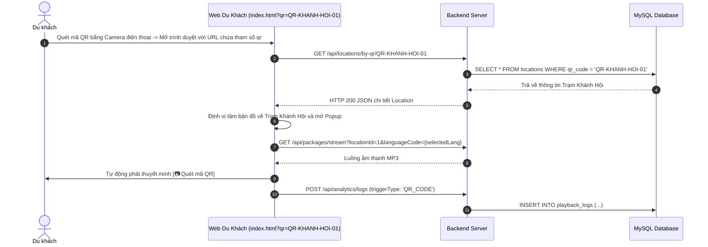
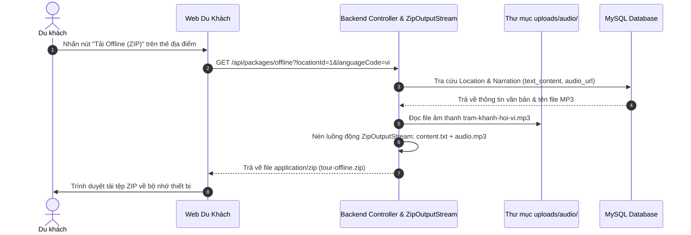
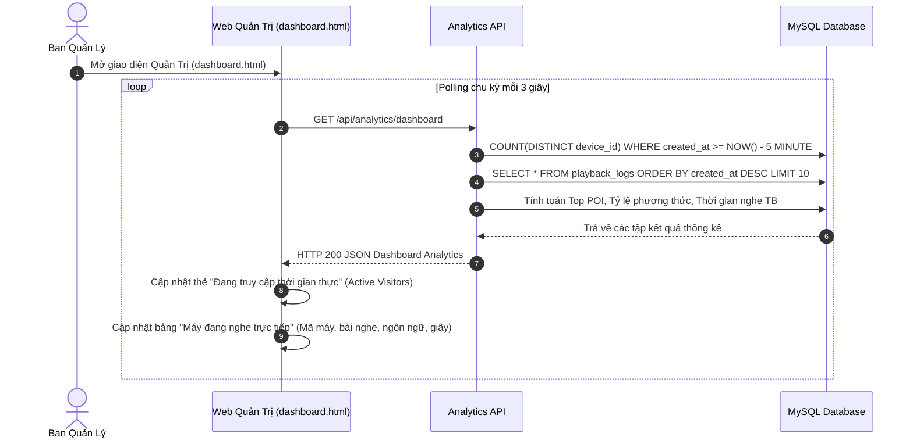

# TÀI LIỆU ĐẶC TẢ CA SỬ DỤNG (USE CASE SPECIFICATIONS & DIAGRAMS)

---

## 🏛️ THÔNG TIN TỔNG QUAN

* **Hệ thống:** Hệ thống Thuyết minh Audio Tour Tự Động Đa Ngôn Ngữ (*Smart Multi-Languages Automatic Audio Tour System*)
* **Môn học:** Công nghệ Phần mềm (Software Engineering) – Khoa Công nghệ Thông tin, Trường Đại học Sài Gòn (SGU)
* **Phiên bản tài liệu:** v2.0 (Khớp hoàn toàn với logic đồ án thực tế và cơ sở dữ liệu 6 bảng hiện hành)
* **Quy chuẩn đặc tả:** Chuẩn RUP (Rational Unified Process) kết hợp UML 2.5 với biểu đồ tuần tự (Sequence Diagram), luồng sự kiện chi tiết và ma trận truy xuất dữ liệu.

---

## 📐 1. SƠ ĐỒ CA SỬ DỤNG TỔNG THỂ (SYSTEM USE CASE DIAGRAM)

---

## 👥 2. DANH SÁCH TÁC NHÂN (ACTORS)

| Tác nhân | Loại tác nhân | Vai trò và Trách nhiệm trong hệ thống |
| :--- | :---: | :--- |
| **Du khách (Tourist)** | Primary Actor | Người dùng truy cập Web Du khách (`index.html`) trên điện thoại di động: chọn ngôn ngữ nghe, quan sát bản đồ, bấm vào các điểm ghim hoặc di chuyển để nghe thuyết minh tự động, quét mã QR và tải gói offline. |
| **Cảm biến Vị trí / GPS (Sensor)** | System Actor | Dịch vụ định vị 3 tầng trên thiết bị người dùng (GPS phần cứng, Triangulation sóng Wifi/Cell, IP Geolocation), liên tục cung cấp tọa độ địa lý thực tế để vẽ icon hình người 🚶 và kích hoạt geofence tự động. |
| **Ban Quản Lý (Admin / Operator)** | Primary Actor | Người quản trị truy cập Web Quản trị (`dashboard.html`): giám sát số lượng khách đang truy cập trong thời gian thực, xem các máy đang nghe, phân tích Heatmap và bổ sung ngôn ngữ thuyết minh mới. |

---

## 📋 3. DANH MỤC TỔNG HỢP CA SỬ DỤNG (USE CASE CATALOG)

| Mã UC | Tên Ca Sử Dụng | Phân hệ | Tác nhân chính | Bảng Dữ liệu Tương tác |
| :---: | :--- | :---: | :---: | :--- |
| **UC-01** | Truy cập Web & Chọn ngôn ngữ thuyết minh | Web Du khách | Du khách | `languages`, `locations` |
| **UC-02** | Định vị & Hiển thị vị trí thực hình người 🚶 | Web Du khách | Cảm biến GPS | Không lưu DB (Client State) |
| **UC-03** | Tự động phát thuyết minh GPS Geofence (Chế độ 1) | Web Du khách | Cảm biến GPS | `locations`, `narrations`, `playback_logs` |
| **UC-04** | Bấm ghim bản đồ nghe thuyết minh thủ công (Chế độ 2) | Web Du khách | Du khách | `locations`, `narrations`, `playback_logs` |
| **UC-05** | Quét mã QR code nhận thông tin & nghe âm thanh | Web Du khách | Du khách | `locations`, `narrations`, `playback_logs` |
| **UC-06** | Tải trọn gói âm thanh Offline dạng ZIP | Web Du khách | Du khách | `locations`, `narrations` |
| **UC-07** | Giám sát du khách & máy đang nghe thời gian thực | Web Quản trị | Ban Quản Lý | `playback_logs`, `locations` |
| **UC-08** | Xem thống kê Dashboard & Bản đồ nhiệt Heatmap | Web Quản trị | Ban Quản Lý | `playback_logs`, `locations` |
| **UC-09** | Thêm ngôn ngữ & Tự động sinh audio AI TTS | Web Quản trị | Ban Quản Lý | `languages`, `narrations`, `locations` |
| **UC-10** | Quản lý Tuyến Tour & Phân cấp Địa danh cha-con | Web Quản trị | Ban Quản Lý | `tours`, `tour_locations`, `locations` |
| **UC-11** | Tự động ghi nhận nhật ký nghe thuyết minh | Hệ thống | Hệ thống ngầm | `playback_logs` |

---

## 🔍 4. ĐẶC TẢ CHI TIẾT TỪNG CA SỬ DỤNG (USE CASE SPECIFICATIONS)

---

### 📌 UC-01: Truy cập Web & Chọn Ngôn Ngữ Thuyết Minh
* **Mô tả:** Du khách mở trang web du khách (`index.html`) trên trình duyệt di động hoặc máy tính. Hệ thống hiển thị thanh công cụ với danh sách các ngôn ngữ được hỗ trợ (`vi`, `en`, `zh`, `ja`), tải danh sách POI lên bản đồ và ghi nhớ ngôn ngữ đã chọn.
* **Tác nhân:** Du khách.
* **Điều kiện tiên quyết:** Thiết bị có kết nối mạng và trình duyệt web hiện đại.
* **Điều kiện sau:** Giao diện bản đồ hiển thị với ngôn ngữ được chọn; ngôn ngữ được lưu vào `localStorage`.

* **Luồng sự kiện chính:**
  1. Du khách truy cập địa chỉ `http://localhost:8080/index.html`.
  2. Giao diện kiểm tra `localStorage` để lấy ngôn ngữ người dùng đã chọn trước đó (nếu chưa có, mặc định là `vi` - Tiếng Việt).
  3. Trình duyệt gửi yêu cầu `GET /api/locations/pois` để lấy toàn bộ 6 địa điểm tham quan.
  4. Hệ thống tải nền bản đồ Esri và vẽ các điểm ghim POI kèm bán kính vòng tròn địa lý.
  5. Du khách nhấn vào hộp chọn ngôn ngữ trên thanh công cụ và chọn ngôn ngữ mong muốn (`en` - English, `zh` - 中文, `ja` - 日本語).
  6. Hệ thống cập nhật trạng thái ngôn ngữ toàn cục và lưu vào `localStorage`.
* **Luồng sự kiện rẽ nhánh:**
  - *Mất kết nối mạng tới Backend:* Giao diện hiển thị thông báo toast lỗi và kích hoạt chế độ nạp POI dự phòng cục bộ.

---

### 📌 UC-02: Định vị & Hiển Thị Vị Trí Thực Bằng Hình Người (🚶)
* **Mô tả:** Hệ thống thu thập tọa độ thực tế của du khách thông qua cơ chế định vị 3 tầng (3-Tier Fallback) và vẽ một biểu tượng hình người đi bộ (🚶) kèm sóng radar phát liên tục tại vị trí thực tế trên bản đồ.
* **Tác nhân:** Cảm biến Vị trí / GPS.
* **Điều kiện tiên quyết:** Du khách bấm nút bật GPS hoặc cấp quyền truy cập vị trí trên trình duyệt.
* **Điều kiện sau:** Marker hình người 🚶 xuất hiện tại tọa độ thực của du khách trên bản đồ Leaflet; tâm bản đồ tự động di chuyển về vị trí du khách.

* **Luồng sự kiện chính:**
  1. Người dùng nhấn nút kích hoạt định vị trên thanh công cụ.
  2. Hệ thống gọi định vị Tầng 1 với độ chính xác cao (`enableHighAccuracy: true`).
  3. Nếu thành công, nhận tọa độ GPS phần cứng chính xác.
  4. Nếu Tầng 1 quá 8 giây không có kết quả (thường gặp trên Laptop/PC), hệ thống tự động kích hoạt Tầng 2 (định vị qua mạng Wifi/tháp sóng di động).
  5. Nếu Tầng 2 vẫn không có phản hồi, hệ thống gọi Tầng 3 qua API IP Geolocation (`ipapi.co` / `geojs.io`) để lấy tọa độ xấp xỉ thành phố hiện tại.
  6. Hệ thống khởi tạo icon `user-person-container` với SVG hình người đi bộ (🚶), vòng tròn radar phát sóng màu xanh dương và nhãn nổi `"🚶 Bạn ở đây"`.
  7. Bản đồ tự động lia tâm mượt mà về vị trí người dùng.

---

### 📌 UC-03: Tự Động Phát Thuyết Minh Qua GPS Geofence (Chế độ 1)
* **Mô tả:** Khi du khách di chuyển đến khu vực có khoảng cách thực tế $\le$ bán kính geofence (`radiusInMeters`) của địa điểm ngoài đời thực, hệ thống tự động phát bài thuyết minh tương ứng theo ngôn ngữ du khách đã chọn mà không cần bấm nút.
* **Tác nhân:** Cảm biến Vị trí / GPS.
* **Điều kiện tiên quyết:** Du khách đang bật định vị GPS và đang di chuyển ngoài hiện trường.
* **Điều kiện sau:** Bài thuyết minh MP3 được phát ra loa/tai nghe; nhật ký nghe với `trigger_type = 'GEOFENCE'` được ghi vào CSDL.

* **Luồng sự kiện chính:**
  1. Trình duyệt liên tục theo dõi vị trí du khách và tính khoảng cách Haversine tới tất cả các POI.
  2. Khi khoảng cách tới một POI nhỏ hơn hoặc bằng `radiusInMeters` của địa điểm đó:
     - Hệ thống kiểm tra cờ trạng thái để tránh phát lặp lại nếu du khách vẫn đang đứng trong vùng bán kính đó.
     - Xác định ngôn ngữ hiện hành mà du khách đã chọn (ví dụ: `vi`, `en`, `zh`, `ja`).
     - Gọi luồng âm thanh `GET /api/packages/stream?locationId={id}&languageCode={code}`.
     - Trình phát âm thanh nổi bật lên, tự động chạy và hiển thị nhãn `🛰️ Kích hoạt qua: GPS GEOFENCE`.
  3. Giao diện tự động gửi gói tin ghi nhận nhật ký nghe `POST /api/analytics/logs` với `triggerType = 'GEOFENCE'`.
  4. Máy chủ lưu trữ bản ghi vào bảng `playback_logs` trong MySQL.

---

### 📌 UC-04: Bấm Ghim Bản Đồ Nghe Thuyết Minh Thủ Công (Chế độ 2)
* **Mô tả:** Du khách nhấp chuột hoặc chạm tay trực tiếp vào icon ghim của một địa điểm bất kỳ trên bản đồ để nghe thuyết minh ngay lập tức theo ngôn ngữ đã chọn.
* **Tác nhân:** Du khách.
* **Điều kiện tiên quyết:** Bản đồ đã tải xong danh sách các điểm ghim POI.
* **Điều kiện sau:** Trình phát phát âm thanh của địa điểm được chọn; nhật ký nghe với `trigger_type = 'MANUAL'` được ghi nhận.

* **Luồng sự kiện chính:**
  1. Du khách quan sát các điểm ghim trên bản đồ và nhấn chọn vào một địa điểm (ví dụ: *Dinh Độc Lập*).
  2. Bản đồ mở Popup hiển thị hình ảnh địa điểm, địa chỉ và nút thao tác nhanh.
  3. Hệ thống nạp bài thuyết minh của địa điểm đó theo đúng ngôn ngữ du khách đang chọn trên thanh công cụ.
  4. Trình phát âm thanh nổi ở góc màn hình bắt đầu phát bài nghe, nhãn phương thức hiển thị `👆 Kích hoạt qua: BẤM THỦ CÔNG`.
  5. Trình duyệt gửi thông tin nhật ký nghe `POST /api/analytics/logs` với `triggerType = 'MANUAL'`.
  6. Bản ghi được lưu trữ vào bảng `playback_logs`.

---

### 📌 UC-05: Quét Mã QR Code Nhận Thông Tin & Nghe Thuyết Minh
* **Mô tả:** Du khách dùng camera điện thoại quét mã QR dán tại biển báo hiện trường (ví dụ: `QR-KHANH-HOI-01`, `QR-DINH-DOC-LAP-01`) để nghe bài thuyết minh trực tiếp mà không cần tìm kiếm trên bản đồ.
* **Tác nhân:** Du khách.
* **Điều kiện tiên quyết:** Du khách đứng trước biển báo có dán mã QR của đồ án.
* **Điều kiện sau:** Web tự động mở đúng địa điểm quét được và phát bài thuyết minh với `trigger_type = 'QR_CODE'`.

* **Luồng sự kiện chính:**
  1. Du khách quét mã QR dán trên tường hoặc trạm dừng.
  2. Trình duyệt mở đường dẫn web kèm mã QR (ví dụ: `index.html?qr=QR-KHANH-HOI-01`).
  3. Giao diện gọi API `GET /api/locations/by-qr/{qrCode}`.
  4. Backend tra cứu trong bảng `locations` theo cột `qr_code` và trả về thông tin chi tiết.
  5. Bản đồ tự động lia tâm tới vị trí địa điểm đó, hiển thị popup và kích hoạt trình phát âm thanh với `triggerType = 'QR_CODE'`.
  6. Gửi log ghi nhận vào bảng `playback_logs`.

---

### 📌 UC-06: Tải Trọn Gói Âm Thanh Offline Dạng ZIP
* **Mô tả:** Du khách bấm nút tải gói ngoại tuyến để lưu file thuyết minh và kịch bản văn bản về máy, phục vụ việc nghe khi đi vào khu vực không có sóng mạng.
* **Tác nhân:** Du khách.
* **Điều kiện tiên quyết:** Du khách đang kết nối Internet tại điểm xuất phát (khách sạn/cổng di tích).
* **Điều kiện sau:** Tệp `tour-offline.zip` được tải về máy du khách.

* **Luồng sự kiện chính:**
  1. Du khách bấm nút **Tải gói Offline** trên giao diện chi tiết địa điểm.
  2. Trình duyệt gọi API `GET /api/packages/offline?locationId={id}&languageCode={code}`.
  3. Máy chủ đọc nội dung kịch bản văn bản từ bảng `narrations` và nạp file MP3 từ `uploads/audio/`.
  4. Máy chủ nén luồng I/O độc lập bằng `ZipOutputStream` đóng gói thành 1 file ZIP duy nhất.
  5. Trả về cho trình duyệt tải xuống với tên file `tour-offline.zip`.

---

### 📌 UC-07: Giám Sát Du Khách & Máy Đang Nghe Thời Gian Thực
* **Mô tả:** Ban Quản lý mở trang web Quản trị (`dashboard.html`) để giám sát số lượng du khách đang truy cập trong thời gian thực (Active Visitors) và danh sách thiết bị/máy đang nghe bài gì, ngôn ngữ gì, thời lượng nghe ở thời gian thực.
* **Tác nhân:** Ban Quản Lý (Admin).
* **Điều kiện tiên quyết:** Ban quản lý đã đăng nhập hoặc truy cập vào trang `dashboard.html`.
* **Điều kiện sau:** Màn hình Dashboard hiển thị số khách trực tuyến cập nhật liên tục mỗi 3 giây.

* **Luồng sự kiện chính:**
  1. Ban quản lý truy cập đường dẫn `http://localhost:8080/dashboard.html`.
  2. Giao diện tự động thiết lập chu kỳ thăm dò (Polling) định kỳ mỗi 3 giây gọi API `GET /api/analytics/dashboard`.
  3. Máy chủ truy vấn bảng `playback_logs`:
     - Đếm số lượng thiết bị phân biệt (`DISTINCT device_id`) có tương tác trong vòng 5 phút gần nhất để tính chỉ số **Du khách đang truy cập thời gian thực**.
     - Lấy danh sách 10 lượt nghe mới nhất để hiển thị vào bảng **Máy đang nghe trực tiếp**.
  4. Bảng điều khiển cập nhật số lượng khách trực tuyến kèm đèn tín hiệu xanh nhấp nháy, hiển thị chi tiết tên thiết bị, tên bài nghe, cờ ngôn ngữ và thời gian đã nghe.

---

### 📌 UC-08: Xem Báo Cáo Thống Kê Dashboard & Bản Đồ Nhiệt Heatmap
* **Mô tả:** Ban Quản lý theo dõi các biểu đồ phân tích chuyên sâu: Tổng lượt nghe, Thời gian nghe trung bình, Biểu đồ tròn tỷ lệ kích hoạt (`GEOFENCE` vs `MANUAL` vs `QR_CODE`), Biểu đồ cột Top 5 địa điểm thu hút nhất và Bản đồ nhiệt Heatmap thể hiện mật độ tập trung du khách.
* **Tác nhân:** Ban Quản Lý.
* **Điều kiện sau:** Toàn bộ biểu đồ Chart.js và lớp bản đồ nhiệt Leaflet.heat hiển thị dữ liệu trực quan chính xác.

---

### 📌 UC-09: Thêm Ngôn Ngữ Mới & Tự Động Sinh Audio AI TTS
* **Mô tả:** Ban Quản lý chọn một ngôn ngữ mới từ danh sách hỗ trợ quốc tế. Hệ thống tự động dịch thuật văn bản thuyết minh từ tiếng Việt sang ngôn ngữ mới (DeepL API) và sinh file âm thanh đọc tự động (Edge-TTS / ElevenLabs) lưu vào máy chủ.
* **Tác nhân:** Ban Quản Lý.
* **Tương tác CSDL:** Thêm bản ghi vào bảng `languages` và nạp các bản ghi thuyết minh mới vào bảng `narrations`.

---

### 📌 UC-10: Quản Lý Tuyến Tour & Phân Cấp Địa Danh Cha - Con
* **Mô tả:** Hệ thống hỗ trợ xem danh sách các tuyến tour tham quan có sẵn (Tour xe buýt lịch sử Quận 4, Tour Dinh Độc Lập) và tra cứu các khu vực con bên trong di tích lớn (Phòng Khánh Tiết, Phòng Đại Yến bên trong Dinh Độc Lập).
* **Tác nhân:** Du khách / Ban Quản Lý.
* **Tương tác CSDL:** Bảng `tours`, `tour_locations` và `locations` (thông qua cột `parent_id`).

---

### 📌 UC-11: Tự Động Ghi Nhận Nhật Ký Nghe Thuyết Minh
* **Mô tả:** Mỗi khi du khách kích hoạt nghe thuyết minh (qua GPS Geofence, bấm ghim thủ công hoặc quét mã QR), hệ thống âm thầm gửi gói tin telemetry ghi nhận thông tin vào CSDL.
* **Tác nhân:** Hệ thống ngầm.
* **Tương tác CSDL:** `INSERT INTO playback_logs (location_id, language_code, listen_duration_seconds, trigger_type, latitude, longitude, device_id, created_at)`.

---

## 📊 5. MA TRẬN TRUY XUẤT YÊU CẦU, CSDL & API ENDPOINTS (TRACEABILITY MATRIX)

| Mã Use Case | Bảng Dữ Liệu Liên Quan | HTTP Method & REST API Endpoint | Vai Trò Nghiệp Vụ Trong Đồ Án |
| :---: | :--- | :--- | :--- |
| **UC-01** | `languages`, `locations` | `GET /api/languages` `GET /api/locations/pois` | Khởi tạo trang web du khách, nạp các điểm ghim lên bản đồ và chọn ngôn ngữ |
| **UC-02** | *Không lưu DB (Client State)* | *Geolocation Browser API* | Định vị 3 tầng và vẽ marker hình người đi bộ (🚶) |
| **UC-03** | `locations`, `narrations`, `playback_logs` | `GET /api/packages/stream` `POST /api/analytics/logs` | Chế độ 1: Tự động phát âm thanh khi đến vùng GPS Geofence |
| **UC-04** | `locations`, `narrations`, `playback_logs` | `GET /api/packages/stream` `POST /api/analytics/logs` | Chế độ 2: Phát âm thanh thủ công khi bấm ghim bản đồ |
| **UC-05** | `locations`, `narrations`, `playback_logs` | `GET /api/locations/by-qr/{qrCode}` `POST /api/analytics/logs` | Quét mã QR code tại địa điểm |
| **UC-06** | `locations`, `narrations` | `GET /api/packages/offline` | Nén động ZIP tải gói nghe ngoại tuyến không cần mạng |
| **UC-07** | `playback_logs`, `locations` | `GET /api/analytics/dashboard` | Giám sát du khách và máy đang nghe ở thời gian thực (Polling 3s) |
| **UC-08** | `playback_logs`, `locations` | `GET /api/analytics/dashboard` | Thống kê số liệu BI, biểu đồ phân tích và bản đồ nhiệt Heatmap |
| **UC-09** | `languages`, `narrations`, `locations` | `POST /api/languages/{code}/translate` | Thêm ngôn ngữ mới và tự động dịch, sinh giọng đọc TTS |
| **UC-10** | `tours`, `tour_locations`, `locations` | `GET /api/tours` `GET /api/locations/{id}/sub-locations` | Quản lý tuyến tour tham quan và cấu trúc địa danh cha - con |
| **UC-11** | `playback_logs` | `POST /api/analytics/logs` | Tự động ghi nhật ký lượt nghe (Audit Log ngầm) |
