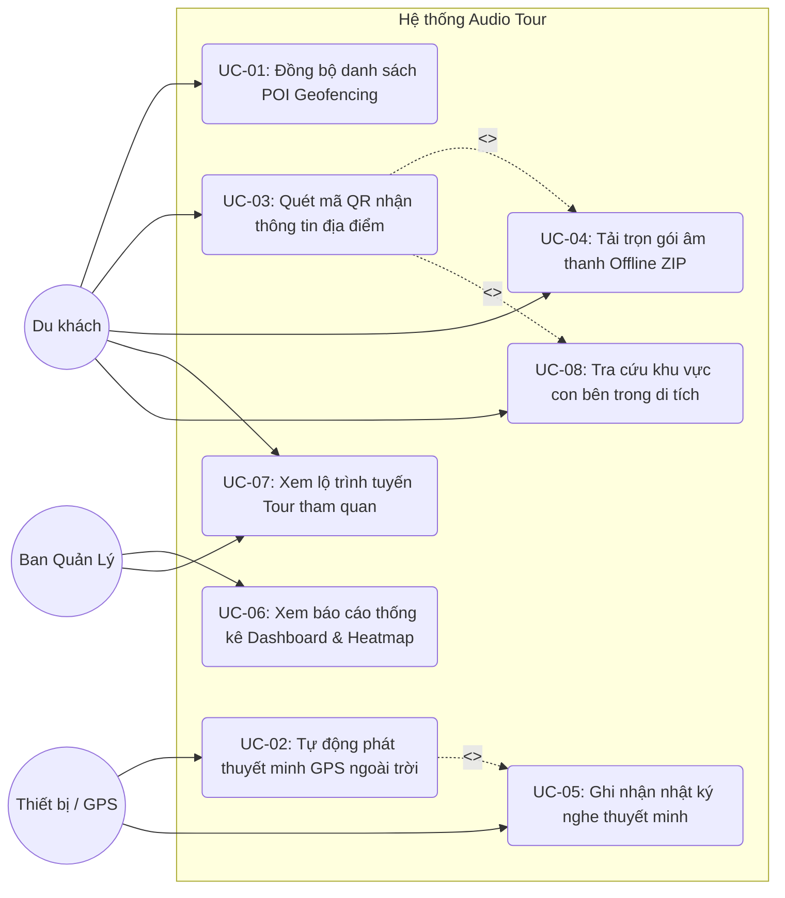

# TÀI LIỆU ĐẶC TẢ CA SỬ DỤNG (USE CASE SPECIFICATIONS - UC)

---

## 🏛️ THÔNG TIN TỔNG QUAN

* **Hệ thống:** Hệ thống Thuyết minh Audio Tour Tự Động Đa Ngôn Ngữ (*Multi Languages Automatic Translation*)
* **Môn học:** Công nghệ Phần mềm (Software Engineering) – Khoa CNTT, Trường Đại học Sài Gòn (SGU)
* **Quy chuẩn đặc tả:** Chuẩn RUP (Rational Unified Process) kết hợp Agile/Scrum Use Case

---

## 📐 1. SƠ ĐỒ CA SỬ DỤNG TỔNG THỂ (USE CASE DIAGRAM)

---

## 👥 2. DANH SÁCH TÁC NHÂN (ACTORS)

| Tác nhân | Loại | Mô tả |
| :--- | :---: | :--- |
| **Du khách (Tourist)** | Primary Actor | Người trực tiếp tham quan, quét mã QR, chọn ngôn ngữ và nghe nội dung thuyết minh. |
| **Thiết bị / GPS (Mobile Device / GPS Sensor)** | Secondary / System Actor | Cảm biến vị trí trên điện thoại tự động đối chiếu tọa độ và gửi log phát ngầm về hệ thống. |
| **Ban Quản Lý (Admin / Tour Operator)** | Primary Actor | Nhà điều hành khai thác dữ liệu thống kê, bản đồ nhiệt Heatmap và quản trị lộ trình tour. |

---

## 📋 3. DANH MỤC TOÀN BỘ CA SỬ DỤNG (USE CASE CATALOG)

| Mã UC | Tên Ca Sử Dụng | Tác nhân chính | Mức độ ưu tiên | Endpoint API ánh xạ |
| :---: | :--- | :---: | :---: | :--- |
| **UC-01** | Đồng bộ danh sách POI Geofencing | Du khách / Mobile App | **Cao (High)** | `GET /api/locations/pois` |
| **UC-02** | Tự động phát thuyết minh GPS ngoài trời | Thiết bị / GPS Sensor | **Cao (High)** | Logic Mobile + `POST /api/analytics/logs` |
| **UC-03** | Quét mã QR nhận thông tin địa điểm | Du khách | **Cao (High)** | `GET /api/locations/by-qr/{qrCode}` |
| **UC-04** | Tải trọn gói âm thanh Offline ZIP | Du khách | **Cao (High)** | `GET /api/packages/offline` |
| **UC-05** | Ghi nhận nhật ký nghe thuyết minh | Thiết bị Mobile App | **Trung bình (Medium)** | `POST /api/analytics/logs` |
| **UC-06** | Xem thống kê Dashboard & Heatmap | Ban Quản Lý | **Trung bình (Medium)** | `GET /api/analytics/dashboard` |
| **UC-07** | Xem danh sách và lộ trình tuyến Tour | Du khách / Ban Quản Lý | **Thấp (Low)** | `GET /api/tours`, `GET /api/tours/{id}` |
| **UC-08** | Tra cứu khu vực con bên trong di tích | Du khách | **Thấp (Low)** | `GET /api/locations/{id}/sub-locations` |

---

## 📝 4. ĐẶC TẢ CHI TIẾT TỪNG CA SỬ DỤNG (USE CASE SPECIFICATIONS)

---

### 🔹 UC-01: Đồng bộ danh sách POI Geofencing
* **Mục đích:** Cung cấp toàn bộ tọa độ, bán kính vùng kích hoạt và độ ưu tiên của tất cả địa danh cho ứng dụng di động để phục vụ kích hoạt định vị ngoại tuyến.
* **Tác nhân chính:** Du khách (thông qua ứng dụng di động khởi động).
* **Tiền điều kiện:** Ứng dụng di động có kết nối Internet khi khởi chạy lần đầu.
* **Hậu điều kiện:** Toàn bộ điểm POI được lưu vào bộ nhớ cache hoặc CSDL SQLite cục bộ trên điện thoại.
* **Luồng sự kiện chính (Basic Flow):**
  1. Người dùng mở ứng dụng di động.
  2. Ứng dụng tự động gửi request HTTP `GET /api/locations/pois` lên Backend.
  3. Tầng `LocationController` gọi `LocationService.getAllLocations()`.
  4. Hệ thống truy vấn CSDL MySQL lấy danh sách tất cả các địa điểm (bao gồm cả địa điểm cha và con).
  5. Hệ thống trả về mã `200 OK` kèm danh sách JSON chứa `id`, `name`, `latitude`, `longitude`, `radiusInMeters`, `priority`.
  6. Ứng dụng di động nạp dữ liệu vào dịch vụ giám sát Geofencing chạy ngầm.
* **Luồng ngoại lệ (Exception Flow):**
  * *E1: Không có kết nối mạng:* Ứng dụng sử dụng dữ liệu đã đồng bộ từ phiên làm việc trước đó trong SQLite.

---

### 🔹 UC-02: Tự động phát thuyết minh GPS ngoài trời (Geofence Trigger)
* **Mục đích:** Tự động kích hoạt bài thuyết minh bằng âm thanh khi du khách di chuyển bước vào vùng địa lý định sẵn mà không cần chạm vào điện thoại.
* **Tác nhân:** Thiết bị di động / Cảm biến GPS.
* **Tiền điều kiện:** Đã hoàn thành UC-01; thiết bị đã bật quyền truy cập vị trí (Location Permission).
* **Hậu điều kiện:** Âm thanh thuyết minh được phát; nhật ký nghe được ghi nhận (UC-05).
* **Luồng sự kiện chính (Basic Flow):**
  1. Du khách di chuyển trên tuyến đường (ví dụ xe buýt vào trạm Khánh Hội).
  2. Cảm biến GPS trên điện thoại ghi nhận tọa độ hiện tại $(lat_u, lng_u)$.
  3. Ứng dụng tính toán khoảng cách Haversine tới các điểm POI trong danh sách đã đồng bộ.
  4. Khi khoảng cách $\le$ `radiusInMeters` của địa điểm và độ ưu tiên (`priority`) cao nhất:
     * Ứng dụng tự động phát file âm thanh thuyết minh tương ứng.
     * Hiển thị thông báo trên màn hình khóa.
  5. Khi bài thuyết minh kết thúc, ứng dụng tự động thực hiện **UC-05 (Ghi nhận nhật ký nghe)** với `triggerType = GEOFENCE`.
* **Luồng rẽ nhánh (Alternative Flow):**
  * *A1: Trùng lặp vùng phủ sóng:* Nếu du khách nằm trong bán kính giao nhau của 2 điểm POI, hệ thống so sánh thuộc tính `priority` và phát điểm có độ ưu tiên lớn hơn.

---

### 🔹 UC-03: Quét mã QR nhận diện thông tin địa điểm
* **Mục đích:** Cho phép du khách quét mã QR dán tại điểm tham quan cố định để nhận thông tin chi tiết địa danh ngay lập tức.
* **Tác nhân chính:** Du khách.
* **Tiền điều kiện:** Du khách đứng trước bảng thông tin có mã QR và cấp quyền Camera.
* **Hậu điều kiện:** Giao diện chi tiết địa điểm được hiển thị trên điện thoại.
* **Luồng sự kiện chính (Basic Flow):**
  1. Du khách mở tính năng Quét mã trên ứng dụng và quét mã QR (ví dụ: `QR-DINH-DOC-LAP-01`).
  2. Ứng dụng trích xuất chuỗi mã QR và gửi request `GET /api/locations/by-qr/{qrCode}`.
  3. `LocationController` tiếp nhận và gọi `LocationService.getLocationByQrCode(qrCode)`.
  4. Hệ thống tìm kiếm trong bảng `locations` theo trường `qr_code`.
  5. Hệ thống trả về HTTP `200 OK` kèm thông tin địa điểm: tên, địa chỉ, hình ảnh đại diện, danh sách phòng ban con (nếu có).
  6. Ứng dụng hiển thị giao diện giới thiệu di tích kèm nút chọn ngôn ngữ và nút Tải Offline.
* **Luồng ngoại lệ (Exception Flow):**
  * *E1: Mã QR không tồn tại trong hệ thống:* Backend trả về lỗi `404 Not Found` với thông báo chuẩn hóa từ `GlobalExceptionHandler`. Ứng dụng báo lỗi "Mã QR không hợp lệ".

---

### 🔹 UC-04: Tải trọn gói âm thanh Offline dạng ZIP
* **Mục đích:** Tải toàn bộ file âm thanh MP3 chất lượng cao và văn bản kịch bản nén trong file ZIP để du khách có thể nghe ngoại tuyến hoàn toàn khi mất mạng.
* **Tác nhân chính:** Du khách.
* **Tiền điều kiện:** Du khách đang ở trang chi tiết của một địa điểm (hoàn thành UC-03).
* **Hậu điều kiện:** File ZIP được giải nén và lưu trữ an toàn trong bộ nhớ máy du khách.
* **Luồng sự kiện chính (Basic Flow):**
  1. Du khách chọn ngôn ngữ muốn nghe (ví dụ: `vi` - Tiếng Việt hoặc `en` - English).
  2. Du khách bấm nút **"Tải về nghe Offline"**.
  3. Ứng dụng gửi request:
     `GET /api/packages/offline?locationId={id}&languageCode={code}`
  4. `AudioPackageController` chuyển tiếp yêu cầu tới `AudioPackageService.createOfflinePackage()`.
  5. Tầng Service:
     * Truy vấn thông tin thuyết minh (`Narration`) tương ứng với địa điểm và ngôn ngữ.
     * Tìm file âm thanh MP3 vật lý trong thư mục `uploads/audio/`.
     * Sử dụng luồng `ZipOutputStream` nén file âm thanh và file văn bản `content.txt` thành mảng byte.
  6. Controller trả về phản hồi với:
     * Header `Content-Disposition: attachment; filename="tour-offline.zip"`.
     * Header `Content-Type: application/zip`.
     * Body: Mảng byte nén của file ZIP.
  7. Ứng dụng di động nhận luồng byte, lưu file và giải nén cục bộ. Du khách có thể bật chế độ máy bay mà vẫn nghe bình thường.
* **Luồng ngoại lệ (Exception Flow):**
  * *E1: Không có bài thuyết minh cho ngôn ngữ đã chọn:* Backend trả về mã lỗi `404 Not Found`.

---

### 🔹 UC-05: Ghi nhận nhật ký nghe thuyết minh
* **Mục đích:** Lưu vết các phiên nghe thuyết minh của du khách để ngăn chặn phát lặp âm thanh và phục vụ phân tích dữ liệu cho Ban quản trị.
* **Tác nhân:** Ứng dụng di động (Thực thi ngầm).
* **Tiền điều kiện:** Du khách đã nghe ít nhất 5 giây của bài thuyết minh.
* **Hậu điều kiện:** Một bản ghi mới được thêm vào bảng `playback_logs` trong CSDL MySQL.
* **Luồng sự kiện chính (Basic Flow):**
  1. Khi bài thuyết minh kết thúc hoặc du khách bấm dừng/chuyển điểm, ứng dụng tổng hợp dữ liệu phiên nghe:
     * `locationId`: ID địa điểm vừa nghe.
     * `languageCode`: Ngôn ngữ đã nghe.
     * `listenDurationSeconds`: Số giây thực tế đã nghe.
     * `triggerType`: `QR_CODE` hoặc `GEOFENCE`.
     * `latitude`, `longitude`: Vị trí GPS lúc nghe.
     * `deviceId`: Mã định danh thiết bị ẩn danh (UUID).
  2. Ứng dụng gửi request:
     `POST /api/analytics/logs` kèm body JSON.
  3. `AnalyticsController` gọi `AnalyticsService.recordPlaybackLog(request)`.
  4. Dữ liệu được lưu vào bảng `playback_logs` kèm thời gian `createdAt` của hệ thống.
  5. Backend trả về HTTP `200 OK`.

---

### 🔹 UC-06: Xem báo cáo thống kê Dashboard & Heatmap
* **Mục đích:** Cung cấp góc nhìn toàn diện cho Ban quản lý về mật độ du khách, thói quen sử dụng và các điểm nóng du lịch.
* **Tác nhân chính:** Ban Quản Lý (Admin / Tour Operator).
* **Tiền điều kiện:** Ban quản lý đăng nhập vào hệ thống Web CMS / Bảng điều khiển.
* **Hậu điều kiện:** Các biểu đồ và bản đồ nhiệt Heatmap được hiển thị trực quan.
* **Luồng sự kiện chính (Basic Flow):**
  1. Quản trị viên truy cập màn hình Thống kê Dashboard.
  2. Web CMS gửi request `GET /api/analytics/dashboard` tới Backend.
  3. `AnalyticsService` thực hiện các truy vấn tổng hợp từ bảng `playback_logs`:
     * Tính tổng lượt nghe: `COUNT(*)`.
     * Tính thời gian nghe trung bình: `AVG(listen_duration_seconds)`.
     * Phân nhóm theo hình thức kích hoạt: `GROUP BY trigger_type`.
     * Tìm Top 5 địa điểm nghe nhiều nhất: `ORDER BY COUNT(*) DESC LIMIT 5`.
     * Gom nhóm tọa độ vẽ Heatmap: `GROUP BY latitude, longitude`.
  4. Backend đóng gói dữ liệu vào `DashboardResponse` DTO và trả về HTTP `200 OK`.
  5. Web CMS render các thành phần:
     * Thẻ số liệu tổng quan (Total Listens, Avg Duration).
     * Biểu đồ tròn so sánh tỷ lệ quét QR vs GPS Geofence.
     * Bảng xếp hạng Top 5 POI.
     * Bản đồ nhiệt Heatmap (Google Maps/Leaflet) với các dải màu từ xanh sang đỏ rực.

---

### 🔹 UC-07: Xem danh sách và lộ trình tuyến Tour tham quan
* **Mục đích:** Giúp du khách tra cứu các hành trình tour được thiết kế sẵn (ví dụ: Tour xe buýt lịch sử Quận 4, Tour khám phá Dinh Độc Lập).
* **Tác nhân:** Du khách, Ban quản lý.
* **Luồng sự kiện chính:**
  1. Người dùng chọn mục "Tuyến Tour" trên giao diện.
  2. Ứng dụng gửi `GET /api/tours` nhận danh sách các tour kèm thời gian dự kiến và hình ảnh.
  3. Người dùng bấm chọn 1 tour cụ thể ➡️ Ứng dụng gọi `GET /api/tours/{id}` nhận chi tiết lộ trình gồm danh sách các điểm dừng theo thứ tự tham quan.

---

### 🔹 UC-08: Tra cứu khu vực con bên trong di tích (Hierarchical POIs)
* **Mục đích:** Cho phép du khách duyệt các phòng ban bên trong một di tích lớn (ví dụ: Phòng Khánh Tiết, Phòng Đại Yến bên trong Dinh Độc Lập).
* **Tác nhân:** Du khách.
* **Luồng sự kiện chính:**
  1. Người dùng đang ở trang chi tiết của một địa điểm gốc (ví dụ Dinh Độc Lập, ID = 4).
  2. Ứng dụng gọi `GET /api/locations/4/sub-locations`.
  3. Backend truy vấn `LocationRepository.findByParentLocationId(4)` và trả về danh sách các phòng ban con.
  4. Người dùng bấm vào từng phòng để xem kịch bản thuyết minh và nghe âm thanh riêng của từng phòng.

---

## 📌 5. MA TRẬN TRUY VẾT YÊU CẦU (REQUIREMENTS TRACEABILITY MATRIX - RTM)

| Mã Use Case | Tên Ca Sử Dụng | Lớp Controller | Lớp Service | Lớp Repository | Bảng CSDL |
| :---: | :--- | :--- | :--- | :--- | :--- |
| **UC-01** | Đồng bộ POI Geofencing | `LocationController` | `LocationService` | `LocationRepository` | `locations` |
| **UC-02** | Thuyết minh GPS tự động | Mobile App logic | `AnalyticsService` | `PlaybackLogRepository` | `playback_logs` |
| **UC-03** | Quét mã QR địa điểm | `LocationController` | `LocationService` | `LocationRepository` | `locations` |
| **UC-04** | Tải trọn gói Offline ZIP | `AudioPackageController` | `AudioPackageService` | `NarrationRepository` | `narrations`, `languages` |
| **UC-05** | Ghi nhận log nghe | `AnalyticsController` | `AnalyticsService` | `PlaybackLogRepository` | `playback_logs` |
| **UC-06** | Dashboard & Heatmap | `AnalyticsController` | `AnalyticsService` | `PlaybackLogRepository` | `playback_logs` |
| **UC-07** | Lộ trình tuyến Tour | `TourController` | `TourService` | `TourRepository` | `tours`, `tour_locations` |
| **UC-08** | Tra cứu phòng ban con | `LocationController` | `LocationService` | `LocationRepository` | `locations` |
